<h1 align="center">PocketMe</h1>

<p align="center">
  <b>A hand-held game console written from scratch in bare-metal Rust.</b><br>
  3D games at about 60 pictures a second on a classic ESP32 with 520 KB of RAM,<br>
  a Bluetooth gamepad with motion sensors, and the same console on a PC as a simulator.
</p>

<table>
  <tr>
    <td width="50%" align="center">
      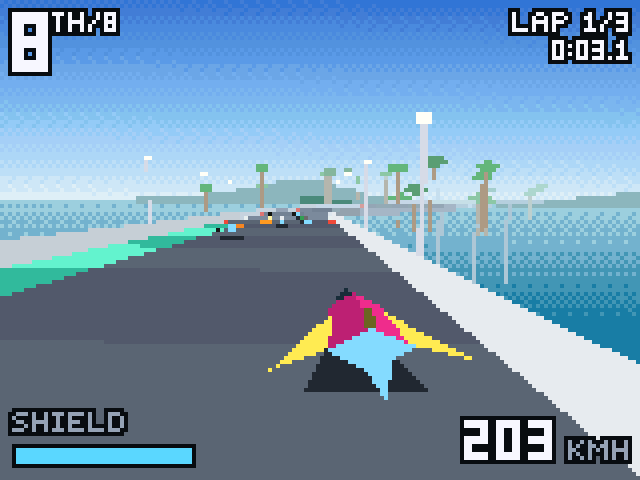<br>
      <b><a href="games/camber/README.md">CAMBER</a></b>: hover-ship racing, eight ships on 3D tracks
    </td>
    <td width="50%" align="center">
      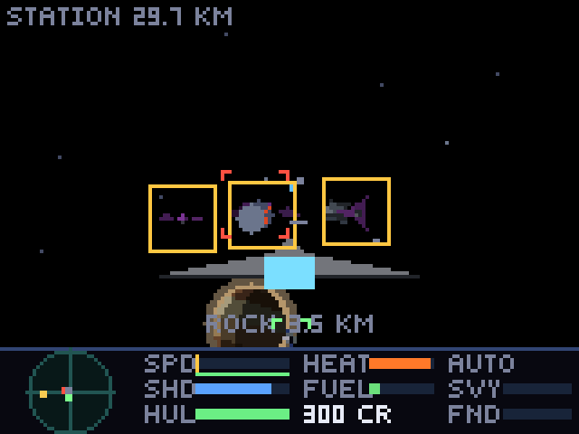<br>
      <b><a href="games/mercator/README.md">MERCATOR</a></b>: space trading with combat
    </td>
  </tr>
  <tr>
    <td align="center">
      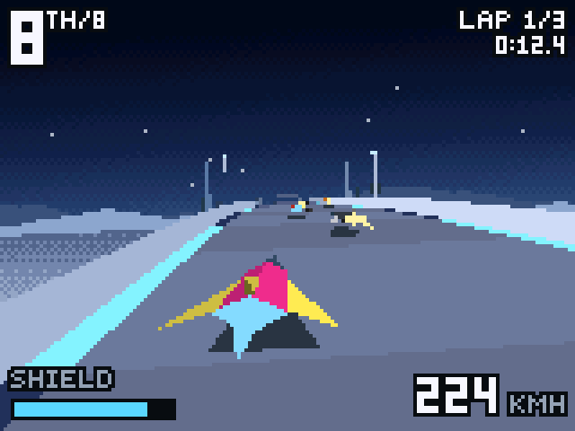<br>
      CAMBER: a boost pad, then the jump on the GLACIER track
    </td>
    <td align="center">
      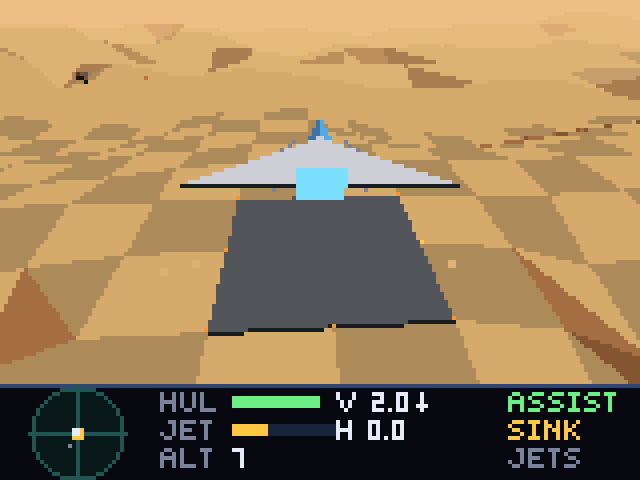<br>
      MERCATOR: a landing on a planet, then out on foot
    </td>
  </tr>
</table>

<p align="center">
  <a href="#why-it-is-interesting">Why it is interesting</a> ·
  <a href="#the-games">Games</a> ·
  <a href="#how-it-works">How it works</a> ·
  <a href="#try-it-on-a-pc">Try it on a PC</a> ·
  <a href="#run-it-on-the-board">Run it on the board</a> ·
  <a href="#documentation">Documentation</a> ·
  <a href="docs/gallery.md">Gallery</a>
</p>

---

PocketMe (a working name) is a small console built to find out how far a
cheap microcontroller can be taken as a games machine. The prototype is
the "Cheap Yellow Display" (CYD, hence `boards/cyd`): a classic ESP32
with 4 MB of flash and no extra RAM, a 320x240 screen, a touch panel and a microSD slot. There is
no operating system under it. The console, the 3D drawing, the Bluetooth
gamepad host and fourteen games and test programs are all in this
repository.

The clips and pictures on this page were drawn by the console's own
code, running in the [simulator](boards/desktop/README.md). They show
the picture pixel for pixel; they are not photographs of the board, and
they say nothing about speed. The speeds below were measured on the
board.

> **Status.** A prototype, as it stood on 2026-11-23. It runs and is
> playable on the board it was built for. It is not a product: what is
> missing is listed under [Status and limits](#status-and-limits).

## Why it is interesting

### About 60 pictures a second, on a chip with 520 KB of RAM

Every game with a 30 or 60 setting starts at 60, and every game with a
detail setting starts at its level called HIGH (HEAVY in HAIRPIN and
LANTERN). Measured on the board at those starting settings, with the
chip's two cores (2026-11-23):

| Game | What was running | Pictures a second |
|---|---|---|
| [CAMBER](games/camber/README.md) | detail HIGH: the first 8 s of a race under thrust; 20 s of driving with steering | 59.7; 58.9 |
| [MERCATOR](games/mercator/README.md) | flight in space, detail HIGH, chase view (no fight) | 59.99 |
| [KESTREL](games/kestrel/README.md) | 11 s of flight with the boost held, detail HIGH | 59.99 |
| [HAIRPIN](games/hairpin/README.md) | about 21 s of a race, detail HEAVY | 58.9 |
| [LANTERN](games/lantern/README.md) | detail HEAVY, turning on the spot (walking: 60.0) | 58.7 |
| [ROOFTOP](games/rooftop/README.md) | running and jumping in room 1 | 59.99 |
| [LANDER](games/lander/README.md) | a flight on level 1 | 59.99 |
| [SKIMMER](games/skimmer/README.md) | a match against the computer | 59.99 (see below) |
| [TUNDRA](games/tundra/README.md) | a match against the computer | 59.99 |

Read with care:

- The panel of this board refreshes about 58.7 times a second, not 60.
  A game whose picture changes nearly everywhere every frame is held to
  about that pace, which is why CAMBER, HAIRPIN and LANTERN show 58.7
  to 58.9 while most of the picture moves. In every run in the table
  the firmware's own timing count found no part of a picture sent
  across the line the panel was drawing (a crossed window is a possible
  tear).
- Not every game runs at 60. STARDUST and the two prototypes (DRIVE3D,
  PROTO3D) are built for 30; the prototypes held 30 on the board at all
  four detail levels (2026-11-22). MERCATOR runs at 30 while docked and
  on the planet, and a fight was not measured.
- SKIMMER's 59.99 counts only the frames that came back to back: the
  run had one pause of more than 0.1 s, and with it counted the rate
  was 59.73. In the firmware README's other runs of that day the two
  counts are the same.
- These are one to three runs a game, each about 7 to 21 s, on the one
  board, driven by scripts over the debug cable, not played by a
  person, and each covers one stretch of one level. The driving was
  crude (held buttons; CAMBER's ship brushed the walls, KESTREL's craft
  broke its hull after 11 s). The runs in this table had no gamepad
  connected. The runs and their conditions are in
  [boards/cyd/README.md](boards/cyd/README.md) ("At the starting
  settings"), in [docs/display.md](docs/display.md) ("What two cores
  changed") and in the games' READMEs.

### A Bluetooth gamepad, with its motion sensors

The firmware holds its own classic Bluetooth host for game controllers,
written from the Bluetooth specification on top of the chip's own
(closed) radio controller, with a patched copy of the radio driver.
Buttons, both sticks, both triggers, and the pad's
**accelerometer and gyroscope** reach the games through the
game interface: LANDER has tilt steering, and PADTEST shows every
number.

Read with care:

- One pad has been used on the hardware: a GuliKit KingKong 2 Pro (its
  four modes in a separate test firmware, its Switch mode in the
  console, where its triggers are on/off). Its modes go through the
  decoders for the Switch Pro Controller and for the Xbox pad over
  Bluetooth, but no real Switch Pro Controller, Xbox pad or DualShock 4
  has been tried: those are checked only in tests on the PC, against
  their published descriptors.
- Motion comes only from a pad in its Switch mode. On the board it was
  checked in PADTEST with pad reports sent in over the debug cable, and
  LANDER's tilt steering was tried in the simulator; a person tilting
  the real pad in a game is not on record yet.
- Classic Bluetooth only (no Bluetooth LE pads), one pad over the radio,
  no rumble. The console only reconnects to a pad that was paired
  before, and pairing still needs that test firmware.
  [docs/limitations.md](docs/limitations.md) has the full list.

### The rest

- **Bare-metal Rust.** One `no_std` program on the chip (Rust without
  its standard library, which needs an operating system). The console's
  core has no heap, no floating point and no `unsafe`; neither has any
  game.
- **3D on a microcontroller.** A shared library draws flat-shaded
  polygons in whole numbers only: a hover racer with eight ships, a
  courier flight through gates, a rally stretch, a platformer prototype.
  The space trading game, with combat and a planet to land
  on, draws with its own trimmed copy of the same polygon code.
- **A picture timed not to tear.** The firmware reads which line the
  panel is drawing and sends only the parts of the picture that changed,
  timed around that line. The chip's second core does the sending: that
  took HAIRPIN at its heavy setting from 45.7 to 58.7 pictures a second.
- **One console, two worlds.** The same `console-core` crate runs on the
  ESP32 and in a deterministic PC simulator, so menus and games are
  written and tested on the PC and only speed, memory, tearing, real
  touch and the radio are judged on the board.
- **Games are separate programs.** A game is a small Rust library that
  depends only on the console's game kit (and, for 3D, the shared 3D
  library). For the chip it is built into its own file, checked
  (header, CRC-32) and loaded into fixed memory slots; it never touches
  hardware. The biggest games run on past the 56 KB code slot into
  unused data memory, and one keeps a part in the firmware's flash.
- **Checked hard.** About 1,700 tests on the PC side, each run on two
  or three feature sets, and a firmware check that makes 154 builds
  over the feature sets and inspects the layout of the builds meant for
  use.

## The games

<table>
  <tr>
    <td width="50%" align="center">
      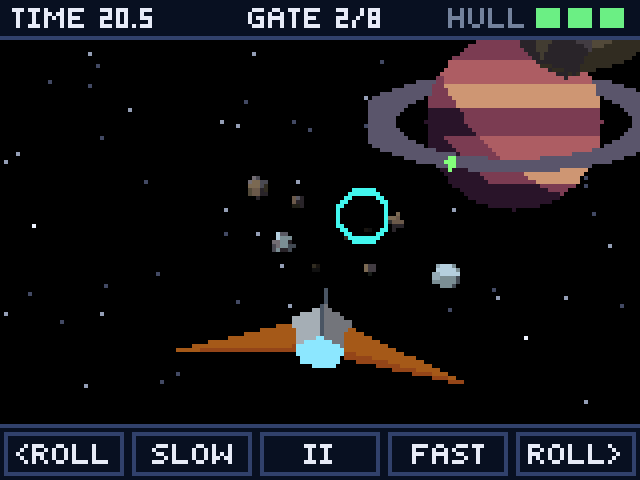<br>
      <b><a href="games/kestrel/README.md">KESTREL</a></b><br>
      A courier craft flown through beacon gates in a belt of rock, against the clock.
    </td>
    <td width="50%" align="center">
      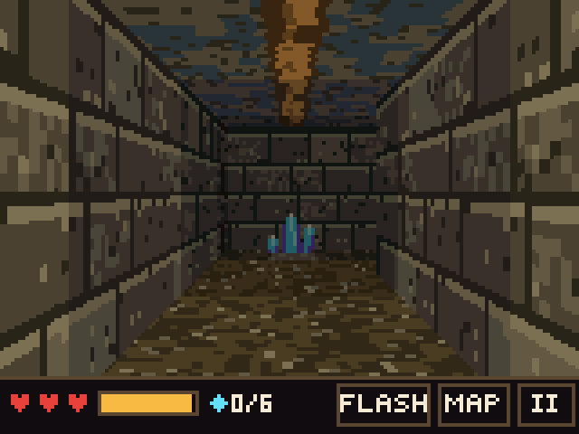<br>
      <b><a href="games/lantern/README.md">LANTERN</a></b><br>
      A first-person walk through an old mine by lamplight, with moths that drink the lamp's oil.
    </td>
  </tr>
  <tr>
    <td align="center">
      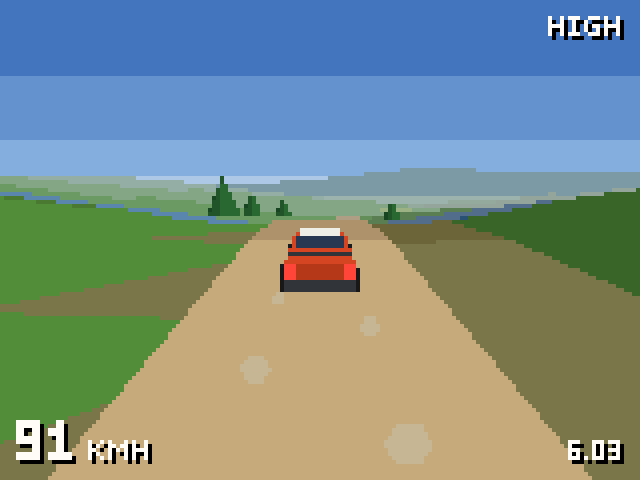<br>
      <b><a href="games/drive3d/README.md">DRIVE3D</a></b> (prototype)<br>
      A rally car sliding on gravel, grass and through a ford, on a height map.
    </td>
    <td align="center">
      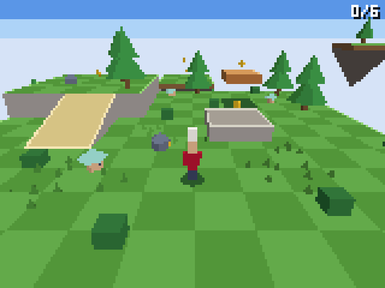<br>
      <b><a href="games/proto3d/README.md">PROTO3D</a></b> (prototype)<br>
      The movement, camera and picture of a 3D platformer on floating islands.
    </td>
  </tr>
</table>

More clips of every game and of the console itself, with captions, are
in the [gallery](docs/gallery.md). All fourteen programs on the home screen:

| | Name | What it is |
|---|---|---|
| 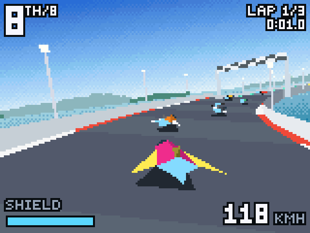 | [CAMBER](games/camber/README.md) | Hover-ship racing on 3D tracks made of polygons, against seven rivals. The console's 3D showpiece. |
| 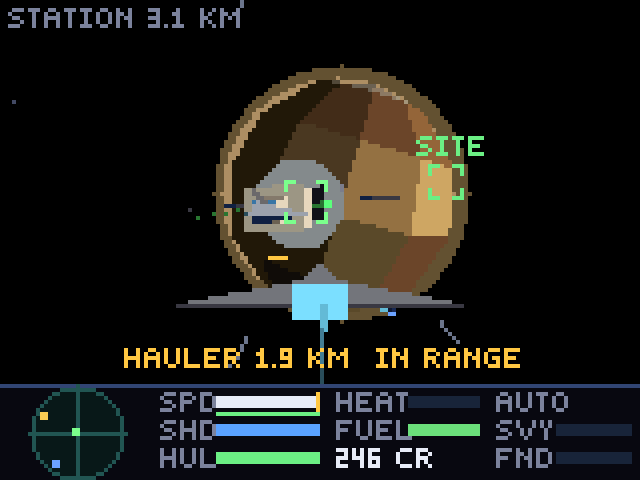 | [MERCATOR](games/mercator/README.md) | Space trading: buy cheap, jump, sell dear, fight raiders, land on a planet and walk to a wreck. The biggest game; part of it lives in the firmware's flash. |
| 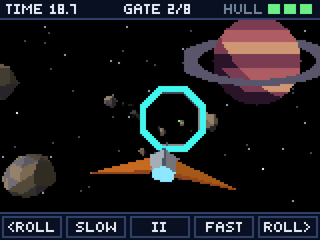 | [KESTREL](games/kestrel/README.md) | Fly a courier craft through beacon gates in a belt of rock and dock before the clock runs out. The console's study of 3D with real polygons; the shared 3D library came out of it. |
| 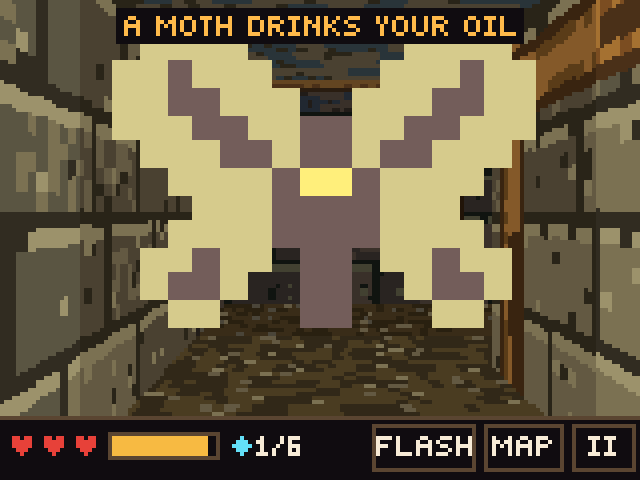 | [LANTERN](games/lantern/README.md) | First-person mine by lamplight (a ray-cast view): crystals, oil, a lift, moths and crawlers. |
| 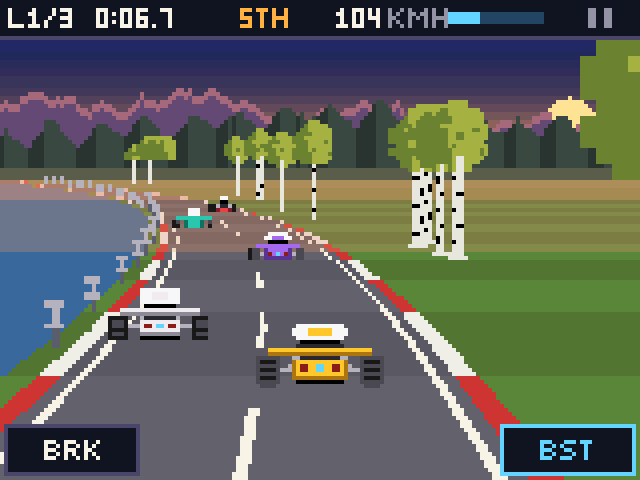 | [HAIRPIN](games/hairpin/README.md) | A kart race on mountain roads at dusk: three courses, four rivals. |
| 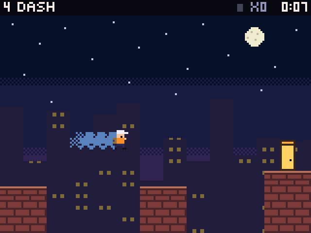 | [ROOFTOP](games/rooftop/README.md) | A precision platformer over a city's roofs: wall jumps and one dash in the air, eight rooms. Needs the gamepad (touch works in its menus only). |
| 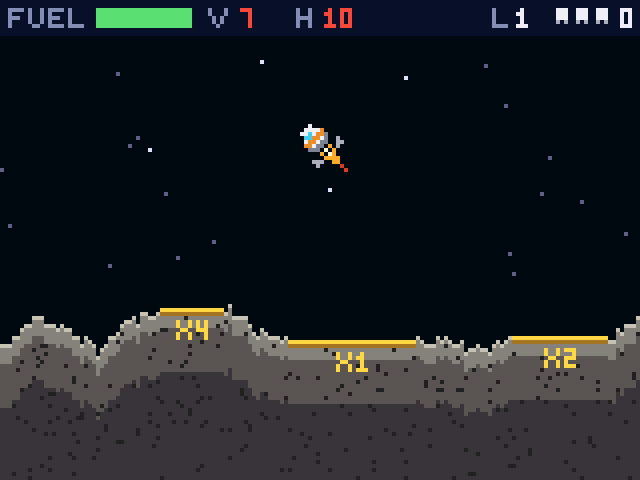 | [LANDER](games/lander/README.md) | A moon lander: turn, burn, and set down slowly on a flat pad. Also a test of sticks, triggers, motion and touch. |
| 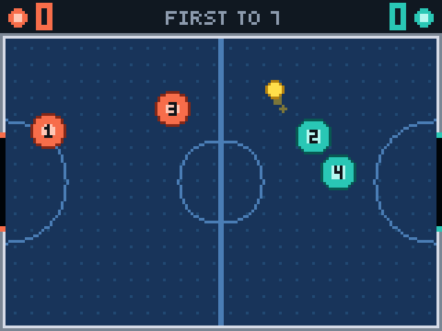 | [SKIMMER](games/skimmer/README.md) | Air hockey on one screen for 1 to 4 players. |
| 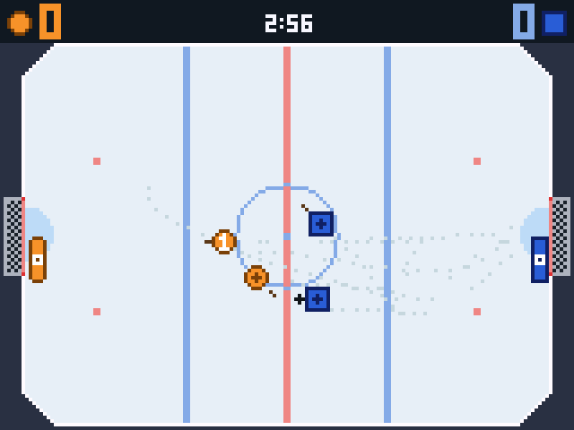 | [TUNDRA](games/tundra/README.md) | Arcade ice hockey on one screen for 1 to 4 players. The console's first multiplayer game. |
| 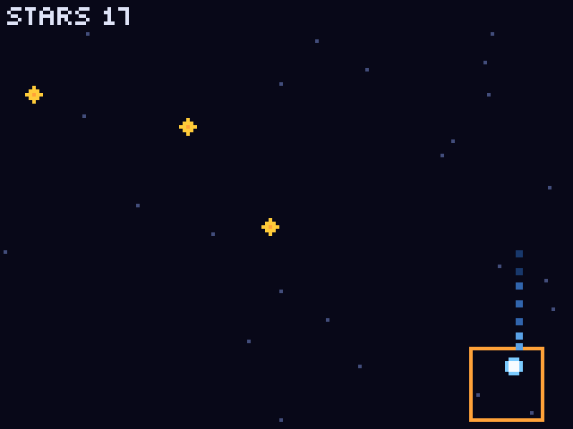 | [STARDUST](games/stardust/README.md) | A small toy (a comet catches stars), here to prove the game path. |
| 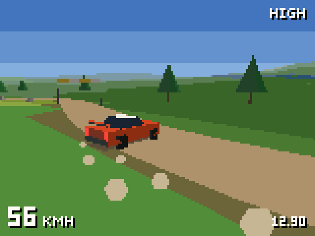 | [DRIVE3D](games/drive3d/README.md) | Prototype: a rally car on one short stretch of road. Gamepad only. |
| 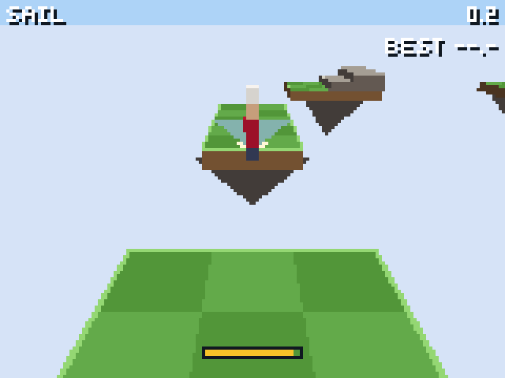 | [PROTO3D](games/proto3d/README.md) | Prototype: a 3D platformer's movement and camera, with four test areas. Needs the gamepad (touch works in its menu only). |
| 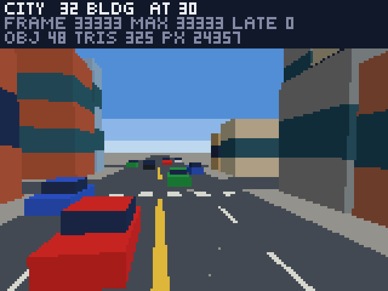 | [BENCH](games/bench/README.md) | Not a game: a speed test that finds how much drawing fits one frame on the real board. |
| 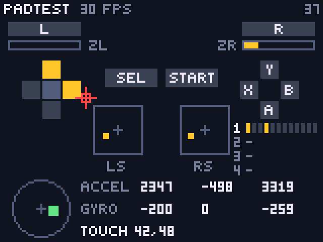 | [PADTEST](games/padtest/README.md) | An input test: shows everything a game receives (buttons, sticks, triggers, touch, motion, four pads). |

The games are original designs made for this console. How they were
built, what each one taught and what they cost in memory is in
[docs/games.md](docs/games.md) and [docs/making-of.md](docs/making-of.md).

## How it works

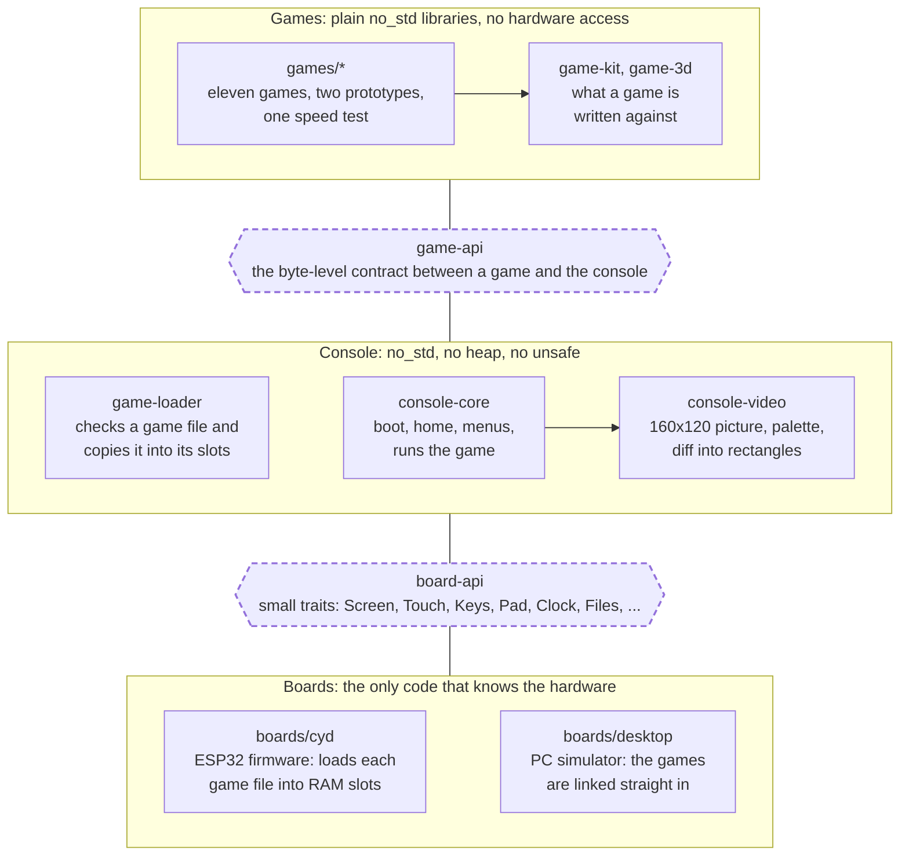

Read it from top to bottom: a layer talks to the next one only through
the contract drawn between them (the two dashed boxes), so a game
never sees a board. The full dependency graph of the crates is in
[docs/architecture.md](docs/architecture.md).

One frame, in plain words:

1. The board calls `Console::step`. The console reads the time once,
   reads the inputs through the board's traits, and never waits.
2. If a game is running, the console calls it with the inputs and a
   160x120 picture, one byte per pixel, to draw into.
3. The console compares the new picture with the one on the screen and
   describes the difference as at most 16 rectangles.
4. On the chip, the second core sends those rectangles to the panel,
   each one timed against the line the panel is drawing, while the first
   core is already working on the next frame.
5. The console tells the board when it wants to be called again.

The longer story, with the memory map and the timing, is in
[docs/architecture.md](docs/architecture.md) and
[docs/display.md](docs/display.md).

## At a glance

| | |
|---|---|
| Chip | classic ESP32, two cores, 520 KB RAM, 4 MB flash, no external RAM |
| Screen | ST7789, 320x240, driven over SPI with DMA |
| Picture | 160x120, one byte per pixel through a palette, shown at 2x |
| Sent per frame | only what changed, in at most 16 rectangles |
| Panel refresh | about 58.7 times a second (measured on the board, 2026-11-17) |
| Frame rate | most games let the player choose 30 or 60 pictures a second and start at 60; at 60 nine games showed 58.7 to 60.0 on the board (the table under [Why it is interesting](#why-it-is-interesting)); STARDUST and the two prototypes run at 30, and PADTEST at 30 or only on change |
| Game memory | a 56 KB code slot and a 48 KB data slot, both in RAM; code may run on into unused data space, and one game keeps a part in the firmware's flash |
| Input | touch, one button, and up to four players' gamepads in the game interface; one gamepad over classic Bluetooth on this board, with its accelerometer and gyroscope in Switch mode |
| Storage | games built into the firmware, or read from the microSD card (read only; not yet tried with games); 8 KB of flash for settings |
| Two cores against one | HAIRPIN at its heavy setting: 45.7 pictures a second on one core, 58.7 on two, with a gamepad connected (measured on the board, 2026-11-18) |
| Tests | 3,442 test runs passed on the PC side (about 1,700 tests, each on two or three feature sets; 2026-11-23); 154 firmware builds checked |
| Language | Rust (`no_std`); Python 3 for build and check scripts |

## Try it on a PC

The simulator is the console itself with a PC "board" under it. It needs
Rust (the pinned version is picked up from `rust-toolchain.toml`) and,
for the window, the SDL3 library (on Arch Linux: the `sdl3` package).

```sh
git clone https://github.com/hudson-bruno/pocketme.git
cd pocketme/boards/desktop
cargo run --release -- --window
```

| Key | Does |
|---|---|
| arrow keys | d-pad |
| `Z` `X` `A` `S` | the four face buttons (bottom, right, left, top) |
| `Q` `W` | shoulders |
| `Return` | start |
| `Tab` | home |
| mouse | touch |
| `Escape` | quit |

Every key (sticks, triggers, a second player on the number pad, motion)
is in the [simulator's README](boards/desktop/README.md#keys-in-the-window).

The simulator also runs with no window, and then builds without SDL3:
it runs a number of frames from an input script and writes pictures.
That is how the tests use it, and every picture on this page was made
by such a run with no window:

```sh
cargo run --no-default-features -- --frames 60 --png /tmp/shot.png
```

There is no workspace at the root of the repository, on purpose: every
crate is built and tested from its own folder. The whole PC side is
checked by one script:

```sh
./check.sh        # in boards/desktop; ends with "check: ok"
```

It also builds the games for the chip, so it needs the ESP32 toolchain
below, and a `nightly` Rust with `rust-src` (it builds the shared
crates for a bare PC too). It calls cargo with `--offline --locked`, so
the crates it needs must already be in cargo's cache (`cargo fetch` in
a crate's folder downloads them). [docs/testing.md](docs/testing.md) explains what it covers.

## Run it on the board

**Without building anything:** [docs/install.md](docs/install.md) is a
step-by-step guide for people who are not programmers: a 1-click browser
installer (`esptool-js` over Web Serial using `manifest.json`, with
automatic English and Brazilian Portuguese UI) and ready-made binary
files for the command line. The 1-click browser installer was tested on
the project's CYD board. With the `pair` feature included, you can pair a
classic Bluetooth gamepad directly from the console's **GAMEPADS** tile
and play all fourteen programs. The files are made by
[tools/release](tools/release/README.md).

**Building it yourself.** You need the board (see [docs/hardware.md](docs/hardware.md)), the Rust
toolchain for Xtensa (the classic ESP32's processor, which standard
Rust does not support) installed with
[espup](https://github.com/esp-rs/espup), and
[espflash](https://github.com/esp-rs/espflash).

```sh
. ~/export-esp.sh
cd boards/cyd        # from the repository's top folder

# 1. build the games for the chip (the firmware embeds them)
GAMES_TARGET=$PWD/target ../../games/build-chip.sh

# 2. build the firmware: the games built in as a card (demo-card), touch,
#    the serial debug link (link), saved settings (store), two cores (core2),
#    the boot animation (boot-gather), MERCATOR's part in flash (game-flash)
cargo build --release --no-default-features \
  --features demo-card,touch,link,store,core2,boot-gather,game-flash

# 3. flash it
espflash flash --chip esp32 --port /dev/ttyUSB0 --non-interactive \
  --partition-table partitions.csv --flash-freq 80mhz \
  target/xtensa-esp32-none-elf/release/pocketme-cyd
```

Things to know before flashing:

- **Always pass `--partition-table partitions.csv`** (it adds the 8 KB
  settings partition at the top of the flash; without it the console
  cannot keep its settings), and do not use
  `cargo run` in `boards/cyd` (its runner flashes without the table).
- **Never erase the whole flash** unnecessarily once a gamepad is paired:
  the pairing is kept in `nvs` (`0x9000..0xB000`). If you do wipe flash,
  a build with `pair` can pair again from the console.
- The firmware was written for and tested on one board. Other variants
  of the "Cheap Yellow Display" are untested.
- The gamepad is optional: add `,pad` for reconnect-only support, or
  `,pad,pair` for on-console classic Bluetooth gamepad pairing and the
  settings screens (`GAMEPADS` and `SETTINGS` tiles). Without a pad, the
  touch screen and the BOOT button work the console and most games;
  ROOFTOP, DRIVE3D and PROTO3D need the pad.

The firmware's own README, [boards/cyd/README.md](boards/cyd/README.md),
has every feature, the log lines and the measurements.

## Repository layout

```
crates/
  game-api/        the contract between console and games; the slot layout
  board-api/       the traits a board provides
  console-video/   the 160x120 picture, the palette, the diff
  console-core/    the console: boot, home, menus, notices, running a game
  game-kit/        what a game is written against
  game-3d/         flat-shaded 3D polygons for games
  game-loader/     checks a game file and copies it into the slots
  settings-store/  power-cut-safe settings in two flash sectors
  touch-filter/    cleans up the resistive touch panel's readings
  debug-link/      the PC-to-console protocol on the serial port
  test-card/       the debug link's test pictures
  pad-proto/ pad-view/ pad-store/ pad-host/   the classic Bluetooth gamepad host
games/             the fourteen programs, and the build for the chip
boards/
  cyd/             the ESP32 firmware
  desktop/         the PC simulator
tools/
  boardctl/        PC tool that talks to the board (screenshots, logs, input)
  media/           makes this documentation's pictures and clips
  release/         makes ready-to-flash files from a built firmware
experiments/       finished trials, kept for their notes and measurements
docs/              the documentation below
```

Each entry depends only on entries above it; nothing depends on a board
or a tool.

## Documentation

| Page | What is in it |
|---|---|
| [Architecture](docs/architecture.md) | The layers, the step function, the game interface, the memory map, how a game is loaded |
| [The picture](docs/display.md) | From a game's picture to the panel: the diff, the timed send, the second core |
| [Optimisations](docs/optimizations.md) | What was made fast or small, and what each change measured |
| [Making a game](docs/games.md) | How a game is written: the contract, drawing, the two slots, the game file, the chip build, adding a new game |
| [The making of the games](docs/making-of.md) | Each game: what it is, how it was made, what it costs, and what the games showed about the console |
| [Design decisions](docs/decisions.md) | The choices and the reasons, with dates |
| [Limitations](docs/limitations.md) | What the build cannot do, and what is not known |
| [Hardware](docs/hardware.md) | The board, its pins and its quirks |
| [Put it on your own board](docs/install.md) | A guide for non-programmers: 1-click browser installer and ready-made files |
| [Testing](docs/testing.md) | The check scripts, the kinds of test, what only the board can tell |
| [Gallery](docs/gallery.md) | Clips of every game and of the console, by topic |
| [Credits](docs/credits.md) | The crates, tools and references the project stands on |

Each crate, board and game also has its own README with the detail:
start with [boards/cyd](boards/cyd/README.md),
[boards/desktop](boards/desktop/README.md) and
[games](games/README.md).

## Status and limits

The prototype is playable, but it is not finished. What it does not
have:

- no saved games, and no installing of games into flash;
- no pairing of a gamepad from the console itself, and no settings app;
- no sound, and no battery support;
- a game that panics stops the console until the reset button;
- it was built for and measured on one board only.

The full list, with what is unknown, is in
[docs/limitations.md](docs/limitations.md); what was studied and
shelved is at the end of
[docs/decisions.md](docs/decisions.md#what-was-shelved).

## Credits

PocketMe is built on the [esp-rs](https://github.com/esp-rs) crates
(`esp-hal`, `esp-rtos`, `esp-radio`) and on
[Embassy](https://embassy.dev). The full list of crates, tools and
references, and how the project was written, is in
[docs/credits.md](docs/credits.md).

## Licence

The project's own code and documentation are under the MIT licence: see
[LICENSE](LICENSE). The patched copy of `esp-radio` in
`experiments/bt-classic-probe/vendor` keeps its authors' licence, MIT or
Apache-2.0; both texts are beside it.
