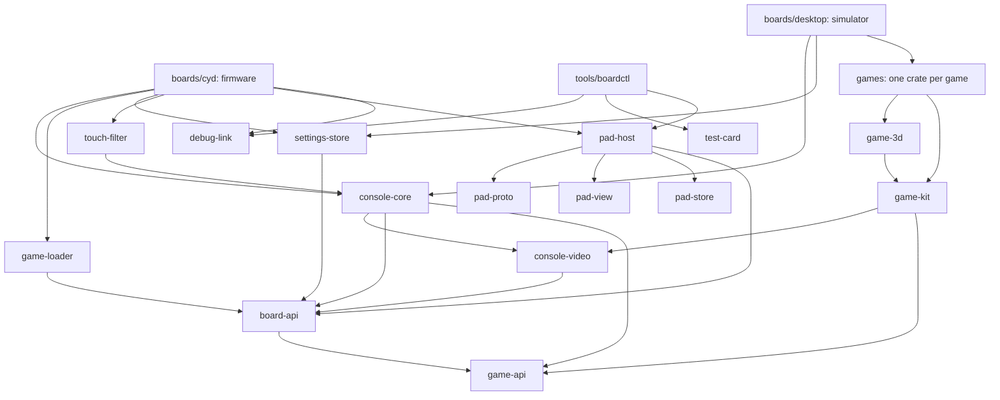
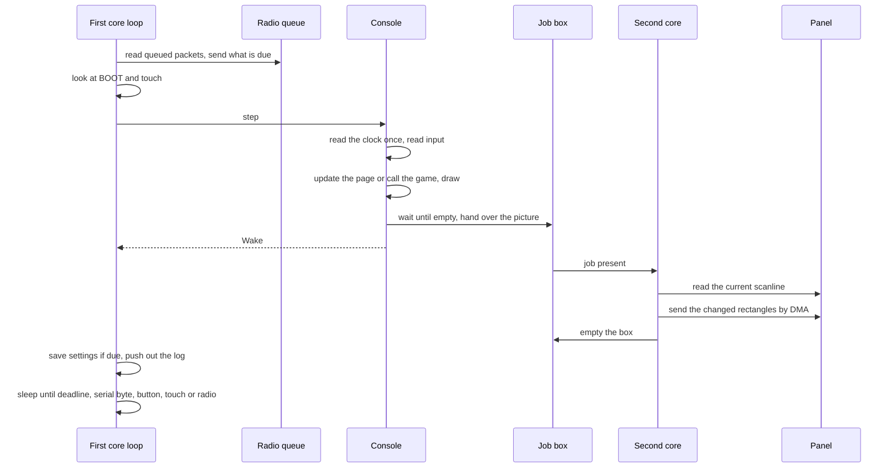

# Architecture

PocketMe is a stack of small Rust crates. The console itself is one
crate that knows nothing about the hardware; under it sit a byte-level
contract for games and a set of small traits a board must fill in, and
on top of it sit two boards: the firmware for the ESP32 prototype board
and a simulator for the PC. This page shows how the parts fit together
and links down to the README of each one.

- [The layers](#the-layers)
- [Every crate in one line](#every-crate-in-one-line)
- [The heart: one struct and one step](#the-heart-one-struct-and-one-step)
- [What a board must provide](#what-a-board-must-provide)
- [The two boards](#the-two-boards)
- [One frame on the firmware](#one-frame-on-the-firmware)
- [One game source, two worlds](#one-game-source-two-worlds)
- [The smaller parts](#the-smaller-parts)
- [The repository](#the-repository)
- [Where this comes from](#where-this-comes-from)

## The layers

The rule is simple: a crate may depend only on crates below it. Nothing
depends on a board or on a tool. The console does not know which board
it runs on, and a game does not know there is a board at all.

In the diagram an arrow means "depends on". The crates at the bottom are
the most widely used and the most frozen; the boards and the tool at the
top are the only places that touch real hardware or the PC's operating
system.



There is no Cargo workspace at the root of the repository, on purpose.
Every crate stands alone with its own `Cargo.lock` and is built and
tested from its own folder. A workspace would pull the finished
experiments into every build, and the chip crates need a different
toolchain and target from the PC crates
([decisions](decisions.md#no-root-cargo-workspace)).

## Every crate in one line

Every folder under `crates/`. "No std" means the crate builds without
Rust's standard library, so it can run on the bare chip; most also
build and test on the PC.

| Crate | What it is | Project crates it uses | What it must not do |
|---|---|---|---|
| [game-api](../crates/game-api/README.md) | The byte-level contract between console and games: `repr(C)` tables, the contract version, and `layout`, the only place the game slot addresses and sizes are written | none | No dependencies at all. Only plain C types cross the line |
| [board-api](../crates/board-api/README.md) | The small traits a board must provide, and a fake board for tests (feature `testing`) | game-api | No std, no heap, no `unsafe`, no logic. A new method needs a default body |
| [console-video](../crates/console-video/README.md) | The 160x120 picture (one byte a pixel), the palette, drawing, the font, and the diff that turns a changed picture into at most 16 rectangles | board-api | No std, no heap, no `unsafe`, no floating point |
| [console-core](../crates/console-core/README.md) | The console: boot screen, home screen, menus, notifications, running a game | board-api, console-video, game-api | No std, no heap, no `unsafe`, no floating point. Never waits, never reads a real clock |
| [game-kit](../crates/game-kit/README.md) | What a game is written against: the `Game` trait and the `game!` macro, a safe face over the contract | game-api, console-video | No heap, no floating point. The `unsafe` it needs stays inside the kit and its `game!` macro, so that games need none |
| [game-3d](../crates/game-3d/README.md) | A shared library of flat-shaded 3D polygons, compiled into each game that uses it | game-kit | The game rules: no std, no heap, no floating point, no `unsafe` |
| [game-loader](../crates/game-loader/README.md) | Checks a game file (header, CRC-32) and copies it into the game slots through the `GameSlots` trait | board-api, game-api | No std, no heap, no `unsafe`; it never writes memory itself |
| [settings-store](../crates/settings-store/README.md) | The console's settings in two 4 KB flash sectors, safe against a power cut at any moment | board-api | No std, no heap, no `unsafe` |
| [touch-filter](../crates/touch-filter/README.md) | Turns the resistive touch panel's readings into steady points | board-api, console-core, console-video | No std, no heap, no `unsafe`, no pins |
| [debug-link](../crates/debug-link/README.md) | The framed protocol between the PC and the board on the serial cable | none | No std, no heap, no I/O |
| [test-card](../crates/test-card/README.md) | Test pictures whose every pixel is known, drawn the same on the board and on the PC | none | No std |
| [pad-proto](../crates/pad-proto/src/lib.rs) | A small classic Bluetooth host for one gamepad, as a state machine | none | No heap, no operating system |
| [pad-view](../crates/pad-view/README.md) | Understands what a gamepad sends (report decoding per pad mode) | none | No std, no heap, nothing that panics on bad input |
| [pad-store](../crates/pad-store/README.md) | Saved gamepad pairings in flash | none | No heap, no operating system |
| [pad-host](../crates/pad-host/src/lib.rs) | Ties the three pad crates together for the console; reconnect only | board-api, pad-proto, pad-view, pad-store | No std, no allocation, no `unsafe`, no panic on bad input |

The rule "no floating point" holds where the table says so: in the
console, the picture code and the game side. The pad decoding in
`pad-view` and `pad-host` does use `f32`.

## The heart: one struct and one step

The console is one plain struct, `Console`, in
[console-core](../crates/console-core/README.md). It has no threads, no
callbacks and no loop of its own. The board owns the loop and calls one
function:

```rust
let mut console = Console::new();      // const: can live in a static
loop {
    let wake = console.step(&mut board);
    // sleep until wake.deadline(), or until input if wake.on_input()
}
```

`step` is generic over `B: Board`, so the compiler makes one copy for
the board it is built for and every call goes straight to that board's
code, with no lookup at run time.

One step does, in this order: read the clock once; if nothing is due,
return; read the input (the button levels and the board's notes of
presses shorter than a frame); update the page on show (boot, home, or
a running game); draw the page, the bottom bar and the notifications
into the 160x120 picture; hand the changed rectangles to the board; say
when to come back. The pages form a small state machine: boot, then
home, and a game page while a game runs.

The answer is a `board_api::Wake`:

- `Wake::At(t)`: call again at clock time `t` (microseconds). A game at
  30 frames a second asks for "now + 33,333".
- `Wake::InputOr(t)`: call again when input changes, or at `t` at the
  latest. `t = u64::MAX` means "only on input". An idle home screen asks
  for this, so the chip can sleep and nothing is sent to the panel.

Calling early or late is always safe: the console looks at the clock and
does only what is due. An early call does not read the input, so no
press is lost.

**Why the console never waits.** A console that owns its own loop and
its own delays cannot be tested deterministically and cannot share a
core with a radio ([decisions](decisions.md#small-board-traits-one-step-function)).
A step function can do both: in a test, the test moves the clock by
hand, so a minute of play takes a few milliseconds and gives the same
result on every run.

**Why the time is read once per step.** Time comes only from the
board's `Clock`, in microseconds as a `u64` (a `u32` would run out after
71 minutes). The console reads it once at the start of a step and uses
that one number throughout, so everything drawn in a step belongs to
the same moment, even on the chip, where the clock moves a little
during a step.

**Why `Console::new()` must be all zero bytes.** The firmware keeps the
console in a `static`. A static whose starting value has any nonzero
byte goes into the `.data` section: the whole value is stored in flash
and copied to RAM at every start. A static that starts as all zeros
goes into `.bss`, and the start-up code only clears that RAM. The
console is about 45 KB (45,176 bytes on the ESP32 in the firmware built
on 2026-11-23, a built size, not measured on the board), and
when it moved from `.data` to `.bss` the firmware's `.data` went from
55,592 to 9,464 bytes (a compile-only build). The test
[`tests/zeros.rs`](../crates/console-core/tests/zeros.rs) puts a new
`Console` in a static and reads its own program file to see which
section the compiler chose; one nonzero byte fails it
([details](../crates/console-core/README.md#starting-as-zeros)).

## What a board must provide

A board is a handful of small traits in
[board-api](../crates/board-api/README.md), gathered by one `Board`
trait. `Board::parts()` lends every part at once, each as its own
`&mut`, so the console can read the touch screen while it holds the
screen, with no `RefCell`, no `dyn` and no heap.

| Trait | What it is | On the CYD | On the PC |
|---|---|---|---|
| `Screen` | the panel | ST7789 over SPI with DMA | a 320x240 picture in memory |
| `Touch` | the touch screen | resistive touch | the mouse, or a script |
| `Keys` | the board's own buttons | BOOT | a key |
| `Pad` | gamepads, four of them | Bluetooth | the keyboard |
| `Clock` | time in microseconds | the chip's timer | moved by the loop or the test |
| `Files` | the SD card | FAT card on SPI | a folder |
| `Link` | the debug cable | UART0 | a TCP address, optional |
| `LogOut` | text lines for a person | serial port | the terminal |
| `Store` | saved settings | a flash area | memory, or a file |

Four more traits are optional, each behind a build feature: `Hci` (raw
Bluetooth packets, `bt-classic`), `Beacon` (pass-by messages,
`passby`), `Gps` (raw GPS bytes, `gps`) and `Audio` (sound, `sound`). A
feature that is off removes the trait, its place in `Board` and all
code that uses it. A board that lacks a part uses `Absent`, which takes
no memory. No board fills these four with a real part today: the CYD's
gamepad host lives in the firmware and fills `Pad`, and the simulator
has no radio, GPS or sound.

`Board::start_game(folder)` has a default body, so a board that cannot
start games still compiles: on the chip it loads the game file into the
slots, on the PC it looks the game up among the linked-in ones. The
screen never gets a full 320x240 picture (150 KB); it gets the changed
rectangles and asks for pixels a short run at a time
([display](display.md)).

## The two boards

Both boards implement board-api and hand the same `console-core` its
parts. They differ in what they are for.

| | Firmware ([boards/cyd](../boards/cyd/README.md)) | Simulator ([boards/desktop](../boards/desktop/README.md)) |
|---|---|---|
| Runs on | the ESP32 of the Cheap Yellow Display board, bare metal | the PC, as the program `pocketme-sim` |
| Time | the chip's timer | simulated, in fixed ticks |
| Games | loaded from a game file into fixed memory slots | linked into the program |
| Pictures | sent to the panel in step with its refresh | kept in memory, saved as PNG or shown in a window |
| What it judges | memory, speed, tearing, radio, real touch | the console's logic and pictures, the same on every run |

**The firmware.** One async task on the first core (the chip has two)
runs the console in a loop, written in
[`src/app.rs`](../boards/cyd/src/app.rs). Each turn: with the gamepad
feature, read the packets the radio driver queued and send what is due;
look at the BOOT button and the touch panel; step the console; save
the settings if they changed and the rules say now; push out the log;
then sleep until the console's deadline, a byte on the serial port, a
press of BOOT or the touch screen, or the radio. The radio driver's own
task only queues the controller's packets; the gamepad host's work
happens in the loop, between frames, so nothing can cut into the timed
windows in which a picture is sent.

With the feature `core2` (on by default) the chip's second core does
nothing but send each finished picture to the panel, while the first
core goes on with the next step in the console's other picture. The
hand-over between the cores is one job box: the first core puts a job
in only when the box is empty, and the second core empties it after
its last use of what the job gave it. Every wait for the second core is
bounded: after 500 ms the firmware stops with a message saying so. The
first core's side of this hand-over is its own crate,
[boards/cyd/handover](../boards/cyd/handover/src/lib.rs), tested on the
PC against a model of the second core in every order of events
([testing](testing.md)). Measured on the board with a gamepad connected,
one core against two, HAIRPIN at its heavy setting went from 45.7 to
58.7 pictures a second ([decisions](decisions.md#two-cores-by-default)).
Without `core2` the build still works on one core; there, sending a
picture does not yield, for up to about 35 ms.

The screen code itself (sending only the changed rectangles, in step
with the panel's own refresh so nothing tears, and the group of timed
functions linked together in flash, called the hot block) is described
in [display](display.md) and [optimizations](optimizations.md).

Big values never go on the stack. The `Console` is a static; the
gamepad host (about 19.7 KB: 19,704 bytes on the ESP32 in the firmware
built on 2026-11-23) is copied onto the heap once
and never moved.

**The simulator.** It is not an emulator of the ESP32: it runs the
console's own code on a "desktop board". Time is simulated: the loop
moves in fixed ticks, 33,333 µs at 30 frames a second and 16,667 µs at
60, and the console runs when the time it asked for falls in the tick,
or sooner when input changes and it asked to wake on input. The clock
then reads exactly the time asked for. With no window the ticks run as
fast as the PC can; with a window, the real clock only decides how many
ticks to run. So both give the same pictures for the same input.

The simulator is strict about what the real board could not do. A run
fails on more than 16 rectangles in one send, a rectangle outside the
panel, two sends in one console step, a log line over 200 bytes, or a
console that asks to run more than 8 times in one frame without time
passing
([list](../boards/desktop/README.md#strict-and-what-is-only-a-guess)).
The build with no window (`--no-default-features`) uses nothing from
outside Rust; the window needs the SDL3 library.

## One frame on the firmware

One frame on the two-core firmware with the gamepad, from the first
core's loop to the panel. The step and the send overlap: while the
second core sends this picture, the first core is already free.



## One game source, two worlds

A game is a `no_std` library crate that depends only on `game-kit` (and,
if it wants, the shared 3D library `game-3d`). It has no heap, no
floating point, no `unsafe` and no panic handler of its own. The same
source runs in two places:

- **In the simulator** the game crate is linked straight into the
  program ([`src/games.rs`](../boards/desktop/src/games.rs)) and found
  by its folder name.
- **On the chip** the game is built by
  [`games/build-chip.sh`](../games/build-chip.sh) as a separate file,
  `GAME.BIN`, linked for two fixed places in RAM. The console's loader
  checks the file and copies it into those places, and the console
  calls it.

The two places, from `game_api::layout` (designed values; the code is
the only place these numbers are written, and scripts and linker files
are generated from it):

| | Address | Size |
|---|---|---|
| Code slot, in the chip's executable RAM | `0x4009_2000` | 56 KB (57,344 bytes) |
| Data slot, in ordinary RAM | `0x3FFF_4000` | 48 KB (49,152 bytes) |
| Executable RAM left below the code slot for the console and the radio | `0x4008_0000` | 73,728 bytes |

A game's code may run on past the code slot into the unused top of the
data slot, up to 106,496 bytes of code in all, as long as code and
data do not meet. One game, MERCATOR, also keeps part of itself in
the firmware's own flash. The console calls the game, never the other
way round (except `abort`, which a game calls to stop on an error): the
game does one frame of work in `update` and returns.
There is no second "PC version" of any game. The details are in
[games](games.md) and [the games README](../games/README.md).

## The smaller parts

**Debug link and boardctl.** [debug-link](../crates/debug-link/README.md)
is a framed protocol on the same serial wire as the log text; frames
carry checksums, so log lines between them do no harm. Through it the
PC can take a screenshot (of the panel's own memory or of the console's
160x120 picture), press buttons on any of four pads, tap the touch
screen and read counters. [tools/boardctl](../tools/boardctl/README.md)
is the PC end, one job per call. The firmware answers only when built
with the feature `link`. How it is used for measuring is in
[testing](testing.md).

**Settings store.** [settings-store](../crates/settings-store/README.md)
keeps the brightness (and, with the boot animation, its setting) in two
4 KB flash sectors. A change adds one 16-byte record in the next blank
slot; a record is never written over another; a sector is erased only
when the one in use is full, and never the one holding the newest
record. So a power cut at any moment leaves the old value or the new
one. The console never writes flash itself: it only says that a setting
changed, and the board saves it. On the chip the store sits in its own
8 KB partition at the top of the flash, and the firmware checks every
write and erase against that range.

**Touch filter.** [touch-filter](../crates/touch-filter/README.md) turns
the resistive panel's readings into the point the console sees: two
pressure limits so a light finger does not flicker, held drop-outs, a
dead band at rest, a lone wild reading left out. It has no pins, so the
chip's readings and the debug link's scripted finger go through the
same code, and its rules are tested on the PC. Its values were tuned on
a recorded test of real touches.

**The gamepad crates.** The gamepad speaks classic Bluetooth, and no
Rust host for it existed for this chip, so one was written from the
Bluetooth specification.
[pad-proto](../crates/pad-proto/src/lib.rs) speaks the layers above the
radio's controller as one state machine that takes packets and time and
gives packets and log lines, so tests can replay whole conversations.
[pad-view](../crates/pad-view/README.md) decodes the pad's reports per
pad mode. [pad-store](../crates/pad-store/README.md) keeps up to four
saved pairings in two 4 KB sectors of flash. [pad-host](../crates/pad-host/src/lib.rs)
ties them together for the console. In the firmware it is reconnect
only: it never searches, is never discoverable, never starts a
connection and never pairs; a pad paired before may call, nothing else.
Two independent layers enforce that: pad-proto's reconnect-only
configuration, and an allow-list in
[boards/cyd/hci-rules](../boards/cyd/hci-rules/src/lib.rs) on every
packet the firmware sends to the controller.

## The repository

```text
boards/
  cyd/          the firmware for the ESP32 board, plus three PC-tested crates:
                hci-rules (radio allow-list), send-plan (screen timing), handover (two cores)
  desktop/      the simulator, its sample SD card and its tests
crates/         the console, the game contract and kit, and the smaller parts listed above
docs/           these pages
experiments/    finished trials, kept for their READMEs and measurements
games/          one folder per game, the chip build script and its linker scripts and checks
tools/
  boardctl/     the PC end of the debug link
```

The folders under `experiments/` are finished trials: the first display
driver, the loader that proved a separately built game can run from
RAM, the debug link's proving firmware, the Bluetooth probes, an early
simulator, an early board lab and the test game for code past the code
slot. They are kept for their READMEs and
their measurements and are not built by any check. Two are still
needed:

- `experiments/bt-classic-probe/vendor/esp-radio` is a patched copy of
  the esp-radio driver with classic Bluetooth. The firmware uses it by
  path, through `[patch.crates-io]` in
  [boards/cyd/Cargo.toml](../boards/cyd/Cargo.toml); every change is
  listed in
  [PATCH-NOTES.md](../experiments/bt-classic-probe/vendor/PATCH-NOTES.md).
- [experiments/bt-gamepad-test](../experiments/bt-gamepad-test/README.md)
  is no dependency of anything, but it is the only firmware that pairs
  a gamepad and writes the pairing. The console firmware only reads it.

## Where this comes from

- [decisions.md](decisions.md)
- [crates/game-api/README.md](../crates/game-api/README.md), [crates/game-api/src/file.rs](../crates/game-api/src/file.rs)
- [crates/board-api/README.md](../crates/board-api/README.md), [crates/board-api/src/time.rs](../crates/board-api/src/time.rs), [crates/board-api/src/lib.rs](../crates/board-api/src/lib.rs)
- [crates/console-video/README.md](../crates/console-video/README.md)
- [crates/console-core/README.md](../crates/console-core/README.md), [crates/console-core/src/lib.rs](../crates/console-core/src/lib.rs), [crates/console-core/tests/memory.rs](../crates/console-core/tests/memory.rs)
- [crates/game-kit/README.md](../crates/game-kit/README.md), [crates/game-3d/README.md](../crates/game-3d/README.md), [crates/game-loader/README.md](../crates/game-loader/README.md)
- [crates/settings-store/README.md](../crates/settings-store/README.md), [crates/touch-filter/README.md](../crates/touch-filter/README.md)
- [crates/debug-link/README.md](../crates/debug-link/README.md), [crates/test-card/README.md](../crates/test-card/README.md), [tools/boardctl/README.md](../tools/boardctl/README.md)
- [crates/pad-proto/src/lib.rs](../crates/pad-proto/src/lib.rs), [crates/pad-view/README.md](../crates/pad-view/README.md), [crates/pad-store/README.md](../crates/pad-store/README.md), [crates/pad-host/src/lib.rs](../crates/pad-host/src/lib.rs)
- the `Cargo.toml` of every crate, of [boards/cyd](../boards/cyd/Cargo.toml), [boards/desktop](../boards/desktop/Cargo.toml) and [tools/boardctl](../tools/boardctl/Cargo.toml)
- [boards/cyd/README.md](../boards/cyd/README.md), [boards/cyd/src/app.rs](../boards/cyd/src/app.rs), [boards/cyd/src/main.rs](../boards/cyd/src/main.rs), [boards/cyd/src/core2.rs](../boards/cyd/src/core2.rs), [boards/cyd/handover/src/lib.rs](../boards/cyd/handover/src/lib.rs), [boards/cyd/hci-rules/src/lib.rs](../boards/cyd/hci-rules/src/lib.rs)
- [boards/desktop/README.md](../boards/desktop/README.md)
- [games/README.md](../games/README.md), [games/build-chip.sh](../games/build-chip.sh)
- the READMEs under [experiments/](../experiments/)
