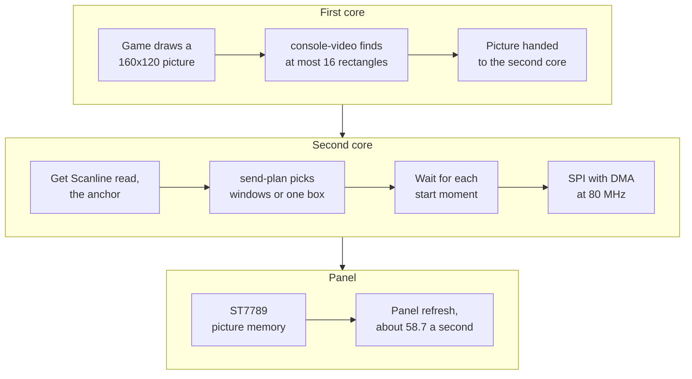

# The display

This page follows one picture from the moment a game finishes drawing
it to the moment it is on the glass. A game draws a small 160x120
picture; the console works out what changed, and the firmware sends
only those parts to the panel, timed against the panel's own refresh,
so the picture does not tear.

- [The picture a game draws](#the-picture-a-game-draws)
- [Finding what changed](#finding-what-changed)
- [The wire to the panel](#the-wire-to-the-panel)
- [Why pictures tear](#why-pictures-tear)
- [Knowing where the panel is](#knowing-where-the-panel-is)
- [Sending in step with the refresh](#sending-in-step-with-the-refresh)
- [The second core](#the-second-core)
- [The 30 and 60 settings](#the-30-and-60-settings)
- [Board measurements](#board-measurements)
- [What is not measured](#what-is-not-measured)
- [Where this comes from](#where-this-comes-from)


## The picture a game draws

The console keeps a picture of 160x120 pixels with one byte per pixel.
The byte is not a colour but an index into a palette (a table of
colours) of 256 entries. Each entry is an RGB565 colour, the 16-bit
format the panel takes, so the palette is 512 bytes plus a version
number. One picture is 19,200 bytes.

The panel is 320x240. Each picture pixel is shown as a block of 2x2
panel pixels. The doubling happens on the way out: the code that sends
the picture turns each run of picture bytes into RGB565 pixels with the
2x already in them. There is no full-size panel buffer anywhere in RAM.
A full 320x240 picture at 16 bits per pixel would be 153,600 bytes, on
a chip with 520 KB of RAM in total and no external RAM
([decisions](decisions.md#the-picture)).

The picture code (crate `console-video`) holds two pictures, the
palette and a small list of rectangles: 39,060 bytes in all (two
pictures of 19,200, palette 516, rectangles 132, flags 12). Finding the
changes uses 720 bytes of stack.

## Finding what changed

After each step the console compares the new picture with the one the
panel already shows. It sends only the difference, as at most 16
rectangles (`MAX_AREAS` in `src/areas.rs`).

The rule:

1. Each row of the picture gives one span: from its first changed pixel
   to its last.
2. A row joins the rectangle above it if the grown rectangle covers at
   most 24 more pixels than the two would apart (`WINDOW_COST_PX`).
3. An unchanged row closes the rectangle above it.
4. When there are more than 16 rectangles, the pair of neighbours that
   would waste the fewest pixels when joined is joined, until 16 are
   left.

The same rule is written in JavaScript on the design page, so the
browser preview and the console send the same rectangles. A test
checks 400 frames against that JavaScript; 162 of them hit the limit
of 16.

### Why 16

Each rectangle becomes one window on the panel. A window is the panel's
way of taking a rectangle of pixels: the chip first sends commands
that set the column and row range, then the pixels.

| | cost |
|---|---|
| one window, set-up only | about 48 to 50 us (board, at 40 and 80 MHz) |
| 16 windows, set-up only | at most about 0.8 ms of a 33 ms frame |
| one picture pixel (4 panel pixels) | about 0.8 us at 80 MHz, 1.6 us at 40 MHz |
| one window, in picture pixels | about 31 at 40 MHz, about 62 at 80 MHz |

More rectangles mean fewer unchanged pixels sent, and 16 cost under a
millisecond, so 16 is the default. The joining cost of 24 pixels is the
design page's number, lower than the measured cost of a window; it has
not been tuned on the board.

On the PC the diff takes 0.9 us for an unchanged picture and 2.5 us
for a picture with 60 marks. On the chip it is estimated (from the
code, not measured) at about 80 us for an unchanged picture, against
189 us measured for the older code.

## The wire to the panel

The panel is an ST7789, a display controller with its own picture
memory. The chip talks to it over SPI (a four-wire serial bus) on the
chip's SPI2 port. Pixels go out by DMA (direct memory access: a part of
the chip that moves bytes to the bus while the processor does other
work).

| setting | value | why |
|---|---|---|
| write clock | 80 MHz | the only speed that can keep up with the refresh (below) |
| fallback write clock | 40 MHz | used only when the 80 MHz read-back check fails at start-up |
| read clock | 4 MHz | 8 MHz gave wrong red bits |
| pixel format | RGB565, 16 bits | the panel's own |
| write direction | column by column (MADCTL 40h) | matches the direction of the refresh |
| DMA strip | 5,120 bytes, two of them | the processor fills one strip while DMA sends the other |

80 MHz needs the SPI pins routed straight through the chip's IO_MUX
(GPIO13 and GPIO14), not through the general pin matrix. A full screen
takes 15,629 us on the wire (board). Small strips were chosen over
strips three times the size: at most 1% slower, 20,480 bytes of RAM
saved ([optimizations](optimizations.md#dma-with-small-strips)).

The low-level SPI driver, the scanline read and `fill_fast` (which turns
picture bytes into doubled RGB565 pixels) run from RAM. The rest of the
timed path runs from a fixed block of flash
([optimizations](optimizations.md#the-hot-block-and-the-flash-cache)).

## Why pictures tear

The panel shows what is in its memory by refreshing: it reads its
memory one line after another and drives the glass. On this board the
refresh moves sideways across the landscape screen, one panel column
("gate line") at a time, left to right. One gate line takes about
49.5 us, and one refresh is about 343 lines, of which 320 are visible.

| figure | value | source |
|---|---|---|
| one refresh | about 17.0 ms (17,018 us) | board, bench |
| refreshes a second | about 58.7 | board (cyd-lab, 2026-11-17; bench) |
| lines in a refresh | 343.6 at 49.59 us (cyd-lab); about 343 (send-plan); 344 at 49.45 us (firmware default before calibration) | board and code |

If the chip writes into a column while the refresh is reading it, the
panel shows half the old picture and half the new one for one refresh.
That is a tear.

The board has no tearing-effect pin (a wire on which some panels
signal the start of each refresh). Writing the picture row by row was
tried first in the `display-dma` experiment, and it tore on every frame:
a full frame takes 11.7 to 31 ms, and the rest of the refresh period is
only about 1 ms. Writing column by column, in the same direction as the
refresh, works: at 80 MHz with 16-bit pixels the writer needs about
48 us for a full-height column, against the refresh's 49.5 us, so it
moves about as fast as the refresh. At 40 MHz the writer is half the
refresh's speed; `display-dma` concluded that 40 MHz cannot be
tear-free, so the working clock is 80 MHz.

## Knowing where the panel is

Without a tearing pin, the chip asks the panel where it is. The ST7789
has a Get Scanline command (45h): it answers with the line the refresh
is on now.

### The start-up survey

At start-up, before anything is drawn, the firmware reads the scanline
for about 200 ms (about 11 refreshes) and fits a line time and a line
count from the readings. The survey has checks. It refuses itself when
a step between readings is odd (`odd_step`), when the wraps from the
last line back to the first are uneven (`uneven_wraps`), or when a wrap
is missed (`missed_wrap`). It also throws out reads that are slow
against the fastest one, and refuses the survey when even the fastest
read took more than 40 us. A refused survey adds a log line
`panel: survey not used: <why>`. Only a survey refused for `odd_step`
or `uneven_wraps` is run again, up to three surveys in all. After any
other refusal, or a third refused survey, the firmware keeps its
defaults (49.45 us a line, 344 lines) until the next start.

The result goes into the boot log as one line:

```text
panel: write_mhz=80 strip_bytes=5120 survey samples=... rejected=...
  (error=... slow=... bits=... fastest_read_us=17 read_limit_us=...
  spread=... odd_steps=...) lines=... line_us=... calibrated=true surveys=...
```

(shown here on two lines; on the board it is one). The two fields to
check after any change to the memory layout are `fastest_read_us=17`
and `calibrated=true`. A slower fastest read means the read path is
hitting the flash cache; it was 25, 29 or 37 us in some builds before
the timed code was gathered into one block.

On the board (2026-11-19, flash at 40 MHz), 220 starts ran 225
surveys; 6 were refused, 5 of them for `odd_step`, each followed by a
clean second survey.

### The anchor before each picture

Before each present, the firmware reads the scanline once more and
stamps it with the processor's cycle counter. That pair is the anchor.
From then on it counts with its own clock in "virtual lines": lines
since the first visible line of refresh 0, counting on through later
refreshes. When no read works, an anchor at most 60 ms old may be used
again. Each core has its own
cycle counter, so an anchor is only good on the core that read it.

## Sending in step with the refresh

A window may start only when the refresh has just left its first
column. From there the writer follows the refresh from behind. It must
never overtake the refresh line in the current pass, and it must be
done before the next pass comes round to it. The planning code keeps 8
lines between the two (`GUARD_LINES`), allows 35 us from the send call
to the first pixel byte (`LEAD_US`) and 10 us after the last
(`TAIL_US`), counts the wire 1.5% slower than its clock (`WIRE_SLOWDOWN`,
measured in `display-dma`), and waits at most 2 refreshes for a start
moment.

```text
one refresh, about 17.0 ms, left to right on the glass
line:   0    13 (first visible)                     about 333        343
        |-----|----------------------------------------|-------------|
pass k:       ====refresh line moving right====>
writer:          [guard 8 lines] ###writing window###>
                 starts just after the refresh leaves the window's
                 first column, never passes the refresh line
pass k+1:     ====> the next refresh must not reach a column
              the writer has not finished
```

The shape of a window decides when it may start:

- A tall window is written about as fast as the refresh moves. It can
  start almost anywhere in a refresh and nearly always fits.
- A low, wide band is written about 20 times faster than the refresh
  moves. It catches up with the refresh line quickly, so it may only
  start in a narrow span late in the refresh.

### Windows or one box

A turning 3D scene changes about ten low, wide bands a frame. Sent as
windows, ten of them seldom fitted one refresh, and the present waited
refresh after refresh. On 2026-11-17, LANTERN at NORMAL detail and the
60 setting ran 33.35 frames a second, with a 27 ms average present, and
582 of 911 presents found no plan that fitted one refresh.

Since 2026-11-18 each present also considers one box around all the
changed rectangles, and takes whichever the timing model says ends
sooner (crate `send-plan`, module `choose`):

1. Read the panel's line (the anchor).
2. Plan both ways, windows and one box, and pick the sooner one and the
   refresh it fits in. All planning is done before the first window
   goes out.
3. For each window: wait for its start moment, send it.
4. If no plan fits one refresh, each window is sent in its own pass;
   this is counted as `no_plan`.

A box also sends pixels that did not change, with the values the panel
already shows, so the picture is the same. It sends more pixels: in
the model (LANTERN, NORMAL/30), about 56,500 a present against 43,900
for windows. A third
shape, groups of windows that share columns, was tried in the model;
over LANTERN's lists it always came out equal to one box, so it was
left out.



A window that misses its moment is still sent, and counted as `late`.
A window the model says crossed the refresh line is counted as
`crossed`: that is a possible tear. Both counts are in the firmware's
`send` log line.

## The second core

The ESP32 has two processor cores. With the feature `core2`, on by
default since 2026-11-18, the second core sends every picture and the
first core goes on with the next step.

| first core | second core |
|---|---|
| the console's loop, the games, the Bluetooth radio, the debug link, the log, saving settings, loading games | one task, `worker`, that sends each handed picture with the same tear-free timing |
| panel set-up, the clock check, the start-up survey, before the second core starts | every timed send from the first picture on, with its own anchor reads |
| screenshots over the link, raw panel commands, the backlight, only after the second core holds nothing | nothing else: it never logs, never uses flash on purpose, never runs game code |

### The hand-over

The console keeps two pictures that swap roles (`console-video`'s
`swap` feature). One present goes like this on the first core:

1. find the changed rectangles;
2. wait until the second core is free;
3. hand over the finished picture and its rectangles;
4. bring the other picture up to date by copying the changed parts
   across (the catch-up copy);
5. swap: the console now draws into the other picture.

In a 420-frame tour in the simulator the catch-up copy cost 5.8% of
a full copy.

The hand-over is one shared word, `JOB`: 0 means the second core holds
nothing, 1 is a picture to send, 2 asks the second core to stop and
wait while the first core uses flash. The first core writes what the
second core needs, then stores the job number with release ordering;
the second core loads it with acquire ordering, does the job and stores
0 with release ordering. The first core's side lives in its own crate,
`handover`, and is tested on the PC against a model of the second core
in every order of events: 76,518 states.

Every wait is bounded. A wait for the second core to finish ends after
500 ms (the longest send measured is about 33 ms); if that bound is
reached, the firmware stops with a panic that says which wait it was,
instead of hanging. A wait for it to park ends after 100 ms (measured
parking takes up to 8 us); then the settings save fails and is tried
again later.

### What two cores changed

Measured on the board, the 60 setting, a gamepad connected, the same
build with and without `core2` (the runs behind the 2026-11-18 choice):

| game, detail | frames a second, one core | two cores | late / crossed, one core | two cores |
|---|---|---|---|---|
| LANTERN level 4 LIGHT | 59.9 | 60.0 | 42 / 5 | 6 / 0 |
| LANTERN level 4 HEAVY | 53.2 | 59.8 | 14 / 0 | 1 / 0 |
| HAIRPIN NORMAL | 55.0 | 59.7 | 92 / 2 | 13 / 0 |
| HAIRPIN HEAVY | 45.7 | 58.7 | 22 / 1 | 1 / 0 |
| KESTREL HIGH | 59.5 | 59.8 | 17 / 0 | 6 / 0 |
| TUNDRA, two players | 59.77 | 59.99 | 17 / 2 | 1 / 0 |

The console's step took 9.2 to 20.4 ms on average on one core and 3.0
to 15.2 ms on two. A picture check over 830 and 1,201 pictures found 0
mismatches. The second core is busy about 7% of the time and sleeps
when idle. Its costs are on [the optimisations page](optimizations.md#the-second-core-sends-the-pictures).

On 2026-11-23 the games' starting settings became HIGH (or HEAVY)
detail and 60. One run of each game at those settings on two cores
(two of MERCATOR and two of LANTERN), with no gamepad connected:
HAIRPIN HEAVY 58.87 frames a second in a race, LANTERN HEAVY 58.74
turning on the spot and 60.01 walking, and KESTREL HIGH, MERCATOR
(HIGH, chase view, flight in space), ROOFTOP, LANDER, SKIMMER and
TUNDRA 59.99 each, with 0 crossed windows in every run. SKIMMER's 59.99
counts only the frames that came back to back: with its one pause of
more than 0.1 s counted, the rate was 59.73. The table is in
[boards/cyd/README.md](../boards/cyd/README.md), "At the starting
settings". CAMBER was not in that round: its runs, from an earlier
round on firmware of the same day, are in
[games/camber/README.md](../games/camber/README.md).

## The 30 and 60 settings

A game asks for one of three rates: 30 a second (the default), 60 a
second, or only when its input changes or a time it asked for comes. The console's periods are
33,333 us and 16,667 us.

The panel refreshes about 58.7 times a second, not 60. At the 30 setting
every picture has close to two refreshes to go out in; the board
measured 30.00 frames a second in all three LANTERN details on
2026-11-18. At the 60 setting the panel sets the pace when pictures
change across the whole width: each picture is sent behind the
refresh, so steps are held to one refresh each, about 17.0 ms. BENCH
measured on the board 58.83 to 58.86 frames a second in such held
steps, with presents averaging 9,322 to 11,471 us and the work itself
4.6 to 6.0 ms. A real overload looks different: 47.17 frames a second
with 20.0 ms of work. So the fast mode follows the panel's own rate
([decisions](decisions.md#no-tearing-follow-the-panel-do-not-fight-it)).

## Board measurements

One core, LANTERN level 4, a gamepad connected, before and after the
windows-or-box choice (2026-11-18):

| setting | frames a second | present average, ms | longest, ms | no one-pass plan | late | crossed |
|---|---|---|---|---|---|---|
| LIGHT/30 | 30.00 to 30.00 | 13.0 to 8.7 | 33.4 to 24.7 | 30/530 to 0/528 | 146 to 16 | 92 to 3 |
| NORMAL/30 | 26.31 to 30.00 | 29.8 to 14.0 | 82.0 to 28.1 | 281/452 to 7/528 | 137 to 17 | 83 to 2 |
| HEAVY/30 | 26.06 to 30.00 | 32.5 to 14.8 | 82.2 to 18.4 | 236/370 to 0/535 | 104 to 13 | 55 to 1 |
| LIGHT/60 | 57.78 to 59.95 | 12.2 to 8.8 | 33.4 to 22.2 | 46/995 to 0/1057 | 195 to 34 | 133 to 3 |
| NORMAL/60 | 39.75 to 56.16 | 28.9 to 13.8 | 80.7 to 18.2 | 296/458 to 13/964 | 146 to 10 | 78 to 0 |
| HEAVY/60 | 36.56 to 52.46 | 27.2 to 14.3 | 98.2 to 36.8 | 265/546 to 3/883 | 136 to 12 | 78 to 0 |

For comparison, with the timing switched off (no guard against
tearing) NORMAL/60 ran 59.72 frames a second.

After the timed code was gathered into one block of flash (2026-11-18),
KESTREL over five code layouts, two runs each (2026-11-19):

| figure | two cores | one core |
|---|---|---|
| game lead, average | 26 to 28 us | 42 to 55 us |
| late windows a run | 0 to 4 | 2 to 15 |
| crossed windows | 0 in every run | 0 in every run |
| `fastest_read_us` | 17 in every run | 17 in every run |
| `calibrated` | true in every run | true in every run |

The lead is the time from a window's send call to its first pixel byte.
In other games on the same day the two-core lead was 31 to 35 us with 0
crossed; on one core TUNDRA showed 1 crossed window in each of two runs.

An earlier soak on two cores (2026-11-17, the tour with an injected
gamepad sending 100 reports a second) ran 600 seconds without a stop:
4,351 presents, 12 late, 0 crossed.


## What is not measured

- That the second core's box send reads only the handed picture, which
  nobody writes during the send, was shown by reading the code
  (`src/core2.rs`). The board runs with the new plan on two cores
  (2026-11-18 and 2026-11-19, above) had 0 crossed windows and the
  picture check found 0 mismatches, but no test aims at that case.
- The diff's time on the chip is an estimate from the code.
- The joining cost of 24 pixels has not been tuned on the board.
- The firmware's planning allows 35 us of lead; the board measured
  averages from 26 us (two cores) to over 100 us (one core, on the
  home screen and in some games). The constant was not changed.

## Where this comes from

- [crates/console-video/README.md](../crates/console-video/README.md)
  and [crates/console-video/src/areas.rs](../crates/console-video/src/areas.rs)
- [boards/cyd/README.md](../boards/cyd/README.md), sections "How it
  works", "Sending a picture: windows or one box", "The timed paths and
  the flash cache", "Numbers", "One core or two" and "The second core
  sends the pictures"
- [boards/cyd/src/screen.rs](../boards/cyd/src/screen.rs),
  [boards/cyd/src/lcd.rs](../boards/cyd/src/lcd.rs),
  [boards/cyd/src/beam.rs](../boards/cyd/src/beam.rs),
  [boards/cyd/src/core2.rs](../boards/cyd/src/core2.rs),
  [boards/cyd/src/main.rs](../boards/cyd/src/main.rs)
- [boards/cyd/send-plan/src/lib.rs](../boards/cyd/send-plan/src/lib.rs),
  [boards/cyd/send-plan/src/choose.rs](../boards/cyd/send-plan/src/choose.rs),
  [boards/cyd/send-plan/src/beam.rs](../boards/cyd/send-plan/src/beam.rs)
- [boards/cyd/handover/src/lib.rs](../boards/cyd/handover/src/lib.rs)
- [crates/console-core/src/game.rs](../crates/console-core/src/game.rs)
- [games/bench/README.md](../games/bench/README.md)
- [experiments/display-dma/README.md](../experiments/display-dma/README.md)
- [experiments/cyd-lab/README.md](../experiments/cyd-lab/README.md)
- [decisions](decisions.md)
