# Gallery

Every clip here was made by the simulator
([boards/desktop](../boards/desktop/README.md)) running the same console
and game code as the chip, from the input scripts in
[tools/media/scenes](../tools/media/scenes). They show what the console
draws, pixel for pixel; they are not photographs of the board, and the
simulator says nothing about speed. The games are played by a script,
not a person, so a clip says nothing about how hard a game is either.
`python3 -I tools/media/make.py --sim <built pocketme-sim>` builds them again.

- [The console](#the-console)
- [CAMBER](#camber)
- [MERCATOR](#mercator)
- [KESTREL](#kestrel)
- [LANTERN](#lantern)
- [DRIVE3D](#drive3d)
- [PROTO3D](#proto3d)
- [HAIRPIN](#hairpin)
- [ROOFTOP](#rooftop)
- [LANDER](#lander)
- [SKIMMER](#skimmer)
- [TUNDRA](#tundra)
- [STARDUST](#stardust)
- [BENCH](#bench)
- [PADTEST](#padtest)

## The console

<table>
  <tr>
    <td width="50%" valign="top">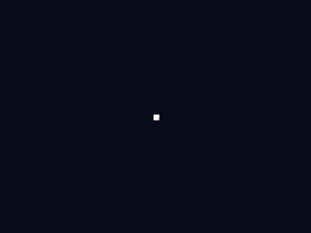 The whole GATHER boot animation, from a single point to the name POCKETME shrinking into the title of the home screen, then about a second of the home screen.</td>
    <td width="50%" valign="top">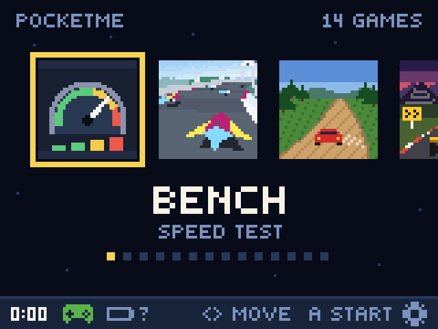 The d-pad moves the choice along the home screen's row of tiles from BENCH to TUNDRA, resting on KESTREL and MERCATOR.</td>
  </tr>
  <tr>
    <td width="50%" valign="top"> From the home screen the d-pad walks to the KESTREL tile and starts it; KESTREL's title menu shows, then the home button opens the pause menu and BACK TO HOME returns to the home screen with KESTREL still chosen.</td>
    <td width="50%" valign="top"> The home button opens the console menu over the home screen: the brightness bar goes down from five steps to two and back up, BOOT ANIM goes from FULL to SHORT, OFF and FULL again, and CLOSE shuts the menu.</td>
  </tr>
  <tr>
    <td width="50%" valign="top">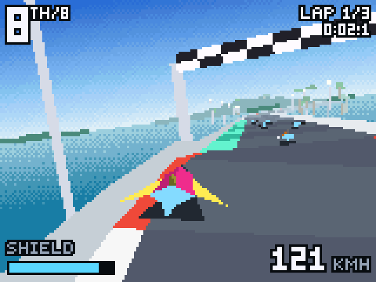 The home button pauses a CAMBER race: the pause menu (RESUME, brightness, BACK TO HOME) stands over the still race and the lap clock stops; the brightness goes one step down and back up, and RESUME lets the race go on.</td>
    <td width="50%" valign="top">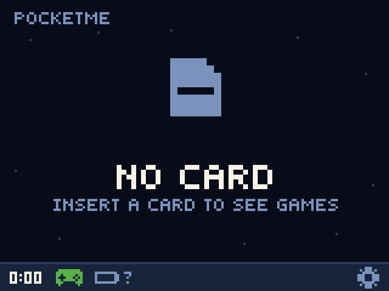 The home screen with the card slot empty says NO CARD; a card goes in and the row of tiles appears with a green CARD READY note, then the card is pulled out: NO CARD again and a red CARD REMOVED note.</td>
  </tr>
</table>

## CAMBER

More about this game: [games/camber](../games/camber/README.md).

<table>
  <tr>
    <td width="50%" valign="top">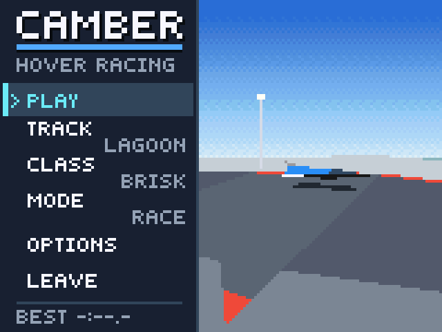 In the title menu TRACK steps from LAGOON to FURNACE and GLACIER and round to LAGOON again, and the live scene behind the menu moves to each track in turn.</td>
    <td width="50%" valign="top">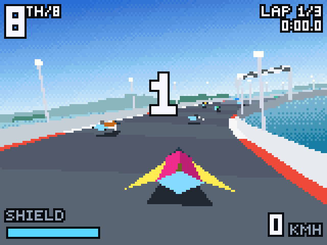 The light counts down to GO! and the ship sets off in 8th place behind the seven rivals, out under the chequered banner.</td>
  </tr>
  <tr>
    <td width="50%" valign="top">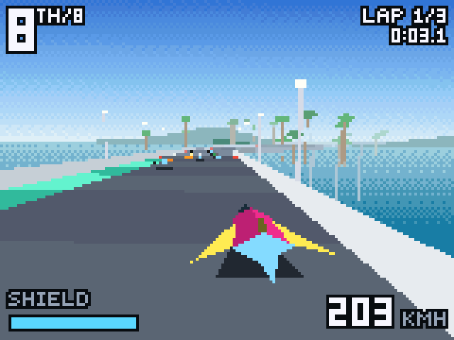 R held carves the ship through a long right bend while the heat marks beside the shield light up; let go, the sling pushes it past a rival on the next straight.</td>
    <td width="50%" valign="top">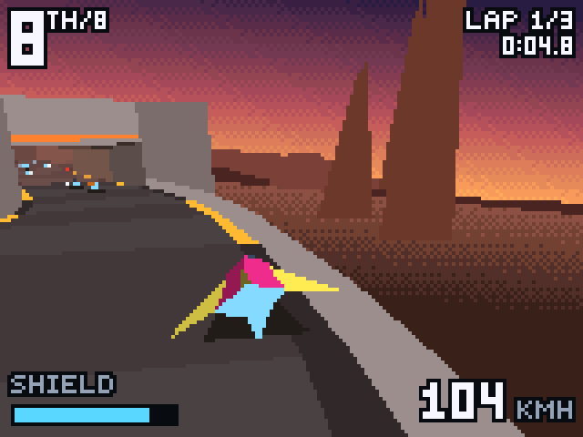 On FURNACE the road runs into a tunnel through the rock; the ship flies through the dark inside and out into the red desert again.</td>
  </tr>
  <tr>
    <td width="50%" valign="top">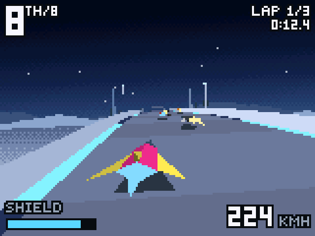 On GLACIER a boost pad sends the ship at the jump; it flies over the gap beside the rivals and lands in 6th place.</td>
  </tr>
</table>

## MERCATOR

More about this game: [games/mercator](../games/mercator/README.md).

<table>
  <tr>
    <td width="50%" valign="top">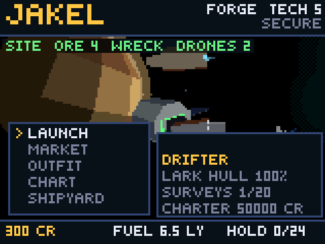 Trading at JAKEL: the market opens, ORE is picked and A held buys it tonne after tonne until the hold shows 8 and the station has NONE LEFT HERE.</td>
    <td width="50%" valign="top">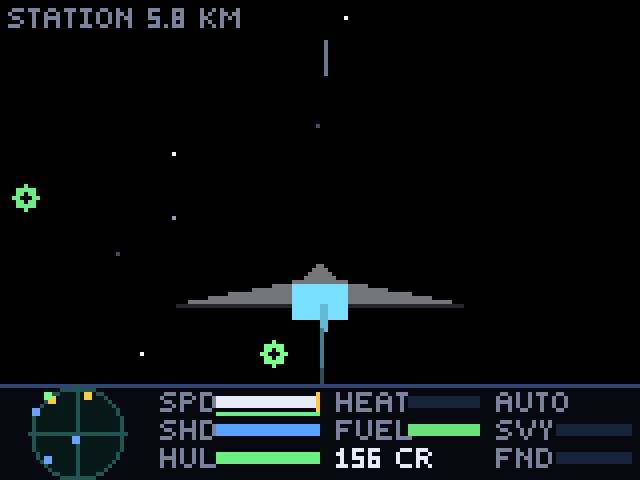 The chart in flight: the cursor steps from JAKEL to DRILO and XICRA, X zooms out to the whole galaxy and back, A jumps to DRILO through the tunnel, and the ship arrives there with a planet ahead.</td>
  </tr>
  <tr>
    <td width="50%" valign="top">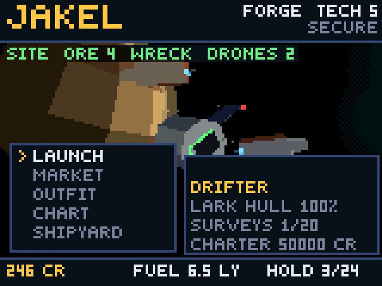 Launching from JAKEL: just outside the station a warden on patrol, about 1 km ahead, comes closer and slides past on the left.</td>
    <td width="50%" valign="top">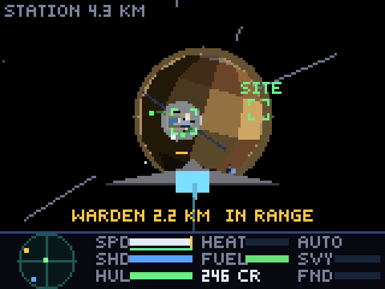 Flying in toward the station past a departing hauler and a passing warden, until the tow lane takes over.</td>
  </tr>
  <tr>
    <td width="50%" valign="top">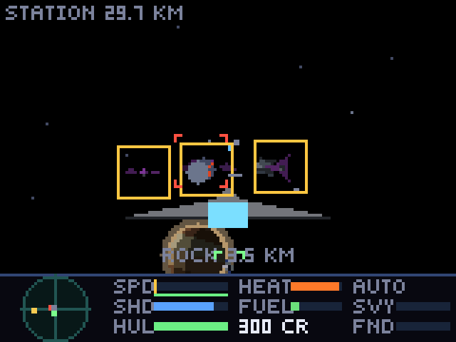 A fight with a raider pack in a RISKY system, seen from behind the ship: the pilot's laser and the gunner's turret fire, the ship's shield takes hits, and two raiders are destroyed.</td>
    <td width="50%" valign="top">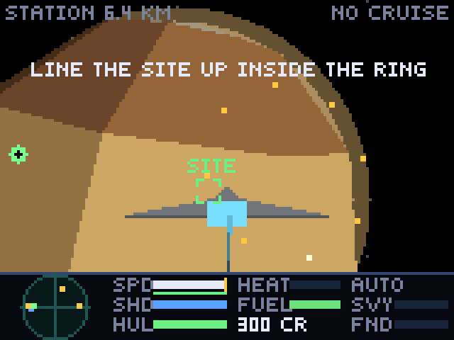 Down to the planet: the ship dives at the landing site's SITE beacon through the ring of amber lights, falls through streaks of entry, and levels off in a hover above the desert.</td>
  </tr>
  <tr>
    <td width="50%" valign="top">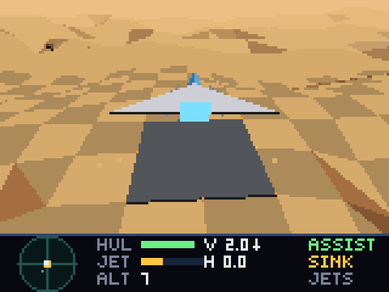 The ship sinks the last few metres onto the landing pad on its jets: LANDED, and then the pilot is out on foot.</td>
    <td width="50%" valign="top">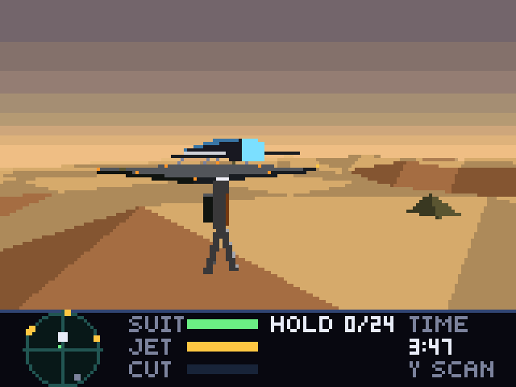 The pilot walks across the landing site back to the ship.</td>
  </tr>
</table>

## KESTREL

More about this game: [games/kestrel](../games/kestrel/README.md).

<table>
  <tr>
    <td width="50%" valign="top">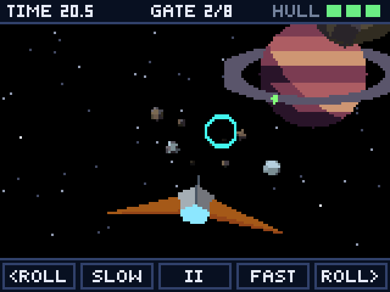 The craft flies through gate 2 of mission 1 and on towards gate 3 among the rocks.</td>
    <td width="50%" valign="top">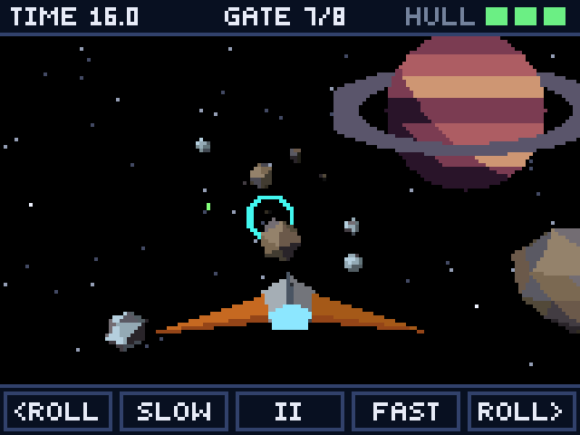 A loose rock strikes the craft (HULL HIT) and the hull drops from 3 to 2; the craft flies on through gate 7 of mission 1.</td>
  </tr>
  <tr>
    <td width="50%" valign="top">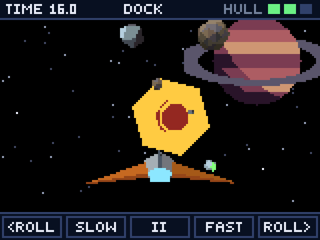 The craft flies into the gold dock gate at the end of mission 1, and the CARGO DELIVERED card shows the gates, time cells, hull, time left and score.</td>
  </tr>
</table>

## LANTERN

More about this game: [games/lantern](../games/lantern/README.md).

<table>
  <tr>
    <td width="50%" valign="top">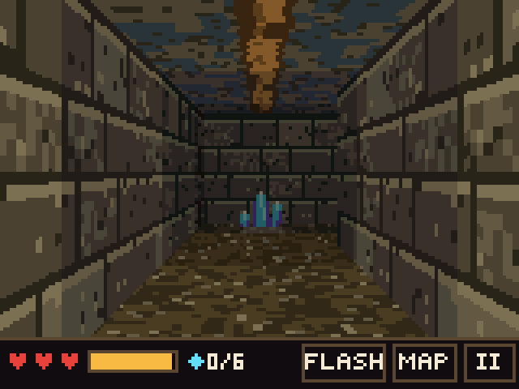 A walk through lamplit tunnels: a crystal is picked up, then a wooden door slides open and the way goes on through it.</td>
    <td width="50%" valign="top">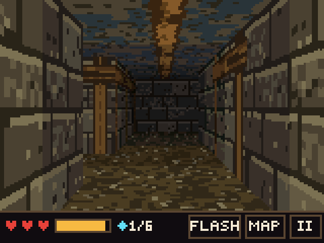 A moth flies at the lamp and drinks its oil; a flash of the lamp drives it off down the tunnel.</td>
  </tr>
  <tr>
    <td width="50%" valign="top">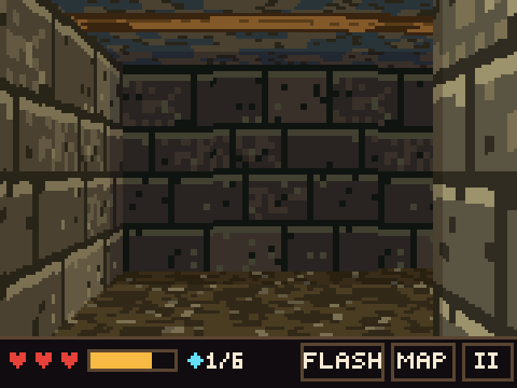 The lift's crank is picked up (THE CRANK! FIND THE LIFT), the lift waits at the end of the next tunnel, and A works it: THE LIFT CLIMBS, with the level's tally.</td>
  </tr>
</table>

## DRIVE3D

More about this game: [games/drive3d](../games/drive3d/README.md).

<table>
  <tr>
    <td width="50%" valign="top">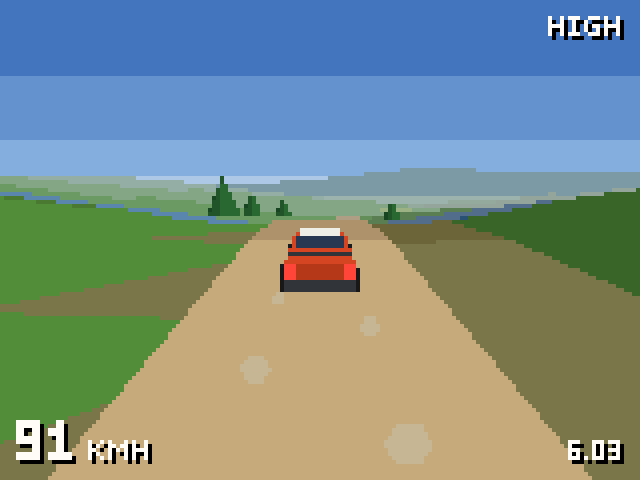 Full throttle on gravel: over the crest, down the drop towards the river and through the ford, the wheels pushing the water aside.</td>
    <td width="50%" valign="top">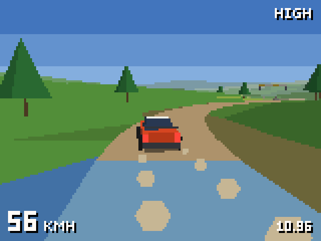 Out of the ford into the right bend: the car slides sideways on the gravel and throws up dust.</td>
  </tr>
  <tr>
    <td width="50%" valign="top">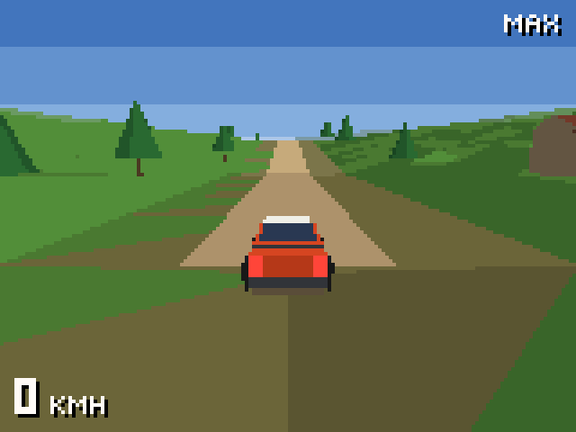 The start of the run at MAX, the highest detail level: the car pulls away up the gravel road throwing dust, with the hills and trees drawn far ahead.</td>
  </tr>
</table>

## PROTO3D

More about this game: [games/proto3d](../games/proto3d/README.md).

<table>
  <tr>
    <td width="50%" valign="top">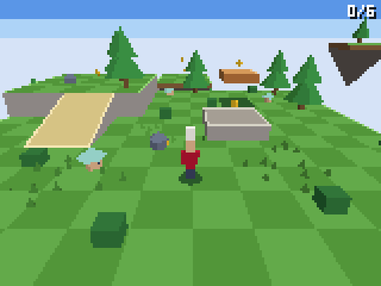 ISLAND: the hero runs and jumps across the island and onto a floating islet, taking three of the six pickups; the camera follows.</td>
    <td width="50%" valign="top">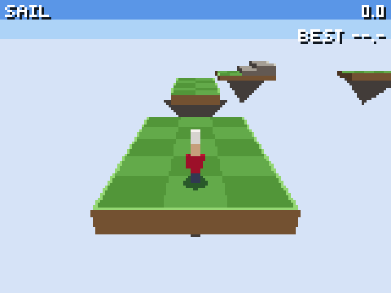 SAIL: the hero runs off the edge and glides over a gap to a small island, then glides over a second gap to the pad by the steps; the bar at the bottom shows the glide left.</td>
  </tr>
  <tr>
    <td width="50%" valign="top">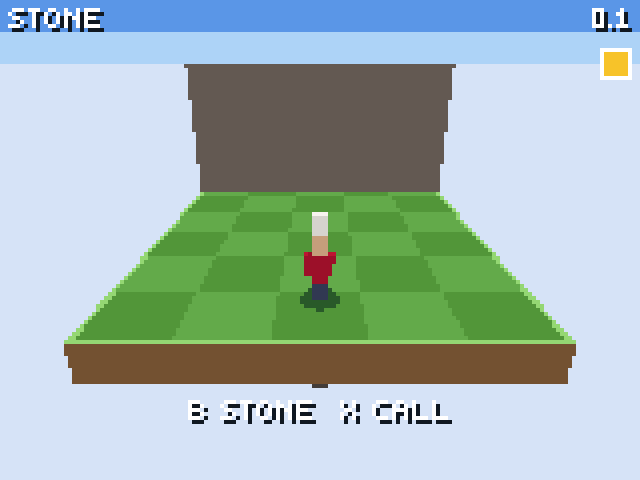 STONE: standing on the slate slab, the hero raises it up the face of the cliff, then jumps off onto the top of the cliff below the GOAL.</td>
    <td width="50%" valign="top">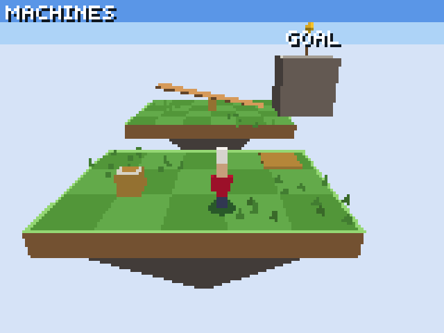 MACHINES: the hero picks up the bob and carries it onto the plate; the plate opens the way, a bridge rises, and the hero crosses it still carrying the bob.</td>
  </tr>
</table>

## HAIRPIN

More about this game: [games/hairpin](../games/hairpin/README.md).

<table>
  <tr>
    <td width="50%" valign="top">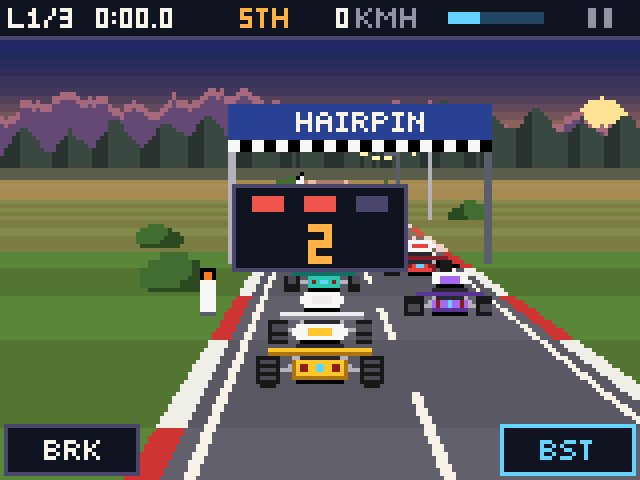 The start light counts down to GO and the kart sets off from 5th place on the RESERVOIR course, under the start banner and up the straight after the pack.</td>
    <td width="50%" valign="top">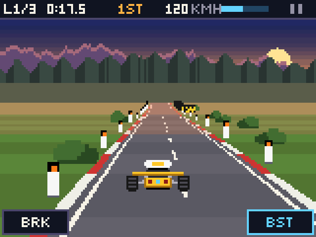 A left bend in 1st place on lap 1: the kart brakes on the straight before it, takes the bend past the chevron boards and comes out on the straight after it.</td>
  </tr>
  <tr>
    <td width="50%" valign="top">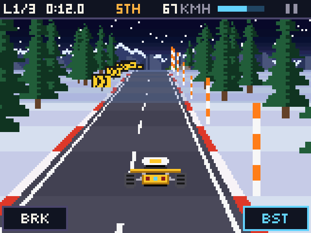 On the SUMMIT course the kart brakes for a right hairpin marked with chevron boards in the snow, turns round it and drives on through the pines.</td>
  </tr>
</table>

## ROOFTOP

More about this game: [games/rooftop](../games/rooftop/README.md).

<table>
  <tr>
    <td width="50%" valign="top">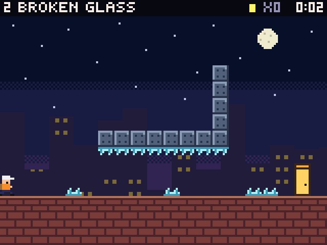 Room 2, BROKEN GLASS: the courier jumps across a roof with glass under the ledges. Room 3, CHIMNEY: it jumps from wall to wall up a narrow shaft to the door.</td>
    <td width="50%" valign="top">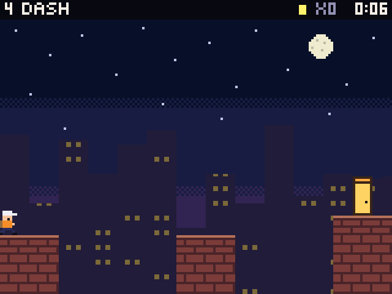 Rooms 4 (DASH) and 5 (UPDRAFT) played through: the courier runs, jumps, dashes and rides an updraft between roofs to each room's door.</td>
  </tr>
  <tr>
    <td width="50%" valign="top">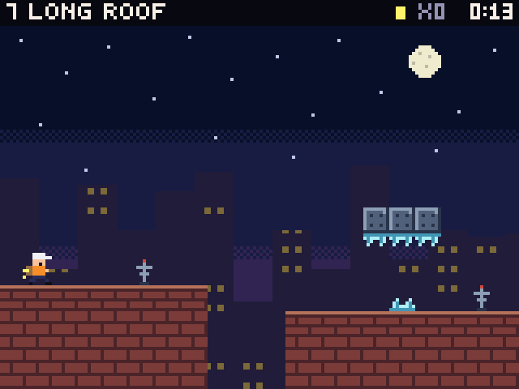 Room 7, LONG ROOF: the view scrolls with the courier as it runs, jumps and dashes across a roof wider than the screen to the door.</td>
    <td width="50%" valign="top">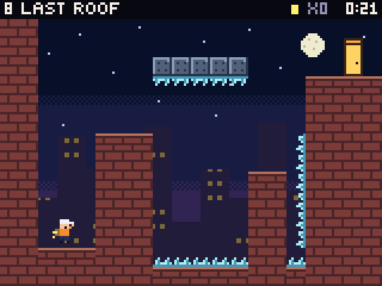 Room 8, LAST ROOF: the courier jumps and dashes up to the door, then DELIVERED shows the total time and the time for each room.</td>
  </tr>
</table>

## LANDER

More about this game: [games/lander](../games/lander/README.md).

<table>
  <tr>
    <td width="50%" valign="top">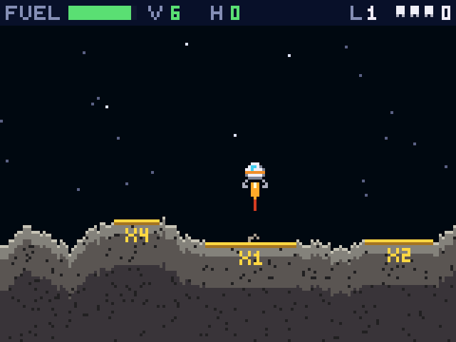 The craft lowers itself onto the X1 pad with a short burn and then a low steady one, and touches down softly: LANDED, SOFT TOUCH +25, 158 points.</td>
    <td width="50%" valign="top">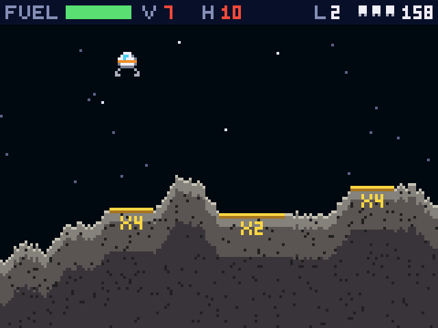 Level 2 in the FOLLOW view: with no burn the craft falls, the camera zooms in near the ground, and it breaks apart: CRASHED, TOO FAST.</td>
  </tr>
  <tr>
    <td width="50%" valign="top">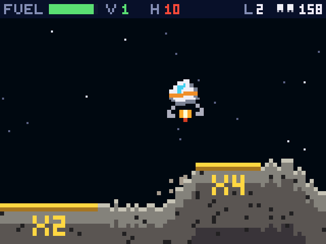 Low over the hills in the FOLLOW view, the craft leans back and burns to stop its sideways drift over a ridge, then sinks onto the X4 pad on top of it and lands.</td>
  </tr>
</table>

## SKIMMER

More about this game: [games/skimmer](../games/skimmer/README.md).

<table>
  <tr>
    <td width="50%" valign="top">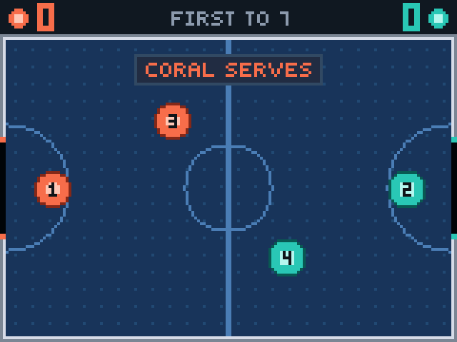 Coral serves, the puck goes back and forth between four mallets, and teal scores.</td>
    <td width="50%" valign="top">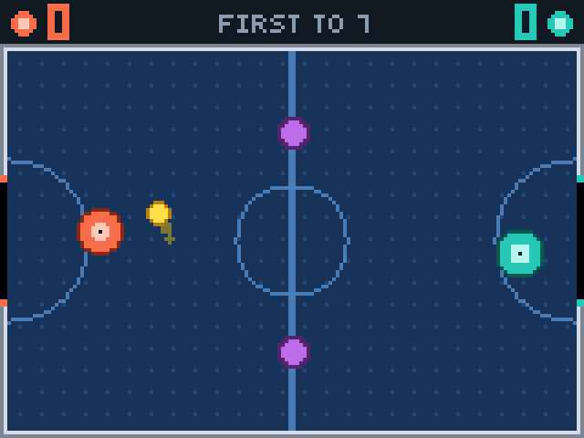 One against one on the WILD table, the computer on both sides: the puck bounces off the bumpers on the centre line, and TEAL scores.</td>
  </tr>
</table>

## TUNDRA

More about this game: [games/tundra](../games/tundra/README.md).

<table>
  <tr>
    <td width="50%" valign="top">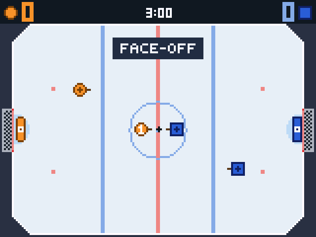 The opening face-off: AMBER player 1 takes the puck and pushes it to the BLUE net with two BLUE skaters on it. The BLUE goalie holds the puck and passes it out, and a BLUE skater carries it back toward centre ice.</td>
    <td width="50%" valign="top">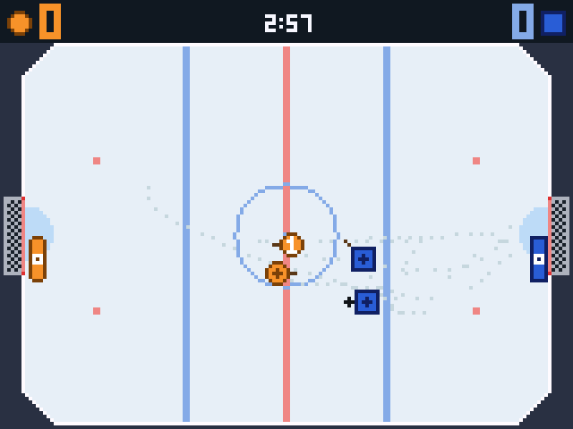 A BLUE skater carries the puck over centre ice to the AMBER net, BLUE scores after a scramble in front of it (0 to 1), and the players line up for the next face-off.</td>
  </tr>
</table>

## STARDUST

More about this game: [games/stardust](../games/stardust/README.md).

<table>
  <tr>
    <td width="50%" valign="top">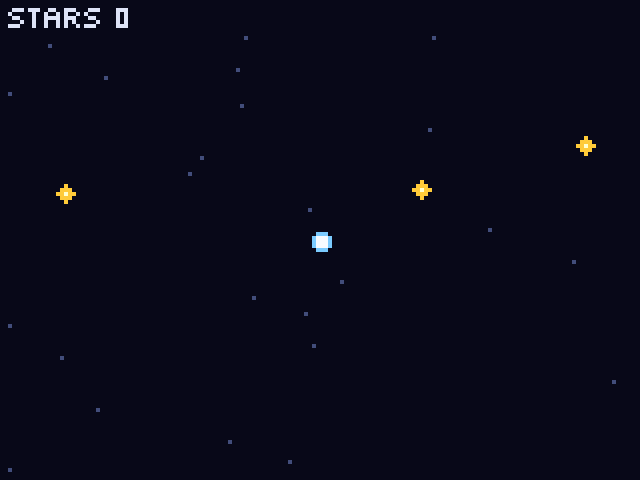 STARDUST opens at STARS 0, and the comet flies to the finger to catch its first six stars.</td>
    <td width="50%" valign="top">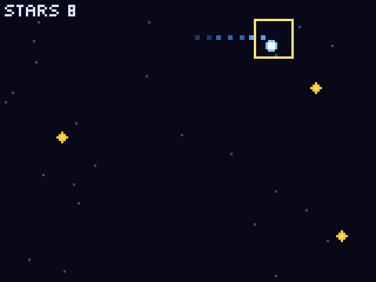 The comet follows a touch from star to star across the sky.</td>
  </tr>
</table>

## BENCH

More about this game: [games/bench](../games/bench/README.md).

<table>
  <tr>
    <td width="50%" valign="top">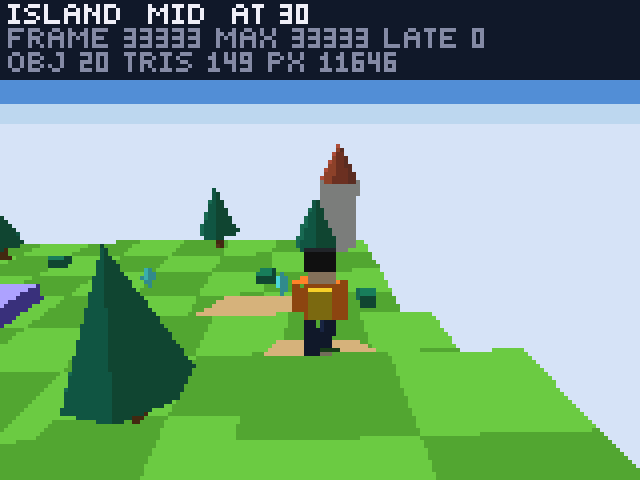 BENCH's ISLAND test: the figure runs across the floating island past a tower and round towards a stone arch, the camera following behind.</td>
    <td width="50%" valign="top">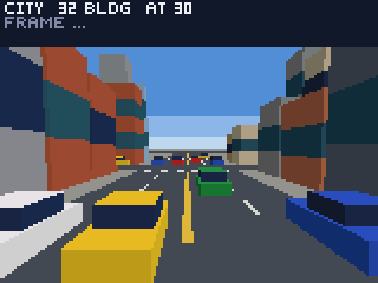 BENCH's CITY test at 32 buildings: the eye drives down a four-lane street between rows of shops and towers, past cars going both ways, and over a zebra crossing at a junction.</td>
  </tr>
  <tr>
    <td width="50%" valign="top">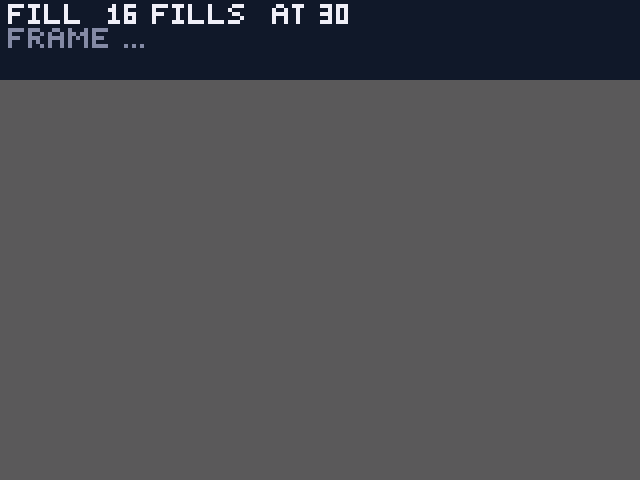 BENCH's other tests one after another at their default loads: FILL, triangles of 20, 100 and 400 pixels, VERT (corners only, nothing drawn), the SCENE tests' balls of triangles, SEND ROWS, SEND DOTS and TRI SPIN.</td>
  </tr>
</table>

## PADTEST

More about this game: [games/padtest](../games/padtest/README.md).

<table>
  <tr>
    <td width="50%" valign="top">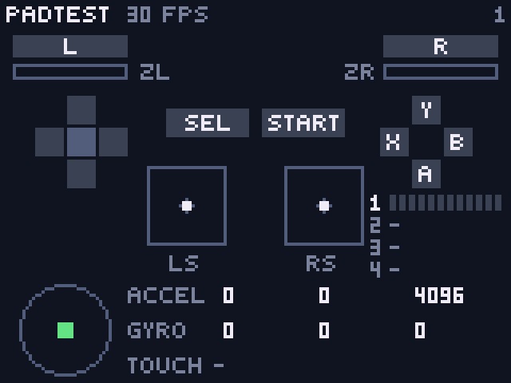 PADTEST following player 1's pad: both sticks turn in circles, the triggers rise and fall, the buttons light one after another, a finger drags across the screen and the level bubble follows the tilt.</td>
    <td width="50%" valign="top"> Pads 2, 3 and 4 connect, each with its own PAD CONNECTED note; each holds buttons that light in its own row at the right and walks one more button along it, while player 1 holds the d-pad, shoulders, triggers, sticks and a finger on the screen.</td>
  </tr>
  <tr>
    <td width="50%" valign="top"> With nothing held PADTEST goes ON DEMAND. Then the pad alone is tilted round in a circle while it turns: the game wakes, the level bubble and the ACCEL and GYRO numbers follow, and when the pad stops sending motion it shows NO MOTION and goes ON DEMAND again.</td>
  </tr>
</table>
