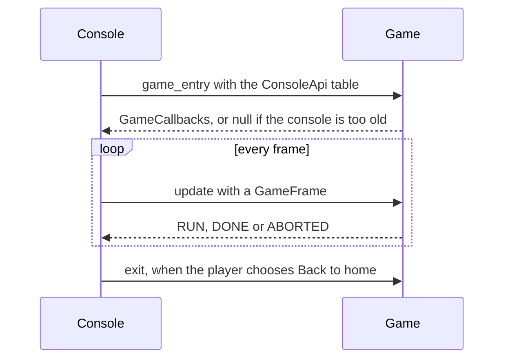
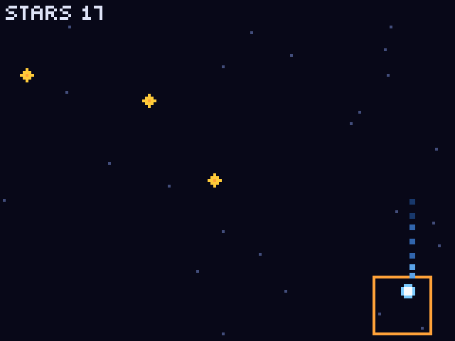
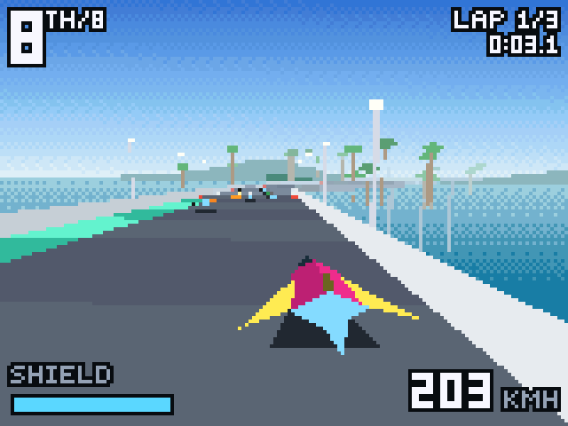
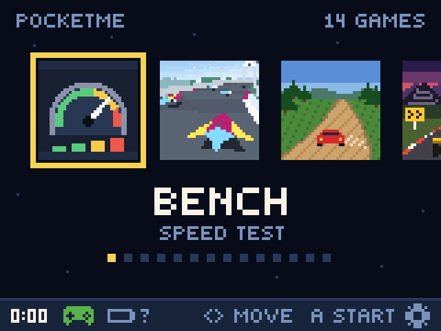
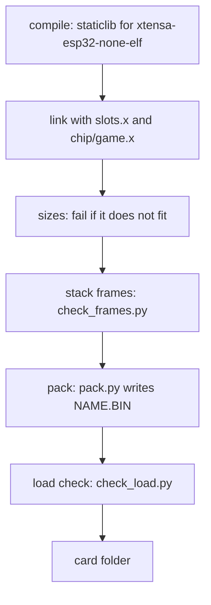
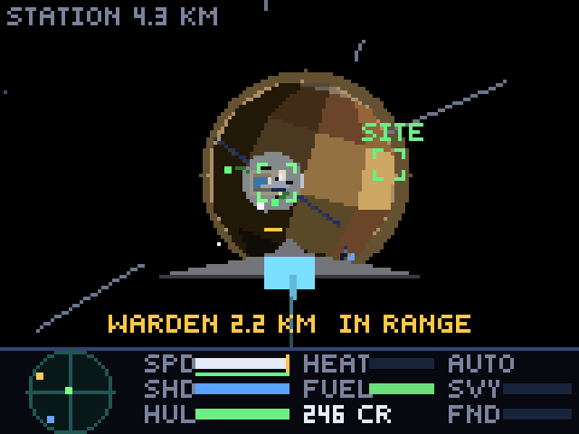

# Making a game

A game for PocketMe is a small Rust library that draws into a picture the
console hands it and reads the input the console hands it; it never
touches the hardware. This page goes from an empty crate to a file on the
SD card: the contract, drawing, memory, the game file, the chip build,
testing, and the six places a new game is registered.

- [What a game is](#what-a-game-is)
- [The contract](#the-contract)
- [A first game](#a-first-game)
- [Drawing](#drawing)
- [Memory: two fixed slots](#memory-two-fixed-slots)
- [The game file](#the-game-file)
- [Growing past the slots](#growing-past-the-slots)
- [The chip build](#the-chip-build)
- [The simulator and tests](#the-simulator-and-tests)
- [Adding a new game](#adding-a-new-game)
- [The fourteen programs and their sizes](#the-fourteen-programs-and-their-sizes)
- [Where this comes from](#where-this-comes-from)

## What a game is

A game is one `no_std` library crate in `games/`. It depends on
[`game-kit`](../crates/game-kit/README.md) and, if it wants, on the
shared 3D library [`game-3d`](../crates/game-3d/README.md), which follows
the same rules: no heap, no floating point, no `unsafe`, no panic handler
of its own, and no hardware.

The same source runs in two places. The simulator on the PC links the
crate straight in. For the chip, [`games/build-chip.sh`](../games/build-chip.sh)
builds it into a file, `GAME.BIN`, which the console copies from the card
into two fixed memory areas and calls. There is no separate PC version of
a game ([decisions](decisions.md#games)).

## The contract

Console and game talk only through tables defined in
[`crates/game-api`](../crates/game-api/README.md): `repr(C)` structs,
fixed-width integers, raw pointers and `extern "C"` functions, because the
two sides may be built by different compiler versions. Games do not use
this crate by hand; `game-kit` wraps it.

| Table | Owner | What is in it |
|---|---|---|
| `ConsoleApi` | console | `abort(code, detail)`, the one function a game may call |
| `GameCallbacks` | game | `update(frame)` and `exit(frame, reason)` |
| `GameFrame` | console, one per call | pointers to the picture, palette, input and log; time, frame number, events; the game's wishes written back |
| `Input` | console, one per call | touch, then four players |

Each call hands the game:

- **the picture**: 160 x 120 bytes, one byte per pixel, each a palette
  number. The game draws into the console's buffer, which keeps the last
  picture.
- **the palette**: 256 colours in RGB565 (16 bits per colour). Numbers 0
  to 239 are the game's; 240 to 255 are the console's, for its notices and
  pause menu.
- **four players**: 12 buttons as bits (`held`, `pressed`, `released`),
  two sticks from -32767 to +32767, two triggers from 0 to 32767, and
  motion (4096 per g, 16 per degree per second). A player with no pad
  reads zeros. Home never reaches a game.
- **touch**, shared, in the game's pixels.
- **time**: `time_us` (pauses not counted), `delta_us` since the last
  call, and `frame`.
- **a log**: 256 bytes per call, printed after the call with the prefix
  `game: `.

The game returns `RUN`, `DONE` or `ABORTED`, and writes its wishes into
the frame: "the palette changed", a video setting, a wake-up time. The
console offers one mode (160 x 120) and three rates: 30 a second (the
default), 60, and on demand, where the game is called only when input
changes, its timer comes, or after a start or resume.



**Versions.** The contract is version 3 (`API_VERSION`), and the oldest
the console runs is 3 (`MIN_GAME_VERSION`); version 3 put the four players
in the middle of `Input`, so version 2 files are refused. Every table
starts with its size and version and only grows at the end, so from
version 3 on, fields one side lacks read as 0. The loader refuses a file
below version 3 with GAME IS TOO OLD, and the kit's entry returns null
when the console's table is older than version 3 or too small.

**Panics.** On the chip the kit's panic handler calls `abort` with the
source line, and the CYD firmware prints why and halts until the reset
button; there is no watchdog. On the PC the kit catches the panic, logs
`panic: <message>` and returns `ABORTED`.

## A first game

A game implements the `Game` trait (`start`, `update`, optional `exit`)
and names its type once with `game_kit::game!`, which makes the entry
function `game_entry`, keeps the state between calls (a `static` on the
chip, a thread-local on the PC) and adds the chip's panic handler.

The sketch below moves a square with the d-pad or the left stick and ends
on Start. It is written against the real kit, in the style of
[STARDUST](../games/stardust/src/lib.rs), but **it was not compiled for
this page**: treat it as a sketch.

```rust
#![no_std]

use game_kit::{Ctx, Flow, Game, STICK_MAX, button, rgb565};

const SKY: u8 = 1; // palette numbers this game sets
const BOX: u8 = 2;
const INK: u8 = 3;

pub struct Walk {
    x: i32, // 1/256 of a pixel: whole numbers only
    y: i32,
}

impl Game for Walk {
    fn start(ctx: &mut Ctx) -> Self {
        ctx.log("walk: started");
        Walk { x: 80 * 256, y: 60 * 256 }
    }

    fn update(&mut self, ctx: &mut Ctx) -> Flow {
        if ctx.started() || ctx.must_redraw() {
            ctx.set_colours(SKY, &[rgb565(10, 12, 30), rgb565(255, 200, 60), rgb565(230, 230, 240)]);
        }
        if ctx.pressed(button::START) {
            return Flow::Done; // back to the home screen
        }
        let (mut dx, mut dy) = ctx.left_stick();
        if ctx.held(button::LEFT) { dx = -STICK_MAX; }
        if ctx.held(button::RIGHT) { dx = STICK_MAX; }
        if ctx.held(button::UP) { dy = -STICK_MAX; }
        if ctx.held(button::DOWN) { dy = STICK_MAX; }

        // 60 pixels a second at full stick, whatever the frame rate.
        let dt = i64::from(ctx.delta_us().min(100_000));
        let step = |d: i16| (i64::from(d) * 60 * 256 * dt / (i64::from(STICK_MAX) * 1_000_000)) as i32;
        self.x = (self.x + step(dx)).clamp(0, 156 * 256);
        self.y = (self.y + step(dy)).clamp(10 * 256, 116 * 256);

        let s = ctx.screen();
        s.clear(SKY);
        s.text(2, 2, "WALK", INK);
        s.rect((self.x / 256) as i16, (self.y / 256) as i16, 4, 4, BOX);
        Flow::Run
    }
}

game_kit::game!(Walk);
```

```toml
[package]
name = "walk"
version = "0.1.0"
edition = "2024"
publish = false

[dependencies]
game-kit = { path = "../../crates/game-kit" }
```

Three habits worth copying:

- **Move by time.** `delta_us` keeps the speed the same at 30 or 60
  frames a second.
- **Set the palette on start and on redraw.** `must_redraw` says the
  picture was lost.
- **Keep big buffers in the state, never in a local.** The kit builds the
  state in its own stack frame (`restart` in
  [`rt.rs`](../crates/game-kit/src/rt.rs)). On the CYD on 2026-11-22 a
  10.8 KB state built inside the update call made that call's frame
  25.8 KB of the 29.2 KB stack.

`ctx.player(n)` reads player `n` (0 to 3); the shortcuts read player 1
([games/README.md](../games/README.md#reading-the-players)).

## Drawing

`ctx.screen()` gives a `Frame` with `clear`, `pixel`, `hline`, `vline`,
`rect`, `outline`, `sprite` (small byte tables with a see-through
colour), `blit`, and the console's font with `text` and `text_scaled`.
At start palette entries 0 to 239 hold a 6 x 8 x 5 colour cube (0 black,
239 white). `set_colour` and `set_colours` also set the "palette changed"
request. STARDUST's stars twinkle by changing one palette entry every
0.15 s, not by drawing. The console then sends only what changed; see
[display](display.md).
<p align="center">
  <br>
  <em>A star caught in the lower right corner, marked by a flash box; 17 stars caught.</em>
</p>

### The shared 3D library

[`crates/game-3d`](../crates/game-3d/README.md) draws flat-shaded 3D
polygons (each face one colour) into the same picture, in whole numbers.
It is compiled into each game that uses it, never into the console.
KESTREL, CAMBER, PROTO3D and DRIVE3D use it (their `Cargo.toml`);
MERCATOR has its own copy of the renderer.

| Quantity | Unit |
|---|---|
| positions | 1/256 metre (`M8` = one metre) |
| screen positions inside the library | 1/16 pixel |
| matrices, sines | 1/16384 |
| angles | 1/65536 of a turn |

The way to the picture: objects whose bounding ball is outside the view
are skipped; corners are turned by one matrix; faces turned away are
dropped; faces crossing the near plane are cut in 3D; then the
perspective division. There is no depth buffer: objects and faces are
drawn far to near (the painter's order). Triangles are filled with the
"top-left rule", so two that share an edge never paint a pixel twice or
leave a gap. A game names its choices once, in a type implementing
`Setup` (checked or wrapping sums, the near plane, and more), so nothing
is decided while it runs.

Detail levels belong to the games: KESTREL, CAMBER and MERCATOR offer
LOW, MID and HIGH, and PROTO3D and DRIVE3D add MAX. MAX is sized for
an average of 24 pictures a second, 41.67 ms each ([decisions](decisions.md#30-pictures-a-second-is-the-target)).
<p align="center">
  <br>
  <em>R held carves the ship through a long right bend while the heat marks beside the shield light up; let go, the sling pushes it past a rival on the next straight.</em>
</p>

## Memory: two fixed slots

On the chip a game lives in two fixed places in RAM, its **slots**. Their
numbers are written only in
[`crates/game-api/src/file.rs`](../crates/game-api/src/file.rs)
(`game_api::layout`); linker scripts, loader and checks are made from it.
All numbers here are designed values.

| | Address | Size | Holds |
|---|---|---|---|
| code slot | 0x4009_2000 to 0x400A_0000 | 0xE000 = 57,344 bytes (56 KB) | machine code and literal pools |
| data slot | 0x3FFF_4000 to 0x4000_0000 | 0xC000 = 49,152 bytes (48 KB) | constants, starting values, zeroed variables |
| console code below the code slot | from 0x4008_0000 | 73,728 bytes | console and radio code |
| console heap below the data slot | from 0x3FFE_7E30 | 49,616 bytes | the radio's heap |

The ESP32 runs code only from instruction RAM, reached over its
instruction bus; data sits in RAM on the data bus. The code slot is the
top of instruction RAM, the data slot the top of a block called SRAM1,
part of which the instruction bus can also see.

```text
instruction bus                             data bus
0x4008_0000 +----------------------+
            | console + radio code |
0x4009_2000 +----------------------+    0x3FFE_7E30 +----------------------+
            | CODE SLOT  56 KB     |                | console heap         |
0x400A_0000 +----------------------+    0x3FFF_4000 +----------------------+
            | spill, up to 48 KB   |  same RAM,     | DATA SLOT  48 KB     |
            | (code past the slot) |  words in      | data from the bottom |
0x400A_C000 +----------------------+  reverse order 0x4000_0000 +----------+
```

**Why fixed.** A game is linked for one address and loaded with no
relocation: checked, copied, run. The header carries both slot addresses,
so a console whose slots moved refuses an old game instead of running
code that points at the wrong places. On 2026-11-17 the code slot shrank
from 64 KB at 0x4009_0000 to 56 KB at 0x4009_2000 because the radio needs
69,756 bytes of RAM code (measured); every game was rebuilt, and an old
file now gets GAME FOR OTHER CODE SLOT.

**Whole aligned 32-bit words.** The code slot can only be read and
written as whole 32-bit words at addresses that are multiples of 4; a
byte read there stops the program (measured on the board). So only
machine code and literal pools (the 32-bit constants a function loads
with `L32R`) go there, while strings, tables and variables go to the data
slot; the board offers the loader only `write_code_word` and
`read_code_word`; and code sizes are multiples of 4. When a game ends the
CYD firmware zeroes both slots (1.09 ms, measured on the board); an all-zero word is an illegal
instruction, so a stray jump stops instead of running old code.

## The game file

```text
CONSOLE/GAMES/<NAME>/GAME.BIN   the game; no file, no tile
CONSOLE/GAMES/<NAME>/INFO.TXT   optional: NAME=, TAG=, TILE=RRGGBB
CONSOLE/GAMES/<NAME>/ART.BIN    optional 36 x 36 tile picture
```

`<NAME>` is the game's folder name in capitals with `-` turned into `_`
(`games/stardust` is `STARDUST`), at most 8 characters of capitals,
digits and `_`. `INFO.TXT` is copied byte for byte; `ART.BIN` is made
from `art.txt` by [`games/art/make_art.py`](../games/art/make_art.py)
([format](../games/README.md#the-tile-picture-arttxt-and-artbin)).
<p align="center">
  <br>
  <em>The d-pad moves the choice along the home screen's row of tiles from BENCH to TUNDRA, resting on KESTREL and MERCATOR.</em>
</p>

### GAME.BIN, byte by byte

A 36-byte header of nine little-endian 32-bit numbers, then the code,
then the data.

| Offset | Field | What |
|---|---|---|
| 0 | `magic` | `GAME` (`GAMF` with a flash part) |
| 4 | `api_version` | 3 |
| 8 | `code_addr` | must equal the console's code slot |
| 12 | `code_size` | multiple of 4; above 57,344 it runs into the spill |
| 16 | `data_addr` | must equal the console's data slot |
| 20 | `data_size` | constants and starting values; multiple of 4 |
| 24 | `bss_size` | bytes zeroed after the data; not in the file |
| 28 | `entry` | address of `game_entry`, inside the code |
| 32 | `crc32` | CRC-32 of bytes 0 to 31 plus everything after the header |
| 36 | payload | code, then data |

The CRC-32 is the one zip and PNG use: it catches a damaged file and is
not a signature.

### What the loader checks, in order

[`crates/game-loader`](../crates/game-loader/README.md) reads in pieces
of 512 bytes and writes memory only through the board's `GameSlots`
trait, so the same code runs on the chip and in PC tests.

1. **Header**, before anything is written: magic (NOT A GAME FILE),
   version (GAME IS TOO OLD), code and data addresses (GAME FOR OTHER CODE
   SLOT / DATA SLOT), whole words (BAD SIZES IN GAME FILE), code size
   (GAME CODE TOO BIG), data size (GAME DATA TOO BIG), spill meeting the
   data (GAME TOO BIG FOR SLOTS), entry (BAD GAME START ADDRESS). For
   `GAMF`, the extension next.
2. **Exact size** (GAME FILE CUT SHORT, GAME FILE TOO LONG).
3. **Flash part**, `GAMF` only (FLASH PART MISSING, FLASH PART DIFFERS).
   Nothing has been written yet.
4. **Copy**: code word by word, each read back (CODE SLOT WRITE FAILED),
   then data.
5. **No byte past the end.**
6. **CRC** (GAME FILE IS DAMAGED).
7. **Zero** the variables.
8. **Spill read again**, if used (GAME CODE OVERWRITTEN).
9. Return `Loaded` with the entry address.

A bad CRC found after writing is safe: no code jumps into a game whose
load failed. On the board on 2026-11-17, STARDUST (then 10,516 bytes)
loaded in about 4.3 ms from the demo card in flash.

## Growing past the slots

### Code past the code slot

From 0x400A_0000, right after the code slot, the instruction bus sees the
data slot's RAM from the top down in reverse word order: address `I` is
data address `0x4000_0000 - 4 - (I - 0x400A_0000)`. This is quoted from
ESP-IDF, was seen to hold on the CYD on 2026-11-22, and the firmware
checks it at every start-up and turns the spill off if it fails.

So code may run on past the slot. This **spill** fills the data slot from
the top while data fills it from the bottom, under one rule
(`layout::fits`), held by the linker script, `build-chip.sh`, the load
check and the loader:

```text
spill + constants + starting values + zeroed  <=  48 KB
code                                          <=  106,496 bytes
```

Header and version did not change; a game that fits its slot is the same
file byte for byte. A probe measured on the board on 2026-11-22 ran
between -0.07 % and +3.4 % slower from the spill than from the slot.
Three games use it (built sizes, 2026-11-23): MERCATOR 18,628 bytes,
PROTO3D 15,824, DRIVE3D 4,252.

### Flash parts

A game that outgrows RAM may keep code and constants that are not needed
every picture in the chip's 4 MB program flash, read through a cache. It
lists them in `games/<name>/flash.list`; only
[MERCATOR's](../games/mercator/flash.list) exists. Its globs over symbol
names say `hot` (stays in RAM with all it calls), `cold` (called only on
an event, may go to flash) or `ram`. MERCATOR's planet loops are `ram`:
from flash they took twice the time (measured on the board).

A firmware built with the `game-flash` feature reserves two windows: 128
KB of code at 0x400D_0020 and 64 KB of read-only data at 0x3F40_0120.
`layout::FLASH_PLACES` gives MERCATOR, its one entry, 81,920 bytes of code
and 32,768 of constants, both at offset 0. Its file starts with `GAMF`
and carries a 32-byte extension, covered by the CRC:

| Offset | Field | What |
|---|---|---|
| 36 | `ext_size` | 32 |
| 40, 44, 48 | `code_addr`, `code_size`, `code_crc32` | the code half in the code window |
| 52, 56, 60 | `ro_addr`, `ro_size`, `ro_crc32` | the data half (may be empty) |
| 64 | `reserved` | 0 |
| 68 | payload | the RAM part: code, then data |

Before writing anything the firmware checks the CRC-32 of both halves as
they lie in flash. The console never writes that flash; the part comes
with the firmware image, so **a new build of such a game needs a new
firmware**. A new magic was chosen over a new version so that a console
without flash parts refuses the file. Checking MERCATOR's part reads
106,808 bytes in 17.0 ms (measured on the board, 2026-11-23). Details:
[boards/cyd/README.md](../boards/cyd/README.md#game-flash-parts-game-flash-2026-11-22)
and [MERCATOR's README](../games/mercator/README.md).

## The chip build

```sh
games/build-chip.sh                  # every game
games/build-chip.sh games/stardust   # only these folders
```

The script first runs its helpers' self-tests and writes `slots.x` from
`game-api`'s `slots_x` example, so no slot number is written in the
script. Then for each game:



1. **Compile** with the `esp` toolchain as one static library.
2. **Link** with [`chip/game.x`](../games/chip/game.x): code into the
   code slot and on into the spill, then constants, data and zeroed
   variables into the data slot. `memcpy` and a few other routines come
   from the chip's ROM (1.4 KB less code in a small game); unwinding
   tables are dropped.
3. **Sizes**: one line per game; fail if it does not fit.
4. **Stack frames**: [`check_frames.py`](../games/chip/check_frames.py)
   fails when `restart` takes more than 16,384 bytes or any other
   function more than 4,096. These are estimates: the stack is 29,200
   bytes and the console used 16,752 before a game ran (measured on the
   CYD), about 12,400 left.
5. **Pack** with [`pack.py`](../games/chip/pack.py).
6. **Load check**: [`check_load.py`](../games/chip/check_load.py) loads
   the file as the console does and compares every byte with the linker's
   placement, to catch alignment gaps.
7. **Card folder** `card/CONSOLE/GAMES/<NAME>/`.

With a `flash.list` the game is linked twice: once to read the call
graph, then `flash_split.py` picks what goes to flash, and a second link
with [`chip/game-flash.x`](../games/chip/game-flash.x) in front makes the
file; the two halves go to `flash/<NAME>/` for the firmware build. The
results land in `boards/desktop/target/check/chip-games/files/`
(`GAMES_TARGET` changes this).

### Chip-only settings

| Setting | Why |
|---|---|
| `panic = "abort"` | no unwinding on the chip |
| `opt-level = "s"` | small code for the slots |
| `lto = "fat"`, `codegen-units = 1` | game and libraries in one piece |
| `overflow-checks = true` | a sum that runs over stops the game |
| `trim-paths = "all"` | no builder's folders in panic messages |

They are on the script's command line because in `Cargo.toml` they would
change the simulator's build of the same crate too. Overflow checks are
off only for games in `OVERFLOW_CHECKS_OFF`; today that is CAMBER
(decided 2026-11-19), which saved 9,488 bytes of code and 5,776 of data
(counted). Division by zero and an index outside a list still stop the
game.

## The simulator and tests

The simulator lists each linked game by its card folder in
[`src/games.rs`](../boards/desktop/src/games.rs):

```rust
unsafe { LinkedGame::new("STARDUST", stardust::game_entry) },
```

The `unsafe` promises that the function is an entry made by `game!`. The
home screen still reads the simulator's card folder, whose `GAME.BIN`
files are one line of text each; the linked code is what runs. Time is
simulated in fixed steps, so runs repeat exactly.

- **Golden records.** The kit's stand-in console,
  [`TestConsole`](../crates/game-kit/src/testing.rs) (feature `testing`,
  dev-dependency only), drives the game through `game_entry` and records
  every changed picture, log line and video request.
  [STARDUST's test](../games/stardust/tests/golden.rs) holds buttons, the
  stick and a finger, pauses, quits, starts again and compares with
  `tests/data/golden.txt`. After a deliberate change of look:
  `UPDATE_GOLDEN=1 cargo test --test golden` (`GOLDEN_SHOTS=<folder>`
  writes PNGs to look at first).
- **Scripted input.** `cargo run -- --frames 90 --script walk.txt --shot
  10,last --prints` in `boards/desktop` plays timed presses, sticks and
  touches for four players
  ([script language](../boards/desktop/README.md#the-input-script)).
- **The simulator's game tests.**
  [`tests/games.rs`](../boards/desktop/tests/games.rs) starts each game
  from its tile, plays it, pauses and goes home.

The simulator cannot judge speed or memory on the chip: `build-chip.sh`
answers the size question, only the board the speed question.

## Adding a new game

Create `games/mygame` as a library crate, copy `rust-toolchain.toml` and
`.gitignore` from `games/padtest`, add `game-kit`, write the game and
`INFO.TXT`. Then the six places:

| Place | What to add |
|---|---|
| [`boards/desktop/Cargo.toml`](../boards/desktop/Cargo.toml) | `mygame = { path = "../../games/mygame" }` |
| [`boards/desktop/src/games.rs`](../boards/desktop/src/games.rs) | a `LinkedGame::new("MYGAME", mygame::game_entry)` line |
| `LINKED` in [`make_sample_card.py`](../boards/desktop/tools/make_sample_card.py) | `"mygame"`, then run the script |
| `CRATES` in [`boards/desktop/check.sh`](../boards/desktop/check.sh) | `games/mygame` |
| `TILES` in [`tests/games.rs`](../boards/desktop/tests/games.rs) | `"MYGAME"` in home order |
| `the_card_folder_lists_the_sample_games` in [`tests/board.rs`](../boards/desktop/tests/board.rs) | the folder name |

## The fourteen programs and their sizes

Bytes, measured on the PC by `games/build-chip.sh` on 2026-11-23
([games/README.md](../games/README.md#building-for-the-chip-build-chipsh)).
"Room left" is 106,496 minus code and data. All but CAMBER have overflow
checks on.

| Game | What it is | Code | Past the slot | Data | Room left |
|---|---|---|---|---|---|
| BENCH | speed test, not a game | 46,428 | 0 | 48,836 | 11,232 |
| CAMBER | hover racing in 3D | 53,824 | 0 | 19,540 | 33,132 |
| DRIVE3D | rally prototype | 61,596 | 4,252 | 36,892 | 8,008 |
| HAIRPIN | pseudo-3D kart race | 37,604 | 0 | 12,484 | 56,408 |
| KESTREL | 3D courier flight | 40,868 | 0 | 20,796 | 44,832 |
| LANDER | moon lander | 28,512 | 0 | 9,572 | 68,412 |
| LANTERN | ray-cast mine | 32,040 | 0 | 40,036 | 34,420 |
| MERCATOR | 3D space trading | 75,972 | 18,628 | 27,708 | 2,816 |
| PADTEST | shows every input | 8,000 | 0 | 2,036 | 96,460 |
| PROTO3D | 3D platformer prototype | 73,168 | 15,824 | 28,428 | 4,900 |
| ROOFTOP | platformer | 19,460 | 0 | 8,556 | 78,480 |
| SKIMMER | air hockey, 1 to 4 | 35,308 | 0 | 7,620 | 63,568 |
| STARDUST | toy | 6,556 | 0 | 2,348 | 97,592 |
| TUNDRA | ice hockey, 1 to 4 | 34,500 | 0 | 8,004 | 63,992 |

MERCATOR's flash part: 81,076 of 81,920 bytes of code and 25,732 of
32,768 bytes of constants.
<p align="center">
  <br>
  <em>Flying in toward the station past a departing hauler and a passing warden, until the tow lane takes over.</em>
</p>

## Where this comes from

- [games/README.md](../games/README.md)
- [crates/game-api/README.md](../crates/game-api/README.md), [src/file.rs](../crates/game-api/src/file.rs), [src/lib.rs](../crates/game-api/src/lib.rs)
- [crates/game-kit/README.md](../crates/game-kit/README.md), [src/rt.rs](../crates/game-kit/src/rt.rs), [src/ctx.rs](../crates/game-kit/src/ctx.rs), [src/testing.rs](../crates/game-kit/src/testing.rs)
- [crates/game-loader/README.md](../crates/game-loader/README.md), [src/load.rs](../crates/game-loader/src/load.rs)
- [crates/game-3d/README.md](../crates/game-3d/README.md)
- [games/build-chip.sh](../games/build-chip.sh) and [games/chip/](../games/chip)
- [games/stardust](../games/stardust), [games/mercator/README.md](../games/mercator/README.md)
- [boards/desktop/README.md](../boards/desktop/README.md), [src/games.rs](../boards/desktop/src/games.rs)
- [boards/cyd/README.md](../boards/cyd/README.md), sections "Games", "Code past the code slot", "Game flash parts"
