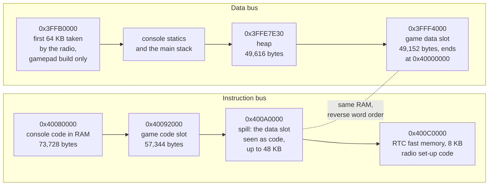
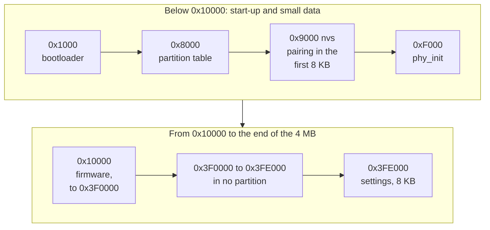

# Hardware

PocketMe's prototype runs on a cheap ESP32 development board with a
built-in screen, a touch layer and a microSD slot. It has no external
RAM and only two buttons, so most of the design comes from fitting a
console, a Bluetooth gamepad host and a game into 520 KB of RAM. This
page describes the board, where the memory and flash go, and how each
input and the card are used.

- [The board](#the-board)
- [Pins and buses](#pins-and-buses)
- [Memory](#memory)
- [Flash](#flash)
- [The gamepad over classic Bluetooth](#the-gamepad-over-classic-bluetooth)
- [Touch and the BOOT button](#touch-and-the-boot-button)
- [The microSD card](#the-microsd-card)
- [The debug link](#the-debug-link)
- [Where this comes from](#where-this-comes-from)


## The board

The board is the ESP32-2432S028, often called the "Cheap Yellow
Display" or CYD. The firmware for it is `pocketme-cyd` in
[boards/cyd](../boards/cyd/README.md).

| Part | What it is | Notes from the sources |
|---|---|---|
| Chip | classic ESP32, revision 3.1 | two Xtensa cores, run at 240 MHz |
| Flash | 4 MB, on an SPI bus (a four-wire serial bus) | read at 80 MHz in DIO mode (two data lines) since 2026-11-22 |
| RAM | 520 KB inside the chip | no PSRAM (external RAM chip) |
| Screen | ST7789 panel, 320x240 | refreshes about 58.7 times a second (measured on the board); no tearing-effect pin wired on this board |
| Touch | XPT2046, a resistive touch controller (it reads pressure through two layers, not a finger's charge) | one reading takes about 1.6 ms (1,621 us average, 2,217 us at most, measured on the board) |
| Card | microSD slot | read only in this firmware |
| Buttons | BOOT (GPIO0) and RESET | BOOT is the only button the console can read; RESET restarts the chip |
| Backlight | one pin, dimmed by the chip's LED PWM unit (LEDC, a timer that switches a pin on and off fast) | five brightness steps in the console |

The two cores have separate jobs in the default build. The first core
runs the console, the game and the radio. The second core only sends
each finished picture to the panel. Every wait for the second core ends
after 500 ms with a panic that says so.

Code that runs from flash and misses the chip's cache waits for a
flash read, so the flash clock matters. At 80 MHz the board showed
console steps about 0.5 ms shorter, and loading the settings took
3,750 us against 5,012 us at 40 MHz (measured 2026-11-19 and
2026-11-22).

The backlight switches at 19,531 Hz with 4,096 duty steps; the
console's dimmest value is 257 of them (6.3 %). Power draw was never
measured; there was no meter.

## Pins and buses

All pins are set in `boards/cyd/src/main.rs`. Both of the chip's free
hardware SPI units are taken (one by the panel, one by the card), so
the touch controller is driven by toggling pins in software.

| Part | Bus | Pins | Speed |
|---|---|---|---|
| Serial port (log and debug link) | UART0 | RX GPIO3, TX GPIO1 | 115,200 baud |
| Panel | SPI2 with DMA (the chip copies memory to the bus by itself) | SCK GPIO14, MOSI GPIO13, MISO GPIO12, CS GPIO15, DC GPIO2 | drawing at 80 MHz, 40 MHz if a read-back check fails; reading the panel at 4 MHz (8 MHz gave wrong red bits) |
| Backlight | LEDC, low-speed timer 0 | GPIO21 | 19,531 Hz |
| Touch | software (pins toggled by hand) | CLK GPIO25, MOSI GPIO32, MISO GPIO39, CS GPIO33, IRQ GPIO36 | |
| microSD | SPI3 | SCK GPIO18, MOSI GPIO23, MISO GPIO19, CS GPIO5 | 400 kHz to wake the card, then 20 MHz |
| BOOT button | input with pull-up | GPIO0 | |

The panel is read as well as written: the firmware asks it for the line
it is drawing (the Get Scanline command) and times each send around
that line, because the board has no tearing-effect pin. How that works
is in [display.md](display.md).

## Memory

### Two buses, two kinds of RAM

The ESP32 runs code only from addresses on its instruction bus, and
reads data from addresses on its data bus. Some RAM is visible on only
one bus, and one block is visible on both.

- **Instruction RAM** (from 0x40080000) holds code. It can only be read
  and written as whole, aligned 32-bit words. A byte read there stops
  the program; this was seen on the board.
- **Data RAM** holds variables, constants, the stack and the heap. Any
  size of read works.
- **SRAM1**, 128 KB, is data RAM at 0x3FFE0000..0x40000000 and the same
  RAM again on the instruction bus at 0x400A0000..0x400C0000, in
  reverse word order. The formula comes from ESP-IDF and was checked on
  the board on 2026-11-22; the firmware checks it again at every start
  (1,919 us) and turns the feature that relies on it off if it is wrong.
- **RTC fast memory** is 8 KB of executable RAM at 0x400C0000. Only the
  first core can run code from it.

What this means for games: a game is two pieces. Its machine code goes
into a code slot in instruction RAM. Its constants, strings and
variables go into a data slot in data RAM, because a byte read from
the code slot would stop the chip. The loader copies the code slot word
by word.

### The map

The slot, spill and heap addresses below are written once, in
`game_api::layout` ([crates/game-api](../crates/game-api/README.md));
the linker scripts are generated from it.



| Region | Address | Size | Kind |
|---|---|---|---|
| Console code in instruction RAM | 0x40080000 | 73,728 bytes | designed |
| Game code slot | 0x40092000 | 57,344 bytes (56 KB) | designed |
| Game data slot | 0x3FFF4000 | 49,152 bytes (48 KB) | designed |
| Spill (code past the code slot) | 0x400A0000 | at most 48 KB, shared with the data slot | designed |
| Heap | 0x3FFE7E30 | 49,616 bytes | designed |
| Console struct, a static | | 45,176 bytes | built size, firmware built on 2026-11-23 |
| Gamepad host on the heap | | 19,704 bytes | built size, firmware built on 2026-11-23 |
| Radio's own share of the heap | | 19,580 bytes | measured on the board (2026-11-17) |
| Least free heap, gamepad build | | 10,292 to 10,364 bytes | measured on the board, builds of 2026-11-17 and 2026-11-18 |
| Radio's private data RAM | 0x3FFB0000 | first 64 KB | gamepad build only |

The code slot was 64 KB until 2026-11-17 and shrank to 56 KB because
the radio's dual-mode controller needs its own RAM code. The data slot
was fixed at 48 KB, ending at SRAM1's end, on 2026-11-19. The cache area
of the second core at 0x40078000 is not used.

### The spill

Most games use far less data than code. A game's code may run on past
the code slot into the top of the data slot, seen from the instruction
bus. Code fills the data slot from the top down; constants and
variables fill it from the bottom up. The one rule is:

> code past the slot + constants + starting values + zeroed ≤ 48 KB,
> and all code ≤ 106,496 bytes

Three games use it, measured as built sizes:

| Game | Bytes past the code slot |
|---|---|
| DRIVE3D | 4,252 |
| PROTO3D | 15,824 |
| MERCATOR | 18,628 |

### Instruction RAM with the gamepad

The radio's libraries made instruction RAM the tightest resource. In
the build with the gamepad (from the linker map):

| Part | Bytes |
|---|---|
| Interrupt vectors | 1,024 |
| RAM code of esp-hal, esp-rtos, esp-radio, flash routines, scanline read | 24,076 |
| Bluetooth controller library (about 33,100) and the rest of the radio's set-up library (7,000) | 40,368 |
| Radio set-up code moved to RTC fast memory | 7,636 (not counted here) |
| **Left below the game code slot** | **8,260** |

That table is the one-core build. With two cores, 56 bytes more must run
from RAM and 8,204 bytes are left. Without the gamepad, 52,608 bytes
are left.

### The stack

The main stack is whatever data RAM is left after the statics, so it
changes with the build. Measured on the board, builds of 2026-11-17 (by
painting the stack and looking how much was overwritten):

| Build | Stack size | Deepest use seen |
|---|---|---|
| one core, no gamepad | 117,624 bytes | 12,912 bytes |
| one core, with gamepad | 38,092 bytes | 18,560 bytes |
| two cores, with gamepad | 29,376 bytes | 16,528 bytes |
| second core's own stack | 8,192 bytes | 1,712 bytes |

Later builds differ a little: the figures the game build's stack
limits use (and the other pages quote) are a 29,200-byte main stack
with 16,752 bytes used by the console before a game runs.

Large values never go on the stack. The console is a static that must
be all zero bytes (so it costs no flash), and the gamepad host is
copied onto the heap once and never moved. Nothing else in the firmware
allocates; the heap exists for the radio and the host.

## Flash

### Partitions

From [boards/cyd/partitions.csv](../boards/cyd/partitions.csv). The
flashing tool writes the bootloader at 0x1000, this table at 0x8000
and the program at 0x10000.

| Name | Type | Offset | Size | Use |
|---|---|---|---|---|
| nvs | data, nvs | 0x9000 | 0x6000 (24 KB) | the first 8 KB hold the saved gamepad pairing |
| phy_init | data, phy | 0xF000 | 0x1000 (4 KB) | the flashing tool's default |
| factory | app | 0x10000 | 0x3E0000 (4,063,232 bytes) | the firmware |
| settings | data, undefined (user type) | 0x3FE000 | 0x2000 (8 KB) | the console's saved settings |



The firmware image of the build with the gamepad and the game flash
parts, built on the PC on 2026-11-22 with MERCATOR's first flash part,
was 1,845,952 bytes (45.43 % of the app partition), and 1,675,632
bytes (41.24 %) without the flash parts. A game may keep part of its
code and constants in two reserved windows of the firmware's own flash
(128 KB of code at 0x400D0020, 64 KB of read-only data at 0x3F400120);
only MERCATOR does. The console never writes, erases or remaps that
flash.

### The settings area: the only place the console writes

The firmware has exactly two ways to the flash. One reads the pairing.
The other is the settings store, and every write and erase it makes is
checked to lie in 0x3FE000..0x400000, twice (by the store and again by
the firmware's own flash wrapper). A write or erase runs with interrupts off.

The store ([crates/settings-store](../crates/settings-store/README.md))
keeps 16-byte records in two 4 KB sectors and survives a power cut at
any moment. Measured on the board on 2026-11-17, with the flash at
40 MHz:

| | Time |
|---|---|
| one record write | 36 us average, 118 us at most |
| a whole save | 122 us average |
| a sector erase (once every 256 saves) | 29.0 ms |
| reading the settings at start (with the pairing area's CRC) | 4,976 us |

It holds the brightness and, in builds with the boot animation, the
BOOT ANIM choice (FULL, SHORT or OFF).

### The pairing area: never written, never read out

The saved gamepad pairing lives in the first two 4 KB sectors of `nvs`
(0x9000..0xB000), written by a separate test firmware
([crates/pad-store](../crates/pad-store/README.md)). It holds up to four
pads. The link keys are stored as plain bytes, not encrypted.

The console only reads this area, and only at start. Its reader has no
write or erase method. It prints the area's CRC-32 to the log at every
start and never the bytes, so the log shows the area is unchanged
without exposing a key. The project's rules forbid erasing the whole
flash or reading this area back to a PC.

## The gamepad over classic Bluetooth


### Classic, not Low Energy

Bluetooth comes in two kinds: classic
Bluetooth (BR/EDR) and Bluetooth Low Energy (LE). A gamepad sends its
buttons with HID, the protocol for keyboards and gamepads, over one of
the two. The ESP32's controller can run both at once (dual mode).

The pad the project was built around, a GuliKit KingKong 2 Pro, speaks
classic only: no LE was seen from it in a scanner. The Rust Bluetooth
stack available for the chip was LE only. The choice was to patch the radio driver (esp-radio 1.0.0-beta.1) to
start the controller in dual mode and to write a small classic host in
Rust from the Bluetooth specification. The patched driver is kept in
the repository with a list of every change. Dual mode cost 10.5 KB more
instruction RAM, 46 KB more flash code, 0.5 KB of static RAM and 3.8 KB
of heap compared with LE only
([experiments/bt-classic-probe](../experiments/bt-classic-probe/README.md)).

### Four crates

| Crate | Job |
|---|---|
| [pad-proto](../crates/pad-proto) | the classic host itself, no heap: HCI (the packets between host and controller), ACL, L2CAP, SDP and HID |
| [pad-view](../crates/pad-view/README.md) | turns HID reports into buttons, sticks and motion for four GuliKit modes (XInput, DInput, Android/iOS, Switch) and generic HID |
| [pad-store](../crates/pad-store/README.md) | reads the saved pairings from flash |
| [pad-host](../crates/pad-host) | ties the three together for the console; always reconnect-only |

### Reconnect-only, in two layers

The console firmware never searches for devices, is never
discoverable, never starts a connection and never pairs. It only keeps
page scan on, which lets a pad that was paired before call in. Two
independent layers enforce this:


1. `Config::reconnect_only` in pad-proto refuses the forbidden actions
   inside the host.
2. The `Gate` in [boards/cyd/hci-rules](../boards/cyd/hci-rules) checks
   every packet sent to the controller against an allow-list. It never
   lets through inquiry, Create Connection, any "yes" to a pairing,
   inquiry scan, or anything Low Energy.

Logs print at most the last two bytes of a device address, and tests
fail if a key or full address reaches any output.

### Pairing

Pairing is done by a separate test firmware,
[experiments/bt-gamepad-test](../experiments/bt-gamepad-test/README.md).
It is the only firmware that searches, pairs (Secure Simple Pairing,
"just works") and saves keys; a normal build is flashed afterwards.
Pairing from the console's own menu is not built.

### What the radio costs

The build with the gamepad against the same build without it, in a
board round of 2026-11-17 (times measured on the board, RAM and flash
sizes from the linker):

| | Without gamepad | With gamepad |
|---|---|---|
| Instruction RAM left below the code slot | 52,608 bytes | 8,260 bytes |
| Data RAM taken by the radio for itself | 0 | first 64 KB |
| Heap used by host and radio | 0 | 19,640 + 19,580 bytes |
| Console loop starts after the clock started | 573 ms | 1,061 to 1,069 ms |
| Flash code added | | 323,040 bytes |
| Flash constants added | | 60,804 bytes |

The radio starts in 374 to 391 ms and reading the pairings takes 8.8 to
9.0 ms. While waiting for a pad, page scan opens an 11.25 ms window
every 1.28 s. With a pad sending 100 reports a second, a game's step
grew by about 300 to 640 us a frame (2 to 4 percent) and no window was
missed; that was measured on one core with an injected pad (reports
played through the real decoder over the serial cable).

### A pad switched off and on

The first board test with the real pad showed a problem: switched off,
the pad stayed "connected" for about 20 s, the controller's default
link supervision timeout (0x7D00 slots), and it could not come back
before that. Three changes followed:

- the host sets the link supervision timeout to the pad's own wish,
  kept between 1 and 5 s (the pad asks for 2 s), or 2 s without one;
- a silence guard: a pad in Switch mode that streams reports and then
  sends nothing for 1 s is treated as gone;
- a loop that did not look for over 250 ms restarts that count, so a
  long frame is never taken for a silent pad.

The expected result is a pad gone in about 1 s in Switch mode and up to
2 s in other modes. This was tested on the PC and with the injected pad
only. The test with the real pad is still open.

## Touch and the BOOT button

### Touch

The XPT2046 reports a position and a pressure. A filter
([crates/touch-filter](../crates/touch-filter/README.md)), tuned on 278
real touches, turns the readings into touches:

| Value | Meaning |
|---|---|
| `Z_ON` 300 / `Z_OFF` 180 | pressure to start a touch / to keep it |
| `HOLD_READS` 2 | light readings allowed inside a touch |
| `DEAD_PX` 3, `REST_READS` 3 | dead band for a resting finger |
| `CONFIRM_READS` 2 | firm readings outside the band before a resting finger moves |

On top of the filter, the console has three rules, decided on
2026-11-17: a touch missing for one frame is still the same touch; a
press held longer than 500 ms is not a tap; and a touch on a gliding
list stops it. The calibration (raw readings to screen pixels) is still
the first guess.

Touch can act as a second player. TUNDRA lets the touch screen be
player 2, SKIMMER lets it play one side, and CAMBER can be flown with
touch alone. ROOFTOP, DRIVE3D and PROTO3D need a gamepad. In the console's interface touch
is shared, not tied to a player.

### The BOOT button

BOOT is GPIO0, read as an input with a pull-up. In the console it
means OK: it starts the chosen game on the
home screen, skips the boot animation, and in a game opens the pause
menu (RESUME is preselected, so a second press resumes). With only one
button and a touch screen, a gamepad gives every game its full
controls. Nine of the eleven games also have touch controls of their
own (their READMEs say how far they go); ROOFTOP and the two
prototypes cannot be played without a gamepad.

## The microSD card

The firmware reads the card and never writes it: the block driver's
write always refuses. Names are FAT 8.3 (eight letters, a dot, three).
A game lives in its own folder:

```text
CONSOLE/GAMES/<NAME>/GAME.BIN
CONSOLE/GAMES/<NAME>/INFO.TXT
```

`<NAME>` is the game's folder name in capitals, at most eight letters.
Reading the home screen from the real card took 12,030 us, of which
7,887 us went to waking the card; the check for a card every two
seconds, with no card in, took 1,272 us (measured on the board).

The usual builds use a demo card instead: all fourteen programs (eleven
games, two prototypes and BENCH) are built into the firmware as a read-only card with the same folders (`demo-card`
feature). A build with `sd-card` reads the real card, and wins when both
are on. Games have not yet been loaded from a real card on the board;
the same loader path was tested with the demo card.

## The debug link

The serial port carries the log and, in builds with `link`, a framed
protocol to a PC tool, [tools/boardctl](../tools/boardctl/README.md).
Each frame starts with `FE DB` and ends with a CRC, with up to 1,024
bytes of payload, so it shares the wire with plain log lines at
115,200 baud ([crates/debug-link](../crates/debug-link/README.md)).
Through it the PC takes screenshots, presses buttons for up to four
players, taps the screen, reads counters and plays an injected gamepad.

## Where this comes from

- [boards/cyd/README.md](../boards/cyd/README.md)
- [boards/cyd/partitions.csv](../boards/cyd/partitions.csv)
- [boards/cyd/src/main.rs](../boards/cyd/src/main.rs)
- [boards/cyd/src/mem.rs](../boards/cyd/src/mem.rs)
- [boards/cyd/src/lcd.rs](../boards/cyd/src/lcd.rs)
- [boards/cyd/src/backlight.rs](../boards/cyd/src/backlight.rs)
- [boards/cyd/src/touch.rs](../boards/cyd/src/touch.rs)
- [boards/cyd/src/sd.rs](../boards/cyd/src/sd.rs)
- [boards/cyd/src/pairing.rs](../boards/cyd/src/pairing.rs)
- [boards/cyd/src/flash_store.rs](../boards/cyd/src/flash_store.rs)
- [boards/cyd/src/demo_card.rs](../boards/cyd/src/demo_card.rs)
- [boards/cyd/hci-rules/src/lib.rs](../boards/cyd/hci-rules/src/lib.rs)
- [crates/game-api/src/file.rs](../crates/game-api/src/file.rs)
- [crates/game-api/README.md](../crates/game-api/README.md)
- [games/chip/game.x](../games/chip/game.x)
- [games/README.md](../games/README.md)
- [crates/console-core/README.md](../crates/console-core/README.md)
- [crates/pad-proto/src/lib.rs](../crates/pad-proto/src/lib.rs)
- [crates/pad-host/src/lib.rs](../crates/pad-host/src/lib.rs)
- [crates/pad-view/README.md](../crates/pad-view/README.md)
- [crates/pad-store/README.md](../crates/pad-store/README.md)
- [crates/touch-filter/README.md](../crates/touch-filter/README.md)
- [crates/settings-store/README.md](../crates/settings-store/README.md)
- [crates/debug-link/README.md](../crates/debug-link/README.md)
- [experiments/bt-classic-probe/README.md](../experiments/bt-classic-probe/README.md)
- [experiments/bt-gamepad-test/README.md](../experiments/bt-gamepad-test/README.md)
- [experiments/native-loader/README.md](../experiments/native-loader/README.md)
- [decisions.md](decisions.md)
