# The making of the games

PocketMe has fourteen programs on its home screen: eleven games (STARDUST,
a toy, and PADTEST, an input test, among them), two prototypes and BENCH,
a speed test, all built and
loaded the same way. This page goes through them one by one: what each one is,
how it was made, which choices were taken, what was cut or is limited,
and what it costs on the chip. It ends with what the games, taken
together, showed about the console's limits.

- [What every game shares](#what-every-game-shares)
- 3D games: [CAMBER](#camber), [MERCATOR](#mercator),
  [KESTREL](#kestrel), [LANTERN](#lantern)
- 3D prototypes: [DRIVE3D](#drive3d), [PROTO3D](#proto3d)
- 2D games: [HAIRPIN](#hairpin), [ROOFTOP](#rooftop),
  [LANDER](#lander), [SKIMMER](#skimmer), [TUNDRA](#tundra),
  [STARDUST](#stardust)
- Speed and input tests: [BENCH](#bench), [PADTEST](#padtest)
- [What the games showed about the console](#what-the-games-showed-about-the-console)
- [Where this comes from](#where-this-comes-from)

## What every game shares

Every game is one small Rust library with no heap, no floating point and
no `unsafe`, depending only on the console's game kit and, for 3D, the
shared library `game-3d`. The same source is linked into the PC
simulator and built as a separate game file for the chip. The general
rules are in [games.md](games.md) and
[games/README.md](../games/README.md). Four words come back below:

- **The slots.** A game file is copied into two fixed places in RAM: a
  code slot of 56 KB (57,344 bytes) in the chip's instruction RAM and a
  data slot of 48 KB (49,152 bytes). Together that is 106,496 bytes.
  "Room left" in the tables below counts what is free in both.
- **The spill.** A game whose code is longer than 56 KB may run on into
  the top of the data slot, which is the same memory seen from the
  instruction bus. Code there, plus the game's data, must fit in 48 KB.
  Three games use it: MERCATOR, PROTO3D and DRIVE3D.
- **The flash part.** MERCATOR alone keeps part of its code and constants
  in two reserved windows of the firmware's own flash (128 KB for code,
  64 KB for read-only data). A new build of that game needs a new
  firmware, because the firmware starts it only when it holds the same
  part byte for byte.
- **The step.** The console calls the game once per picture. The game
  draws a 160x120 picture, one byte per pixel; the console sends only
  the changed parts, in at most 16 rectangles. The screen refreshes
  about 58.7 times a second (measured on the board, 2026-11-17). The
  chip's second core sends one picture while the first draws the next.

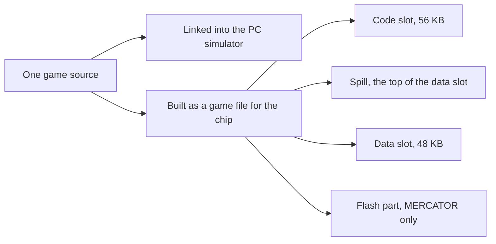

The 3D games share one way of drawing, written in whole numbers:
objects outside the view are dropped by a bounding ball, corners are
turned with one matrix, faces that point away are dropped, polygons are
cut against the view in 3D, projected to 1/16 of a pixel, sorted far to
near and filled. There is no depth buffer: what is drawn last is in
front (the painter's order). Lengths are kept in 1/256 m and angles in
1/65536 of a turn ([crates/game-3d/README.md](../crates/game-3d/README.md)).

Sizes below are built sizes, measured on the PC on 2026-11-23. Board
numbers carry their date. The target is 30 pictures a second; MAX, the
top detail level of PROTO3D and DRIVE3D, is sized for an average of 24
a second (41.67 ms), an average and not a ceiling ([decisions.md](decisions.md)).

## CAMBER

CAMBER is an anti-gravity racer for one player against seven rivals. You
fly a hover ship round three tracks. Its own idea is the carve: holding a
shoulder button tilts the ship into a hard turn that heats its vanes, and
letting go pays the heat back as a burst of speed, the "sling". It plays
with the gamepad, and touch alone can fly a race.

**How it is made.**

- The track is a real mesh in 8 m segments, baked while the game is
  compiled. Each segment's edges are projected once, and the polygons on
  both sides share those corners, so no crack can open between them.
  Where two neighbouring segments cut their shared edge at different
  points, each road strip goes through every point either one uses, for
  about 2 more triangles a picture (measured on the PC).
- Segments are painted far to near, and each ship is drawn in the
  segment under its tail, so the painter's order holds without a depth
  buffer. Four haze steps darken the far track.
- The race runs in fixed ticks of 1/60 s, so the 30 and the 60 setting
  run the same race.
- The rivals were rebuilt on 2026-11-22 against three recorded races by
  the author. Three "front" rivals fly a ship equal to yours; four "pack"
  rivals are 5.5 to 10.2 % slower. They carve by your rules.

**Choices.**

- The sling's reward has three steps: 123 % of top speed for 1.5 s,
  134 % for 2.25 s, 146 % for 3.25 s. This row was chosen on the board
  on 2026-11-22 out of four. At the middle speed class a scripted
  carver's best lap with it was 11.2 % faster than the same pilot's
  without carving (measured on the PC).
- Classes: STEADY 58 m/s, BRISK 72 m/s (default), WILD 86 m/s. CATCH-UP
  is LIGHT by default (at most 2.0 %) or OFF.
- Roads were made 10 % wider at the author's wish (2026-11-21).
- Defaults: DETAIL HIGH, RATE 60, VIEW CHASE.
- CAMBER is the only game built with overflow checks off (the author's
  decision, 2026-11-19). That saved 9,488 bytes of code and 5,776 of data
  (counted on the chip build, 2026-11-19). On the board, before the
  shared library existed, a step took 17,871 µs with the checks and
  10,418 µs without.

**Limits.** Only 3,520 bytes of the code slot are left (2026-11-23). The
title screen's live backdrop took most of the 10,392 there were the day
before. At HIGH a picture has 462 triangles on average and 662 at worst
(measured on the PC).

| What | Value |
|---|---|
| Code | 53,824 bytes |
| Data | 19,540 bytes |
| Room left | 33,132 bytes |
| On the board | at the 60 setting and HIGH detail: 59.7 pictures a second over 8 s of thrust, 58.9 over 20 s of driving, which is the panel's own limit (2026-11-23); at 30: 10.92 ms a step standing, 10.30 ms over 8 s of thrust (2026-11-22) |
| Detail levels | LOW (16 segments), MID (24), HIGH (32, default) |

More: [games/camber/README.md](../games/camber/README.md)

  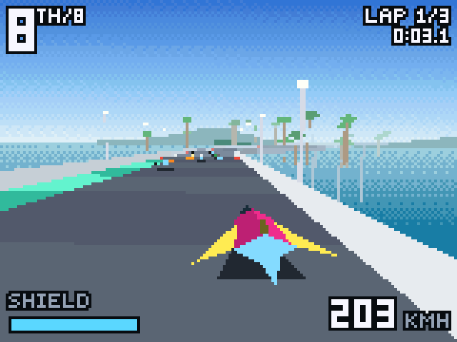 
  <em>R held carves the ship through a long right bend while the heat marks beside the shield light up; let go, the sling pushes it past a rival on the next straight.</em>

## MERCATOR

MERCATOR is a space trading game. You fly a small ship through the Lens,
a galaxy of 136 star systems, buy goods where they are made and sell
them where they are wanted. The aim is the Mapmakers' charter: survey 20
systems and dock with 50,000 credits. Raiders hunt you in dangerous
systems. A second player on a second gamepad can be the gunner in a
turret. Since 2026-11-23 you can also fly down to a planet's landing
site, land by hand, walk out, cut goods from its seams and lift off
before a storm.

**How it is made.**

- Nothing about the galaxy is stored. The title offers ten galaxies, and
  each, with its 136 systems, comes from one seed number.
- Every ship, station, sun and planet is flat-shaded 3D in true
  perspective. The polygon code is KESTREL's, copied and trimmed: it is
  MERCATOR's own copy, not the shared `game-3d`.
- MERCATOR is the only game with a flash part. Its `flash.list` names
  the code that runs every picture (it stays in RAM, with all it calls),
  the code that runs only on an event such as docking or a jump (it may
  go to flash), and functions that stay in RAM whatever happens. A
  script splits the game by those lines. The first split moved 84
  functions and 167 constants; today 142 functions and 630 constant
  sections are in flash.

**Choices.**

- Risk pays: a buy in a LAWLESS system pays about twice a run between
  two SECURE systems. A LAWLESS station does not pay bounties.
- Ships were scaled up: fighters are drawn 3 times their former size,
  your own ship 6 times, and the station is about 2.15 km across its
  wings. Other ships are drawn in true perspective at every distance.
- Effects, traffic, extra hulls and rocks each have a switch in the
  code, to free time or bytes.
- It starts at DETAIL HIGH in the CHASE view at 60 pictures a second
  (the author's decision, 2026-11-23; MID and the cockpit before). The
  same day the chase view's space dust was moved from around the ship
  to around the camera, 420 m behind it, so that it passes as fast as
  the cockpit's: at 300 m/s a speck moved 0.35 pixels a step in the old
  chase view against 2.20 in the cockpit, and 2.25 after the change
  (measured on the PC).
- The planet's site clock is 240, 225, 210 or 195 s by danger. In a
  scripted test a landing brought home 316 to 390 credits on average,
  against about 530 for a trade jump (on the PC; it measures the rules,
  not how hard a landing is for a person).

**Limits.** MERCATOR has the least room of any game: 2,816 bytes in the
slots, and 844 bytes of code left in its flash part (81,076 of 81,920).
The planet's inner loops ran at half speed from flash, so 19 of them
were moved back to RAM (about 11,400 bytes), and the docked screens went
to flash to pay for it. Before it had a flash part it was down to 660
bytes of room. Its README says nobody has played the planet on the
board, while the firmware README says the planet's whole visit was
timed there at LOW, MID and HIGH at 30 pictures a second (2026-11-23);
those numbers are kept outside the repository.

| What | Value |
|---|---|
| Code | 75,972 bytes, 18,628 past the code slot |
| Data | 27,708 bytes |
| Room left | 2,816 bytes |
| Flash part | code 81,076 of 81,920 bytes, constants 25,732 of 32,768 |
| On the board | 59.99 pictures a second in flight, worst step 7.86 ms (2026-11-22); at the starting settings (HIGH, CHASE, 60) 59.99 in flight, 4.5 ms a step on average (2026-11-23); a fight not measured; the planet timed at its three detail levels at 30, the planet's only rate (numbers kept outside the repository) |
| Detail levels | LOW, MID, HIGH (default); 30 or 60 (default) pictures a second |

More: [games/mercator/README.md](../games/mercator/README.md)

  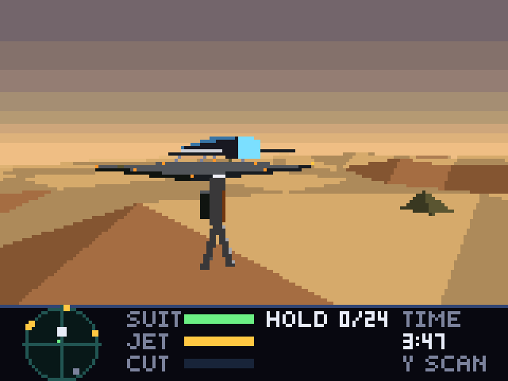 
  <em>The pilot walks across the landing site back to the ship.</em>

## KESTREL

KESTREL is a courier flight down a drifting belt of rock and old wrecks.
You fly through every beacon gate, each of which adds time to the
clock, and dock at HALDEN station before the clock runs out, in three
missions of 8, 10 and 12 gates. A barrel roll moves the craft aside
faster than steering. It plays with the gamepad, and the tests fly all three
missions with touch alone. It uses the shared 3D library.

**How it is made.**

- The course is not stored. Rocks and gates come from a hash of each
  10 m slice of the course.
- The camera never turns, so the backdrop never moves and the palette is
  set once.
- Models are small: the craft has 48 faces, a gate 64.
- Triangle budgets are 160, 240 and 320 for the three detail levels.

**Choices.**

- LOW draws a 128x80 view to 65 m; MID 160x96 to 90 m; HIGH reaches
  120 m. The game starts at HIGH and 60 pictures a second (the author's
  decision, 2026-11-23; LOW and 30 before).
- At LOW a gate is no longer drawn when it is closer than 2.2 times its
  size, because a ring that fills the view would send almost the whole
  view.

**Limits.** On the board it was measured at HIGH only (2026-11-18 and
2026-11-23, the table below); the other board numbers in its README are estimates made
before that. CAMBER's README quotes KESTREL's board steps as 6.1, 7.0 and
8.0 ms at LOW, MID and HIGH (no date given).

| What | Value |
|---|---|
| Code | 40,868 bytes |
| Data | 20,796 bytes |
| Room left | 44,832 bytes |
| On the board | HIGH at the 60 setting: 59.5 pictures a second on one core, 59.8 on two (2026-11-18); 59.99 on two over 11 s of mission 1 (2026-11-23) |
| Detail levels | LOW, MID, HIGH (default) |

More: [games/kestrel/README.md](../games/kestrel/README.md)

  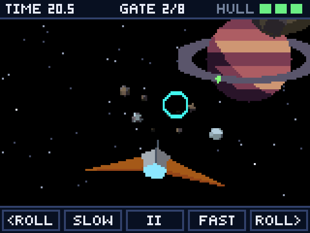 
  <em>The craft flies through gate 2 of mission 1 and on towards gate 3 among the rocks.</em>

## LANTERN

LANTERN is a first-person walk through an old mine by lamplight. You
pick up crystals, keep the lamp filled with oil, find the lift's crank
and ride the lift up, in levels of 12x12 to 32x32 cells. The lamp lights
7 cells when full and 2.5 when empty. Moths drink your oil, crawlers
bite, and the lamp's flash stops them for a while. It plays
with twin sticks on the gamepad, and with touch boxes for FLASH, MAP and
pause.

**How it is made.**

- The view is ray cast: for each column of the picture the game follows
  a line from the player across the grid, cell by cell, until it hits a
  wall. Positions are whole numbers with 12 bits after the point.
- 14 wall and floor textures of 32x32 pixels and 13 sprites are built while the
  game is compiled.
- The palette holds 28 materials in 8 shades each, plus 16 colours for
  text and boxes: 240 in all.
- Sprites are sorted against a list of wall depths, one per column.

**Choices.** LIGHT draws 120x80 with 60 rays, each two pixels wide.
NORMAL draws 160x104. HEAVY adds a textured floor. The game starts at
HEAVY and 60 pictures a second (the author's decision, 2026-11-23;
LIGHT and 30 before).

**Limits.** Its frame rates were measured on the board (2026-11-18 and
2026-11-23, the table below); the times in its README are estimates made before that. Textures and maps make its data
the second largest of the set, after BENCH.

| What | Value |
|---|---|
| Code | 32,040 bytes |
| Data | 40,036 bytes |
| Room left | 34,420 bytes |
| On the board | level 4 at the 60 setting, two cores: LIGHT 60.0, HEAVY 59.8 pictures a second; one core 59.9 and 53.2 (2026-11-18); level 1 HEAVY on two cores: 58.7 turning on the spot, 60.0 walking (2026-11-23) |
| Detail levels | LIGHT, NORMAL, HEAVY (default) |

More: [games/lantern/README.md](../games/lantern/README.md)

  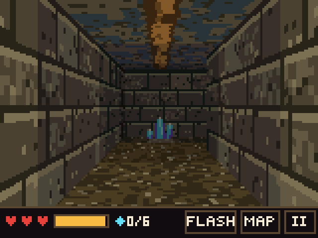 
  <em>A walk through lamplit tunnels: a crystal is picked up, then a wooden door slides open and the way goes on through it.</em>

## DRIVE3D

DRIVE3D is a prototype, not a finished game, and the name is a working
name. One rally car slides on gravel, grass and a ford along a 344 m
stretch of road on a height map, with a hill, a crest that throws the
car, a drop and two corners. It is played with the gamepad only (the
author's rule, 2026-11-22); touch does nothing.

**How it is made.**

- The rules and the picture are kept apart. The picture reads the rules
  only through a small read-only interface, so the rules are tested
  without any picture.
- The land is drawn as 8 m cells near the camera and 16 m blocks
  farther out, in four haze steps, far to near.
- Dust puffs stay where the car threw them and fade in about half a
  second. In the ford each wheel pushes a flat sheet of water aside.
- The rules run at a fixed 30 steps a second, and the detail level
  changes only the picture.

**Choices.**

- Grass holds the car to 12 m/s, so the road is the best way through a
  corner (the author's rule, 2026-11-22).
- Four detail levels, starting at HIGH (MID before 2026-11-23). The land reaches 80, 144, 240 and
  352 m; things beside the road 32, 56, 112 and 192 m.

**Limits.** Its restart stack frame is 10,576 bytes, the second largest.
HIGH and MAX with the ford's spray have not been timed on the board.

| What | Value |
|---|---|
| Code | 61,596 bytes, 4,252 past the code slot |
| Data | 36,892 bytes |
| Room left | 8,008 bytes |
| On the board | step average standing: LOW 6.58, MID 10.49, HIGH 17.21, MAX 26.36 ms; all held 29.99 to 30.09 pictures a second (2026-11-22) |
| Detail levels | LOW, MID, HIGH (start), MAX |

More: [games/drive3d/README.md](../games/drive3d/README.md)

  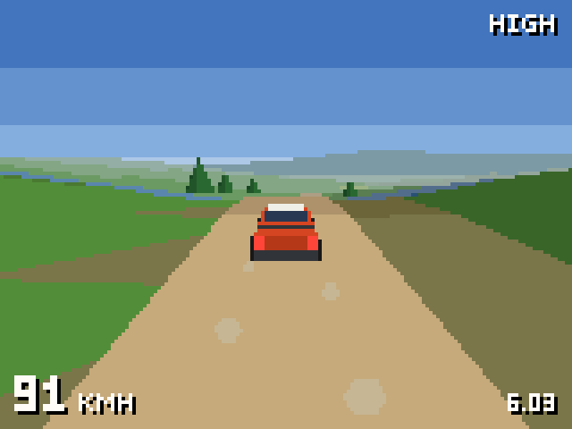 
  <em>Full throttle on gravel: over the crest, down the drop towards the river and through the ford, the wheels pushing the water aside.</em>

## PROTO3D

PROTO3D is a prototype of a 3D platformer on floating islands. It tries
out the movement, the follow camera and the 3D picture; it is not a
finished game. A small hero runs, jumps and lands in four test areas:
ISLAND (gold nuts to collect, and two kinds of creature), MACHINES (a
weight that works a bridge and a plank), SAIL (a glide against the
clock) and STONE (a slab you carry and raise as your own step). It is
played with the gamepad; taps work only in the AREAS menu.

**How it is made.**

- Models are made while the game is compiled.
- Draw order: far islets, floors, then the rest far to near. Blocks and
  the hero's body are boxes, and what lies behind a plane between two
  boxes is drawn first, so a wall behind the hero never covers the hero.
- A cost model, 0.48 + 0.01473 T + 0.000291 P ms, where T is triangles
  and P is pixels, estimates each view's time on the PC. It is an
  estimate, not checked on the board.
- The state's small fields are kept in its first 512 bytes. When they
  moved past byte 511 the code grew by about 850 bytes, because the chip
  reaches near fields with shorter instructions.

**Choices.**

- Four detail levels, HIGH at the start (MID before 2026-11-23).
- A meadow of grass over the ground was tried and dropped: the author
  found it too busy (2026-11-22). The three-tier trees and the grass
  hanging over edges stayed.
- The game must keep at least 4,000 bytes of room. Flower patches left
  3,348 and a light meadow 1,960 (measured on chip builds, 2026-11-22),
  so neither went in.

**Limits.** Its restart stack frame, 13,792 bytes, is the largest of any
game, against a limit of 16,384. Only ISLAND was measured on the board;
MACHINES, SAIL and STONE were not.

| What | Value |
|---|---|
| Code | 73,168 bytes, 15,824 past the code slot |
| Data | 28,428 bytes |
| Room left | 4,900 bytes |
| On the board | ISLAND, step average: LOW 7.22, MID 11.41, HIGH 18.24, MAX 23.74 ms; 29.99 to 30.01 pictures a second, one view 29.63 (2026-11-22) |
| Detail levels | LOW, MID, HIGH (start), MAX |

More: [games/proto3d/README.md](../games/proto3d/README.md)

  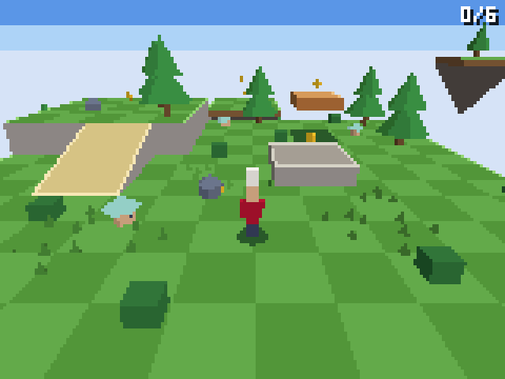 
  <em>ISLAND: the hero runs and jumps across the island and onto a floating islet, taking three of the six pickups; the camera follows.</em>

## HAIRPIN

HAIRPIN is a kart race on a road drawn the old arcade way: not real 3D,
but rows of the screen filled between the ends of road segments (a
"pseudo-3D" road). You race four rivals on three courses with a battery
and a boost. It plays with the gamepad or with touch alone (BRAKE and
BOOST boxes).

**How it is made.** The road is made of segments of 200 units, each with
a bend and a height, worked out from short section lists instead of a
big table. Trees, posts and signs are flat pictures (sprites) standing
beside the road, drawn back to front. The palette has three steps of
evening haze for the far road.

**Choices.** LIGHT draws 112x66 in a frame. NORMAL draws 160x90 and
HEAVY 160x110. Stripes that run towards you give the strongest feeling
of speed but cost most of the send, so LIGHT draws none. The game
starts at HEAVY and 60 pictures a second (the author's decision,
2026-11-23; LIGHT and 30 before).

**Limits.** At HEAVY it reached 45.7 pictures a second on one core and
58.7 on two (measured on the board, 2026-11-18), one of the numbers
behind the choice of two cores; the firmware README has the table.

| What | Value |
|---|---|
| Code | 37,604 bytes |
| Data | 12,484 bytes |
| Room left | 56,408 bytes |
| On the board | 60 setting, two cores: NORMAL 59.7, HEAVY 58.7 pictures a second (2026-11-18); HEAVY again 58.9 over about 21 s of a race (2026-11-23) |
| Detail levels | LIGHT, NORMAL, HEAVY (default) |

More: [games/hairpin/README.md](../games/hairpin/README.md)

  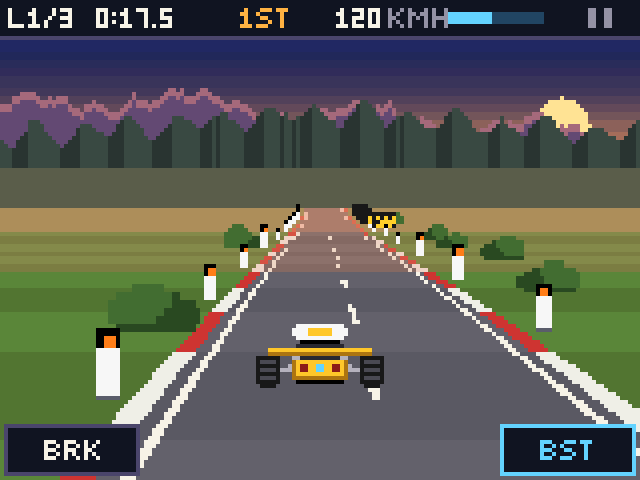 
  <em>A left bend in 1st place on lap 1: the kart brakes on the straight before it, takes the bend past the chevron boards and comes out on the straight after it.</em>

## ROOFTOP

ROOFTOP is a precision platformer for one player. A night courier
crosses eight rooms of roofs with a run, a jump, a wall slide and one
dash in the air. Broken glass sends the courier back to the start of the
room; there are no lives, and the end screen counts time and retries. It
plays with the gamepad; touch works in the menus.

**How it is made.** A jump still works 6 ticks after leaving an edge,
and a press just before landing is kept. A scripted full run is 1,456
ticks (24.26 s) on the PC.

**Choices.** The wide rooms' view follows in half-screen steps (STEP,
the default, calm) or every pixel (SMOOTH, heavy). RATE is 60 by
default (since 2026-11-23) or 30. A one-screen room changes at most 339 pixels a picture;
room 7 in SMOOTH at 60 is the heaviest case.

**Limits.** Nothing is saved. On the board only room 1 with STEP has
been measured; the wide rooms and SMOOTH have not.

| What | Value |
|---|---|
| Code | 19,460 bytes |
| Data | 8,556 bytes |
| Room left | 78,480 bytes |
| On the board | room 1, STEP, 60: 59.99 pictures a second, 4.6 ms a step on average (2026-11-23, one scripted run) |
| Detail levels | none; SCROLL STEP or SMOOTH, RATE 30 or 60 |

More: [games/rooftop/README.md](../games/rooftop/README.md)

  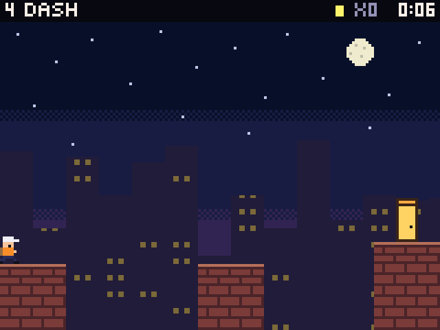 
  <em>Rooms 4 (DASH) and 5 (UPDRAFT) played through: the courier runs, jumps, dashes and rides an updraft between roofs to each room's door.</em>

## LANDER

LANDER is a moon lander for one player: turn the craft, fire its engine
and set it down on a pad slowly and upright before the fuel runs out.
Each landing calls up a harder level (the title can start at any of the
first 20), and there are three craft. It is also a test of the console: it uses
analog triggers and sticks, motion (STEER TILT leans the craft as the
pad tilts), touch, and the requests for frame rate and screen hints.

**How it is made.** Each level's ground comes from a random number maker
seeded with the level number, so nothing is stored. Positions have 16
bits after the point. The craft is a 9x9 picture, turned by looking up,
for each target pixel, where it came from.

**Choices.** VIEW STILL (default) keeps the camera still, so few pixels
change; FOLLOW moves the whole ground and is the heavy case. The game
tells the console which one it is (MOSTLY_STILL or SCROLLS) and asks for
ON_DEMAND when nothing moves, so the console calls it only on input.

**Limits.** The heaviest picture sends 13,988 pixels, 73 % of the
picture (on the PC). On the board only a level-1 flight in STILL has
been measured; FOLLOW has not.

| What | Value |
|---|---|
| Code | 28,512 bytes |
| Data | 9,572 bytes |
| Room left | 68,412 bytes |
| On the board | level 1, STILL, 60: 59.99 pictures a second, 4.2 ms a step on average (2026-11-23, one scripted run) |
| Detail levels | none; VIEW STILL or FOLLOW, RATE 30 or 60 |

More: [games/lander/README.md](../games/lander/README.md)

  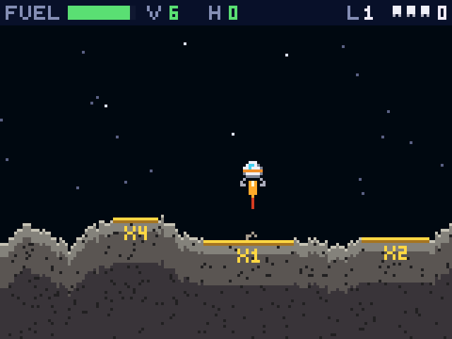 
  <em>The craft lowers itself onto the X1 pad with a short burn and then a low steady one, and touches down softly: LANDED, SOFT TOUCH +25, 158 points.</em>

## SKIMMER

SKIMMER is top-down air hockey for 1 to 4 players, one mallet a side or
two a side. Players nobody holds are the computer. Touch can play one
side.

**How it is made.** The puck moves in sub-steps of at most 1.5 pixels,
so it never passes through a mallet or a rail at any speed or frame
rate. A computer mallet hits a puck that lies against a rail from the
nearest spot it can reach, so the puck comes off at an angle; without
that rule two computers could pass the puck along a rail for ever.

**Choices.** Each side is AUTO by default: a pad when one is connected,
otherwise touch or the computer. The computer is EASY, NORMAL (default)
or HARD. A
match is first to 5, 7 (default) or 11, or TIMED with a golden goal.
TABLE PLAIN or WILD adds two bumpers. The default rate is 60.

**Limits.** On the board only one match against the computer has been
measured; four players and the WILD table have not.

| What | Value |
|---|---|
| Code | 35,308 bytes |
| Data | 7,620 bytes |
| Room left | 63,568 bytes |
| On the board | a match against the computer at 60: 59.99 pictures a second counting the frames back to back (59.73 with its one pause of more than 0.1 s), 2.3 ms a step on average (2026-11-23, one scripted run) |
| Detail levels | none |

More: [games/skimmer/README.md](../games/skimmer/README.md)

  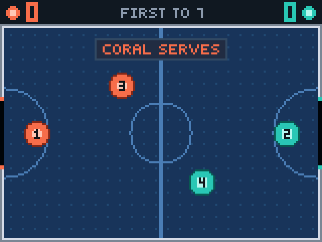 
  <em>Coral serves, the puck goes back and forth between four mallets, and teal scores.</em>

## TUNDRA

TUNDRA is top-down ice hockey for 1 to 4 players, and the console's
first multiplayer game. Each team has two skaters and a goalie; the
goalies and every skater nobody holds are the computer. Player 2 can be
AUTO, COMPUTER, TOUCH or a second gamepad, because on this board the
touch screen can stand in for a second player.

**How it is made.** The ice keeps marks from fast skating and checks,
the newest 160. Scripted minutes of play were replayed through the
firmware's model of the screen send on the PC: 30.00 pictures a second,
an estimate, since the model's drawing time is a guess.

**Choices.** A match is 2, 3 or 5 minutes or first to 5 goals. Overtime
is sudden death and capped at 3 minutes of game clock, after which the
match is a draw. ICE MARKS can be turned off.

**Limits.** How the touch screen feels for steering has not been
judged. The frame rate was measured on the board (the table below).

| What | Value |
|---|---|
| Code | 34,500 bytes |
| Data | 8,004 bytes |
| Room left | 63,992 bytes |
| On the board | two players, 60 setting: 59.77 pictures a second on one core, 59.99 on two (2026-11-18); one pad against the computer on two cores: 59.99 (2026-11-23) |
| Detail levels | none |

More: [games/tundra/README.md](../games/tundra/README.md)

  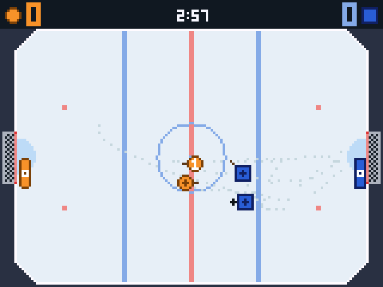 
  <em>A BLUE skater carries the puck over centre ice to the AMBER net, BLUE scores after a scramble in front of it (0 to 1), and the players line up for the next face-off.</em>

## STARDUST

STARDUST is a small toy, not a finished game: a comet catches stars,
and each star caught adds one to the count. You steer with the gamepad
or a finger on the screen (the comet flies towards it). It is here to
prove the game path: pixel art from small tables, the palette, input
and time.

**How it is made.** The stars twinkle by changing one palette colour.
The comet moves by the time that passed, so its speed does not depend
on the frame rate. Positions are in 1/256 of a pixel, and the stars
come from a fixed seed, so every run is the same.

**Choices.** It runs at the console's default rate, 30 pictures a
second.

**Limits.** It has no levels and no end besides START. It has the
smallest code of the set.

| What | Value |
|---|---|
| Code | 6,556 bytes |
| Data | 2,348 bytes |
| Room left | 97,592 bytes |
| On the board | 30.00 pictures a second over 10 s (2026-11-17) |
| Detail levels | none |

More: [games/stardust/README.md](../games/stardust/README.md)

  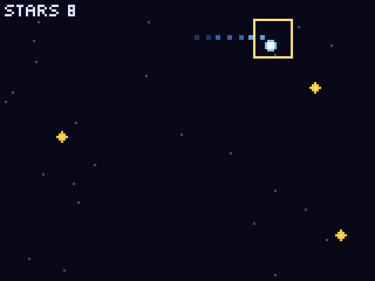 
  <em>The comet follows a touch from star to star across the sky.</em>

## BENCH

BENCH is a speed test, a measuring tool and not a game. It is built and
registered like a game, so it runs in the same slots. Its 13
tests cover fills, triangles, corners, whole scenes, sending, and two
3D scenes, CITY and ISLAND.

**How it is made.** A ramp raises the load until a step no longer fits
60 pictures a second, then 30, and reports the largest load that fits.
CITY draws buildings far to near, so the hidden work grows with the
load.

**Choices.** A reading next to the panel's own sweep (about 17,018 µs,
measured on the board) is labelled "near panel pace", because there the
panel, not the work, sets the rate: held steps read 58.83 to 58.86
pictures a second. An overloaded step (load 108) read 47.17.

**Limits.** BENCH's data, 48,836 bytes, fills its 49,152-byte slot
almost to the top. Its ISLAND test has a known seam-crack issue that
was not fixed in BENCH. The simulator cannot measure speed; only the
board can.

| What | Value |
|---|---|
| Code | 46,428 bytes |
| Data | 48,836 bytes |
| Room left | 11,232 bytes |
| On the board | fixed CITY 32 at the 60 setting held 60.01 pictures a second; CITY 128 took about 37 ms (no date given) |
| Detail levels | the load of each test, LOW to XXL for ISLAND |

More: [games/bench/README.md](../games/bench/README.md)

  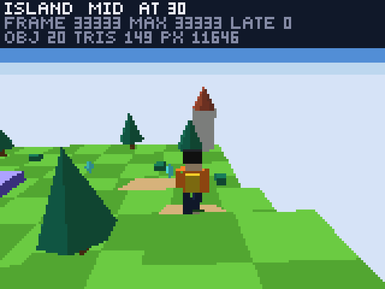 
  <em>BENCH's ISLAND test: the figure runs across the floating island past a tower and round towards a stone arch, the camera following behind.</em>

## PADTEST

PADTEST is a game that checks input, so each part of it can be seen to
work. It shows everything a game receives: the 12 buttons, both sticks, both
triggers, a red cross where a finger touches, and the gamepad's motion
sensor as a spirit level with its six numbers (or NO MOTION).

**How it is made.** After one second with no change it asks the console
for ON_DEMAND, so it is called only when something happens; at the first
change it asks for 30 pictures a second again. Motion alone does not
wake a game, so a quarter-second timer reads the motion sensor while it
sleeps.

**Limits.** In a test on the board with 16 buttons pressed over the
debug link (2026-11-17) it ran 297 steps and sent only 39 pictures. Its
picture rate was not measured, since it draws only on change.

| What | Value |
|---|---|
| Code | 8,000 bytes |
| Data | 2,036 bytes |
| Room left | 96,460 bytes |
| On the board | on demand: 297 steps, 39 pictures sent (2026-11-17) |
| Detail levels | none |

More: [games/padtest/README.md](../games/padtest/README.md)

  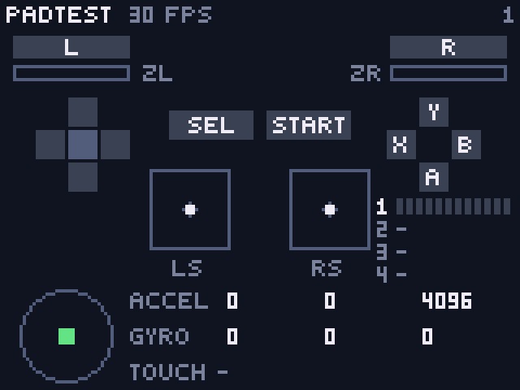 
  <em>PADTEST following player 1's pad: both sticks turn in circles, the triggers rise and fall, the buttons light one after another, a finger drags across the screen and the level bubble follows the tilt.</em>

## What the games showed about the console

**RAM ran out before speed did.** Two of the three games in the spill
ended near the floor of the slots: MERCATOR with 2,816 bytes of room,
PROTO3D with 4,900. Each new feature had to pay for itself in bytes.
PROTO3D left out flower patches and a light meadow for lack of room.
MERCATOR fits only because part of it lives in flash, and that part has
844 bytes of code left.

**Flash is slower than RAM.** Code in the flash part runs through the
chip's flash cache. The planet's inner loops took twice the time from
flash (measured on the board, 2026-11-23), so they went back to RAM,
and code that runs only on its own screens, such as the docked panels
and the market, went to flash instead.

**The stack is a limit too.** The console's stack is 29,200 bytes, and
the console used 16,752 of it before a game ran (measured on the
board). A build check fails a game whose start-up frame passes 16,384
bytes, or any other frame 4,096 (both limits are estimates). PROTO3D's
start-up frame is 13,792.

**Sending is the main cost on screen.** Games that keep most of the
picture still (LANDER's STILL view, ROOFTOP's one-screen rooms, PADTEST)
send little. CAMBER sends about 13,500 of its 19,200 pixels on average
(on the PC); KESTREL's camera never turns, so its backdrop costs nothing. With
the second core one picture is sent while the next
is drawn; on one core HAIRPIN at HEAVY reached 45.7 pictures a second,
on two 58.7 (2026-11-18).

**The panel sets the frame time.** The panel refreshes about 58.7 times
a second, so the 60 setting means "as fast as the panel". The 3D games
were sized for 30 pictures a second; PROTO3D's and DRIVE3D's top
detail, MAX, is aimed at an average of 24. On the board DRIVE3D at MAX averaged 26.36 ms a step
standing and PROTO3D's ISLAND at MAX 23.74 ms, both holding 30. For the
gaps of the build as a whole, see [limitations.md](limitations.md).

## Where this comes from

- [games/README.md](../games/README.md): sizes, spill, flash parts, stack frames
- [games/camber/README.md](../games/camber/README.md)
- [games/mercator/README.md](../games/mercator/README.md)
- [games/mercator/flash.list](../games/mercator/flash.list)
- [games/kestrel/README.md](../games/kestrel/README.md)
- [games/lantern/README.md](../games/lantern/README.md)
- [games/drive3d/README.md](../games/drive3d/README.md)
- [games/proto3d/README.md](../games/proto3d/README.md)
- [games/hairpin/README.md](../games/hairpin/README.md)
- [games/rooftop/README.md](../games/rooftop/README.md)
- [games/lander/README.md](../games/lander/README.md)
- [games/skimmer/README.md](../games/skimmer/README.md)
- [games/tundra/README.md](../games/tundra/README.md)
- [games/stardust/README.md](../games/stardust/README.md)
- [games/bench/README.md](../games/bench/README.md)
- [games/padtest/README.md](../games/padtest/README.md)
- [crates/game-3d/README.md](../crates/game-3d/README.md)
- [crates/game-api/src/file.rs](../crates/game-api/src/file.rs): slot and flash window sizes
- [games/build-chip.sh](../games/build-chip.sh): overflow checks per game
- [games/chip/check_frames.py](../games/chip/check_frames.py): stack frame limits
- [boards/cyd/README.md](../boards/cyd/README.md): board numbers
- [decisions.md](decisions.md)
